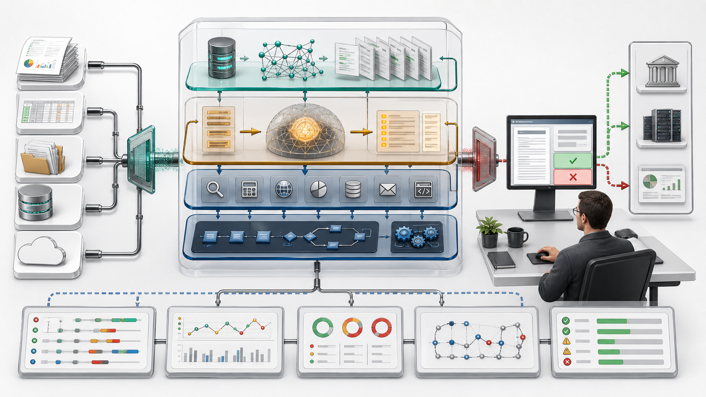
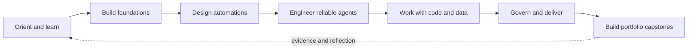

# Free AI Automation and Agent Engineering Curriculum

An independent, free-first self-study curriculum for learning artificial intelligence, automation, data, and agent engineering from foundations through responsible delivery.

The curriculum uses two commercial syllabi only as a topic map. All lessons are original and rely on public documentation, standards, research papers, government guidance, and reproducible local exercises. No paid model, API, or course subscription is required.



*The course treats an agent as an observable system with data, tools, controls, people, and measurable outcomes, not as a model in isolation.*

## Table of Contents

- [Overview](#overview)
- [Start Here](#start-here)
- [Learning Model](#learning-model)
- [Visual Course Journey](#visual-course-journey)
- [Course Stages](#course-stages)
- [Suggested Learning Paths](#suggested-learning-paths)
- [Executable Labs](#executable-labs)
- [Documentation Site](#documentation-site)
- [Course Map](#course-map)
- [Complete Chapter Index](#complete-chapter-index)
- [Capstones and Portfolio](#capstones-and-portfolio)
- [Sources and Scope](#sources-and-scope)
- [Contributing and License](#contributing-and-license)
- [Verification Notes](#verification-notes)

## Overview

| Item | Current scope |
|---|---:|
| Numbered module directories | 30 (`00` through `29`) |
| Markdown files in `content/` | 188 |
| Approximate course length | 94,500 words |
| Technical lessons with explicit local practice | 140 |
| Orientation chapters | 7 |
| Specified capstone builds | 5 |
| Executable learning labs | 7 |
| Mermaid learning diagrams | 68 |
| Original instructional visual assets | 4 |
| Reference citations in course content | 628 |
| Unique referenced URLs | 472 |
| Recommended full-course pace | 40 weeks at 9-10 hours per week |

The complete path is approximately 360-400 hours. A 20-week accelerated path or 60-week extended path can be used, but review gates should remain after the equivalent of weeks 10, 19, 28, and 40.

## Start Here

1. Read [How to Use This Course](content/00-course-orientation-and-study-plan/01-how-to-use-this-course.md).
2. Review the [Competency Map](content/00-course-orientation-and-study-plan/02-competency-map.md).
3. Choose a pace in the [Forty-Week Study Plan](content/00-course-orientation-and-study-plan/03-forty-week-study-plan.md).
4. Prepare the [Free and Local Learning Environment](content/00-course-orientation-and-study-plan/04-free-local-environment.md).
5. Create a learning journal and use one recurring business process as a running case study.
6. Use [Assessment and Evidence](content/00-course-orientation-and-study-plan/05-assessment-and-evidence.md) to decide when a module is complete.

The canonical in-course navigation page is the [Course Index](content/00-course-index.md).

## Learning Model

Each technical lesson contains:

- learning objectives;
- substantive explanations and design tradeoffs;
- free local practice with concrete artifacts;
- completion criteria;
- direct references to public sources.

The standard cycle is **read, reproduce, modify, build, evaluate, and explain**. Watching or reading alone is not completion. Evidence may include code, workflow exports, diagrams, test results, evaluation datasets, decision records, runbooks, or demonstrations.

Modules use a 100-point evidence model with 70 as the normal advancement threshold. Safety-critical tests and reproducibility remain mandatory even when the numerical score is higher.

The course supports deterministic mocks, local services, and local models. Do not upload employer, client, health, financial, identity, or other sensitive data to learning services.

## Visual Course Journey



Each module includes at least two focused Mermaid maps of its main process, architecture, or decision cycle. The executable labs add their own implementation diagrams. These visuals render directly on GitHub and remain readable as source in any Markdown editor.

## Course Stages

1. **Foundations, Modules 01-08:** learning practice, digital literacy, AI, LLMs, prompt/context engineering, web systems, Docker, and MCP.
2. **Automation Design, Modules 09-14:** process discovery, use-case design, algorithms, n8n, integrations, and agent architecture.
3. **Reliable Agent Systems, Modules 15-19:** RAG, memory, multimodality, human approval, security, privacy, evaluation, and multi-agent orchestration.
4. **Code and Data, Modules 20-25 and 29:** Python, SQL, statistics, LangChain, LangGraph, CrewAI, model adaptation, and Node.js automation.
5. **Responsible Delivery, Modules 26-28:** ethics, governance, risk, project delivery, organizational adoption, capstones, and portfolio evidence.

## Suggested Learning Paths

- **Complete path:** follow modules `00-28` in order and take Module 29 after Modules 06 and 11 or alongside Module 20.
- **Business and no-code path:** prioritize `00-19`, then `26-28`; add code modules as the projects require them.
- **Python and data path:** prioritize `00-11`, `14-18`, and `20-28`.
- **JavaScript-focused automation path:** complete `00-19`, then use `29` for the primary runtime exercises before `26-28`; Modules 21-24 remain Python-oriented and require either the Python prerequisite or a deliberate Node.js port with equivalent tests.
- **Governance and delivery path:** prioritize `00`, `03-05`, `09-10`, `14-18`, and `26-28`.

Module 29 can replace Module 20 as the main automation runtime. It does not replace the Python examples and projects in Modules 21-24 or later framework-specific material. Any agent that can change an external system should be designed only after completing Modules 16-18 and 26.

## Executable Labs

The [`labs/`](labs/) directory contains free, synthetic, portfolio-ready systems with starter code, separate solutions, fixtures, failure cases, and automated tests:

1. [Python invoice audit](labs/python-invoice-audit/);
2. [SQL support analytics](labs/sql-support-analytics/);
3. [grounded RAG search](labs/rag-grounded-search/);
4. [Node.js webhook processor](labs/node-webhook-processor/);
5. [n8n order triage](labs/n8n-order-triage/);
6. [Docker health stack](labs/docker-health-stack/);
7. [MCP task server](labs/mcp-task-server/).

Start with the [lab route and evidence standard](labs/README.md). After installing any lab-specific dependencies, run the available suites together with:

```bash
make test-labs
```

## Documentation Site

The course also builds as a searchable, responsive MkDocs site with explicit module navigation and browser-local lesson progress. No account or analytics service is required.

```bash
python3 -m venv .venv
source .venv/bin/activate
python -m pip install -r requirements-docs.txt
mkdocs serve
```

Open `http://127.0.0.1:8000`. Run `make docs` for a strict production build. GitHub Actions validates the source and can publish the same static output to GitHub Pages.

## Course Map

| Module | Subject | Summary |
|---:|---|---|
| 00 | [Course Orientation and Study Plan](content/00-course-orientation-and-study-plan/01-how-to-use-this-course.md) | Establishes a free-first 40-week learning system with competency pathways, reproducible local tooling, evidence-based assessment, source-quality rules, and syllabus coverage. |
| 01 | [Learning How to Learn](content/01-learning-how-to-learn/01-build-an-evidence-based-study-system.md) | Builds measurable study habits through knowledge maps, retrieval, spacing, interleaving, deliberate feedback, debugging, and a sustainable weekly loop. |
| 02 | [Digital Literacy and Cloud](content/02-digital-literacy-and-cloud/01-navigate-computers-files-and-the-internet.md) | Covers filesystems, the internet, shell, Git, data formats, databases, integrations, cloud concepts, and practical security habits. |
| 03 | [AI Fundamentals](content/03-ai-fundamentals/01-frame-problems-for-ai.md) | Frames appropriate AI problems, explains learning from data and model evaluation, distinguishes models, workflows, and agents, and introduces responsible controls. |
| 04 | [LLMs and Generative AI](content/04-llms-and-generative-ai/01-map-the-generative-ai-landscape.md) | Explains tokens, next-token prediction, embeddings, Transformers, training, alignment, decoding, and local model evaluation. |
| 05 | [Prompt, Context, and Loop Engineering](content/05-prompt-context-and-loop-engineering/01-write-clear-prompt-contracts.md) | Develops testable prompt contracts, structured outputs, retrieval and memory design, bounded tool and human loops, and evaluation harnesses. |
| 06 | [Web, APIs, and Webhooks](content/06-web-apis-and-webhooks/01-understand-the-web-request-path.md) | Teaches the web request path, HTTP semantics, REST APIs, OpenAPI contracts, and reliable, authenticated webhooks. |
| 07 | [Docker and Infrastructure](content/07-docker-and-infrastructure/01-understand-images-and-containers.md) | Moves from images and containers through reproducible builds, storage, networking, Compose, hardening, observability, and rollback. |
| 08 | [Model Context Protocol](content/08-model-context-protocol/01-understand-mcp-architecture-and-lifecycle.md) | Covers MCP architecture and primitives, then builds, tests, connects, secures, and governs a typed local MCP server. |
| 09 | [Process Mapping and Opportunities](content/09-process-mapping-and-opportunities/01-process-boundaries-and-current-state.md) | Converts current-state evidence into process maps, prioritized opportunities, pilot metrics, stakeholder controls, risks, and an automation brief. |
| 10 | [Use-Case Design](content/10-use-case-design/01-problem-framing-and-user-needs.md) | Turns an automation brief into problem framing, user stories, acceptance criteria, service scenarios, prototypes, and an implementation handoff. |
| 11 | [Algorithms for Automation](content/11-algorithms-for-automation/01-from-process-to-algorithm.md) | Translates processes into deterministic logic using validation, transformations, branches, loops, state machines, retries, idempotency, tests, and observability. |
| 12 | [n8n Fundamentals](content/12-n8n-fundamentals/01-local-installation-and-editor-tour.md) | Builds local n8n fluency through triggers, nodes, expressions, data mapping, branching, loops, webhooks, executions, and error workflows. |
| 13 | [Advanced n8n and Integrations](content/13-advanced-n8n-and-integrations/01-http-apis-authentication-and-pagination.md) | Adds API authentication, pagination, reusable subworkflows, resilience, secure self-hosting, backups, scaling, monitoring, and releases. |
| 14 | [Agent Architecture](content/14-agent-architecture/01-agent-system-boundaries-and-components.md) | Designs bounded agents around narrow tools, controlled planning, state and retrieval, justified multi-agent patterns, threat models, evaluation, and oversight. |
| 15 | [RAG, Knowledge Sources, and Memory](content/15-rag-knowledge-sources-and-memory/01-rag-architecture-and-source-governance.md) | Builds governed RAG across source selection, ingestion, chunking, cited hybrid retrieval, grounded evaluation, memory, and knowledge lifecycle. |
| 16 | [Human-in-the-Loop and Multimodality](content/16-human-in-the-loop-and-multimodality/01-designing-human-oversight.md) | Designs meaningful oversight through durable approvals, review interfaces, escalation, local multimodal pipelines, accessibility, quality, and safety testing. |
| 17 | [Security, Privacy, and LGPD](content/17-security-privacy-and-lgpd/01-threat-modeling-ai-automation.md) | Secures AI automation through threat modeling, LGPD-aware privacy engineering, vendor and transfer controls, security testing, and incident response. |
| 18 | [Monitoring, Evaluation, and Optimization](content/18-monitoring-evaluation-and-optimization/01-observability-for-ai-workflows.md) | Establishes observability, reproducible evaluation sets, RAG/tool/agent metrics, controlled experiments, and production release gates. |
| 19 | [Multi-Agent Orchestration](content/19-multi-agent-orchestration/01-when-and-how-to-use-multiple-agents.md) | Evaluates when multiple agents are justified, then develops contracts, state, routing, synthesis, reliability controls, and an evaluated capstone. |
| 20 | [Python for Automation](content/20-python-for-automation/01-python-projects-types-and-boundaries.md) | Builds production-minded Python automations with safe files and CLIs, resilient APIs, bounded concurrency, recovery, tests, logging, and a capstone. |
| 21 | [Relational Databases](content/21-relational-databases/01-relational-modeling-and-constraints.md) | Covers relational modeling, SQL, transactions, idempotency, indexing, query plans, and secure Python/PostgreSQL operations. |
| 22 | [Data Analysis and Statistics](content/22-data-analysis-and-statistics/01-questions-data-provenance-and-cleaning.md) | Moves from provenance and cleaning through exploratory statistics, visualization, uncertainty, hypothesis tests, experiments, regression, and reporting. |
| 23 | [LangChain and LangGraph](content/23-langchain-and-langgraph/01-framework-runtime-and-harness.md) | Implements validated tools and structured output, explicit graph state and routing, durable approval, replay safety, and a stateful support project. |
| 24 | [CrewAI](content/24-crewai/01-crews-flows-and-fit.md) | Compares Crews and Flows, defines bounded tasks and agents, secures tools and memory, and evaluates a research crew against simpler baselines. |
| 25 | [Fine-Tuning and Model Adaptation](content/25-fine-tuning-and-model-adaptation/01-choose-the-right-adaptation.md) | Teaches adaptation decisions, dataset quality and rights, supervised fine-tuning, LoRA, QLoRA, PEFT, evaluation, release, and rollback. |
| 26 | [Ethics, Governance, Impact, and Risk](content/26-ethics-governance-impact-and-risk/01-ethical-reasoning-and-human-rights.md) | Turns ethical and human-rights reasoning into governance gates, impact and risk assessment, audit documentation, and policy mapping. |
| 27 | [Project Management, Adoption, and Change](content/27-project-management-adoption-and-change/01-discovery-outcomes-and-roadmap.md) | Takes an AI initiative from discovery through iterative delivery, stakeholder planning, pilots, operations, value measurement, and improvement. |
| 28 | [Capstone Projects and Portfolio](content/28-capstone-projects-and-portfolio/01-capstone-rules-and-rubric.md) | Defines a shared rubric and evidence package for five capstone builds, followed by portfolio and presentation guidance. |
| 29 | [Node.js for Automation](content/29-nodejs-for-automation/01-nodejs-runtime-and-project-structure.md) | Provides a JavaScript path covering Node.js projects, validated files and CLIs, APIs, webhooks, async queues, idempotency, testing, logging, and a capstone. |

## Complete Chapter Index

### 00. Course Orientation and Study Plan

1. [How to Use This Course](content/00-course-orientation-and-study-plan/01-how-to-use-this-course.md)
2. [Competency Map](content/00-course-orientation-and-study-plan/02-competency-map.md)
3. [Forty-Week Study Plan](content/00-course-orientation-and-study-plan/03-forty-week-study-plan.md)
4. [Free and Local Learning Environment](content/00-course-orientation-and-study-plan/04-free-local-environment.md)
5. [Assessment and Evidence](content/00-course-orientation-and-study-plan/05-assessment-and-evidence.md)
6. [Source and Reference Policy](content/00-course-orientation-and-study-plan/06-source-and-reference-policy.md)
7. [Syllabus Coverage Map](content/00-course-orientation-and-study-plan/07-syllabus-coverage-map.md)

### 01. Learning How to Learn

1. [Build an Evidence-Based Study System](content/01-learning-how-to-learn/01-build-an-evidence-based-study-system.md)
2. [Turn a Syllabus into a Knowledge Map](content/01-learning-how-to-learn/02-turn-a-syllabus-into-a-knowledge-map.md)
3. [Retrieve, Space, and Interleave](content/01-learning-how-to-learn/03-retrieve-space-and-interleave.md)
4. [Practice, Feedback, and Debugging](content/01-learning-how-to-learn/04-practice-feedback-and-debugging.md)
5. [Run a Sustainable Weekly Learning Loop](content/01-learning-how-to-learn/05-run-a-sustainable-weekly-learning-loop.md)

### 02. Digital Literacy and Cloud

1. [Navigate Computers, Files, and the Internet](content/02-digital-literacy-and-cloud/01-navigate-computers-files-and-the-internet.md)
2. [Use the Command Line and Git](content/02-digital-literacy-and-cloud/02-use-the-command-line-and-git.md)
3. [Read Data Formats, Databases, and Integrations](content/02-digital-literacy-and-cloud/03-read-data-formats-databases-and-integrations.md)
4. [Build a Cloud Mental Model](content/02-digital-literacy-and-cloud/04-build-a-cloud-mental-model.md)
5. [Protect Accounts, Data, and Decisions](content/02-digital-literacy-and-cloud/05-protect-accounts-data-and-decisions.md)

### 03. AI Fundamentals

1. [Frame Problems for AI](content/03-ai-fundamentals/01-frame-problems-for-ai.md)
2. [Understand How Machines Learn from Data](content/03-ai-fundamentals/02-understand-how-machines-learn-from-data.md)
3. [Evaluate Models and Generalization](content/03-ai-fundamentals/03-evaluate-models-and-generalization.md)
4. [Distinguish Agents from Models and Workflows](content/03-ai-fundamentals/04-distinguish-agents-from-models-and-workflows.md)
5. [Use AI Responsibly and Critically](content/03-ai-fundamentals/05-use-ai-responsibly-and-critically.md)

### 04. LLMs and Generative AI

1. [Map the Generative AI Landscape](content/04-llms-and-generative-ai/01-map-the-generative-ai-landscape.md)
2. [Understand Tokens, Language Models, and Embeddings](content/04-llms-and-generative-ai/02-understand-tokens-language-models-and-embeddings.md)
3. [Understand Transformers and Attention](content/04-llms-and-generative-ai/03-understand-transformers-and-attention.md)
4. [Separate Training, Alignment, and Inference](content/04-llms-and-generative-ai/04-separate-training-alignment-and-inference.md)
5. [Run and Evaluate a Small Local Model](content/04-llms-and-generative-ai/05-run-and-evaluate-a-small-local-model.md)

### 05. Prompt, Context, and Loop Engineering

1. [Write Clear Prompt Contracts](content/05-prompt-context-and-loop-engineering/01-write-clear-prompt-contracts.md)
2. [Use Examples and Structured Outputs](content/05-prompt-context-and-loop-engineering/02-use-examples-and-structured-outputs.md)
3. [Engineer Context, Retrieval, and Memory](content/05-prompt-context-and-loop-engineering/03-engineer-context-retrieval-and-memory.md)
4. [Design Bounded Tool and Human Loops](content/05-prompt-context-and-loop-engineering/04-design-bounded-tool-and-human-loops.md)
5. [Build Harnesses and Evaluation Loops](content/05-prompt-context-and-loop-engineering/05-build-harnesses-and-evaluation-loops.md)

### 06. Web, APIs, and Webhooks

1. [Understand the Web Request Path](content/06-web-apis-and-webhooks/01-understand-the-web-request-path.md)
2. [Read and Send HTTP Messages](content/06-web-apis-and-webhooks/02-read-and-send-http-messages.md)
3. [Design and Consume REST APIs](content/06-web-apis-and-webhooks/03-design-and-consume-rest-apis.md)
4. [Describe APIs with OpenAPI](content/06-web-apis-and-webhooks/04-describe-apis-with-openapi.md)
5. [Receive Webhooks Reliably and Securely](content/06-web-apis-and-webhooks/05-receive-webhooks-reliably-and-securely.md)

### 07. Docker and Infrastructure

1. [Understand Images and Containers](content/07-docker-and-infrastructure/01-understand-images-and-containers.md)
2. [Build Reproducible Images with Dockerfiles](content/07-docker-and-infrastructure/02-build-reproducible-images-with-dockerfiles.md)
3. [Configure Runtime, Storage, and Networks](content/07-docker-and-infrastructure/03-configure-runtime-storage-and-networks.md)
4. [Orchestrate Local Services with Compose](content/07-docker-and-infrastructure/04-orchestrate-local-services-with-compose.md)
5. [Harden, Observe, and Debug Containers](content/07-docker-and-infrastructure/05-harden-observe-and-debug-containers.md)

### 08. Model Context Protocol

1. [Understand MCP Architecture and Lifecycle](content/08-model-context-protocol/01-understand-mcp-architecture-and-lifecycle.md)
2. [Design Tools, Resources, and Prompts](content/08-model-context-protocol/02-design-tools-resources-and-prompts.md)
3. [Build a Local MCP Server](content/08-model-context-protocol/03-build-a-local-mcp-server.md)
4. [Test, Inspect, and Connect MCP Servers](content/08-model-context-protocol/04-test-inspect-and-connect-mcp-servers.md)
5. [Secure and Govern MCP Integrations](content/08-model-context-protocol/05-secure-and-govern-mcp-integrations.md)

### 09. Process Mapping and Opportunities

1. [Process Boundaries and the Current State](content/09-process-mapping-and-opportunities/01-process-boundaries-and-current-state.md)
2. [BPMN and Service Blueprints](content/09-process-mapping-and-opportunities/02-bpmn-and-service-blueprints.md)
3. [Opportunity Discovery and Prioritization](content/09-process-mapping-and-opportunities/03-opportunity-discovery-and-prioritization.md)
4. [Feasibility, Value, and Metrics](content/09-process-mapping-and-opportunities/04-feasibility-value-and-metrics.md)
5. [Stakeholders, Risks, and the Automation Brief](content/09-process-mapping-and-opportunities/05-stakeholders-risks-and-automation-brief.md)

### 10. Use-Case Design

1. [Problem Framing and User Needs](content/10-use-case-design/01-problem-framing-and-user-needs.md)
2. [User Stories and Acceptance Criteria](content/10-use-case-design/02-user-stories-and-acceptance-criteria.md)
3. [Storyboards and Service Scenarios](content/10-use-case-design/03-storyboards-and-service-scenarios.md)
4. [Low-Fidelity Prototypes and Tests](content/10-use-case-design/04-low-fidelity-prototypes-and-tests.md)
5. [Use-Case Specification and Handoff](content/10-use-case-design/05-use-case-specification-and-handoff.md)

### 11. Algorithms for Automation

1. [From Process to Algorithm](content/11-algorithms-for-automation/01-from-process-to-algorithm.md)
2. [Data Structures, Validation, and Transformation](content/11-algorithms-for-automation/02-data-structures-validation-and-transformation.md)
3. [Branching, Loops, and State Machines](content/11-algorithms-for-automation/03-branching-loops-and-state-machines.md)
4. [Scheduling, Retries, and Idempotency](content/11-algorithms-for-automation/04-scheduling-retries-and-idempotency.md)
5. [Testing, Complexity, and Observability](content/11-algorithms-for-automation/05-testing-complexity-and-observability.md)

### 12. n8n Fundamentals

1. [Local Installation and the Editor](content/12-n8n-fundamentals/01-local-installation-and-editor-tour.md)
2. [Triggers, Nodes, and a First Workflow](content/12-n8n-fundamentals/02-triggers-nodes-and-first-workflow.md)
3. [Items, Expressions, and Data Mapping](content/12-n8n-fundamentals/03-items-expressions-and-data-mapping.md)
4. [Branching, Merging, and Looping](content/12-n8n-fundamentals/04-branching-merging-and-looping.md)
5. [Webhooks, Executions, and Error Workflows](content/12-n8n-fundamentals/05-webhooks-executions-and-error-workflows.md)

### 13. Advanced n8n and Integrations

1. [HTTP APIs, Authentication, and Pagination](content/13-advanced-n8n-and-integrations/01-http-apis-authentication-and-pagination.md)
2. [Subworkflows, Reuse, and Contracts](content/13-advanced-n8n-and-integrations/02-subworkflows-reuse-and-contracts.md)
3. [Resilience, Rate Limits, and Idempotency](content/13-advanced-n8n-and-integrations/03-resilience-rate-limits-and-idempotency.md)
4. [Self-Hosting, Security, and Secrets](content/13-advanced-n8n-and-integrations/04-self-hosting-security-and-secrets.md)
5. [Scaling, Monitoring, and Release Operations](content/13-advanced-n8n-and-integrations/05-scaling-monitoring-and-release-operations.md)

### 14. Agent Architecture

1. [Agent System Boundaries and Components](content/14-agent-architecture/01-agent-system-boundaries-and-components.md)
2. [Tools, Planning, and Control Loops](content/14-agent-architecture/02-tools-planning-and-control-loops.md)
3. [Memory, Context, and Retrieval](content/14-agent-architecture/03-memory-context-and-retrieval.md)
4. [Multi-Agent Orchestration Patterns](content/14-agent-architecture/04-multi-agent-orchestration-patterns.md)
5. [Safety, Evaluation, and Human Oversight](content/14-agent-architecture/05-safety-evaluation-and-human-oversight.md)

### 15. RAG, Knowledge Sources, and Memory

1. [RAG Architecture and Source Governance](content/15-rag-knowledge-sources-and-memory/01-rag-architecture-and-source-governance.md)
2. [Ingestion, Chunking, and Citations](content/15-rag-knowledge-sources-and-memory/02-ingestion-chunking-and-citations.md)
3. [Embeddings, Vector Search, and Hybrid Retrieval](content/15-rag-knowledge-sources-and-memory/03-embeddings-vector-search-and-hybrid-retrieval.md)
4. [Grounded Generation and RAG Evaluation](content/15-rag-knowledge-sources-and-memory/04-grounded-generation-and-rag-evaluation.md)
5. [Conversation Memory and Knowledge Lifecycle](content/15-rag-knowledge-sources-and-memory/05-conversation-memory-and-knowledge-lifecycle.md)

### 16. Human-in-the-Loop and Multimodality

1. [Designing Human Oversight](content/16-human-in-the-loop-and-multimodality/01-designing-human-oversight.md)
2. [Durable Approval Workflows](content/16-human-in-the-loop-and-multimodality/02-durable-approval-workflows.md)
3. [Review Interfaces, Feedback, and Escalation](content/16-human-in-the-loop-and-multimodality/03-review-interfaces-feedback-and-escalation.md)
4. [Local Multimodal Pipelines](content/16-human-in-the-loop-and-multimodality/04-local-multimodal-pipelines.md)
5. [Multimodal Quality, Accessibility, and Safety](content/16-human-in-the-loop-and-multimodality/05-multimodal-quality-accessibility-and-safety.md)

### 17. Security, Privacy, and LGPD

1. [Threat Modeling AI Automation](content/17-security-privacy-and-lgpd/01-threat-modeling-ai-automation.md)
2. [LGPD Foundations for AI Systems](content/17-security-privacy-and-lgpd/02-lgpd-foundations-for-ai-systems.md)
3. [Privacy Engineering and Impact Assessment](content/17-security-privacy-and-lgpd/03-privacy-engineering-and-impact-assessment.md)
4. [Vendors, International Transfers, and Data Security](content/17-security-privacy-and-lgpd/04-vendors-international-transfers-and-data-security.md)
5. [Security Testing and Incident Response](content/17-security-privacy-and-lgpd/05-security-testing-and-incident-response.md)

### 18. Monitoring, Evaluation, and Optimization

1. [Observability for AI Workflows](content/18-monitoring-evaluation-and-optimization/01-observability-for-ai-workflows.md)
2. [Building Reproducible Evaluation Sets](content/18-monitoring-evaluation-and-optimization/02-building-reproducible-evaluation-sets.md)
3. [Evaluating RAG, Tools, and Agents](content/18-monitoring-evaluation-and-optimization/03-evaluating-rag-tools-and-agents.md)
4. [Experiment Design and Optimization](content/18-monitoring-evaluation-and-optimization/04-experiment-design-and-optimization.md)
5. [Production Monitoring and Release Gates](content/18-monitoring-evaluation-and-optimization/05-production-monitoring-and-release-gates.md)

### 19. Multi-Agent Orchestration

1. [When and How to Use Multiple Agents](content/19-multi-agent-orchestration/01-when-and-how-to-use-multiple-agents.md)
2. [Agent Contracts, Context, and State](content/19-multi-agent-orchestration/02-agent-contracts-context-and-state.md)
3. [Routing, Parallelism, and Synthesis](content/19-multi-agent-orchestration/03-routing-parallelism-and-synthesis.md)
4. [Multi-Agent Reliability, Security, and Governance](content/19-multi-agent-orchestration/04-reliability-security-and-governance.md)
5. [Multi-Agent Capstone and Evaluation](content/19-multi-agent-orchestration/05-multi-agent-capstone-and-evaluation.md)

### 20. Python for Automation

1. [Python Projects, Types, and Boundaries](content/20-python-for-automation/01-python-projects-types-and-boundaries.md)
2. [Files, Command Lines, and Safe Batch Processing](content/20-python-for-automation/02-files-command-lines-and-safe-batch-processing.md)
3. [HTTP APIs, Validation, and Resilience](content/20-python-for-automation/03-http-apis-validation-and-resilience.md)
4. [Concurrency, Scheduling, and Recovery](content/20-python-for-automation/04-concurrency-scheduling-and-recovery.md)
5. [Testing, Logging, and Automation Capstone](content/20-python-for-automation/05-testing-logging-and-automation-capstone.md)

### 21. Relational Databases

1. [Relational Modeling and Constraints](content/21-relational-databases/01-relational-modeling-and-constraints.md)
2. [SQL Queries, Joins, Aggregates, and Windows](content/21-relational-databases/02-sql-queries-joins-aggregates-and-windows.md)
3. [Transactions, Concurrency, and Idempotency](content/21-relational-databases/03-transactions-concurrency-and-idempotency.md)
4. [Indexes, Query Plans, and Performance](content/21-relational-databases/04-indexes-query-plans-and-performance.md)
5. [Python, PostgreSQL Security, and Operations](content/21-relational-databases/05-python-postgresql-security-and-operations.md)

### 22. Data Analysis and Statistics

1. [Questions, Data Provenance, and Cleaning](content/22-data-analysis-and-statistics/01-questions-data-provenance-and-cleaning.md)
2. [Exploratory Analysis and Descriptive Statistics](content/22-data-analysis-and-statistics/02-exploratory-analysis-and-descriptive-statistics.md)
3. [Data Visualization and Communication](content/22-data-analysis-and-statistics/03-data-visualization-and-communication.md)
4. [Sampling, Uncertainty, and Hypothesis Tests](content/22-data-analysis-and-statistics/04-sampling-uncertainty-and-hypothesis-tests.md)
5. [Experiments, Regression, and Reproducible Reporting](content/22-data-analysis-and-statistics/05-experiments-regression-and-reproducible-reporting.md)

### 23. LangChain and LangGraph

1. [Framework, Runtime, and Harness](content/23-langchain-and-langgraph/01-framework-runtime-and-harness.md)
2. [Models, Tools, and Structured Output](content/23-langchain-and-langgraph/02-models-tools-and-structured-output.md)
3. [State, Nodes, Edges, and Routing](content/23-langchain-and-langgraph/03-state-nodes-edges-and-routing.md)
4. [Persistence, Interrupts, and Approval](content/23-langchain-and-langgraph/04-persistence-interrupts-and-approval.md)
5. [Project: Stateful Support Routing](content/23-langchain-and-langgraph/05-support-routing-project.md)

### 24. CrewAI

1. [Crews, Flows, and Architectural Fit](content/24-crewai/01-crews-flows-and-fit.md)
2. [Agents, Tasks, and Processes](content/24-crewai/02-agents-tasks-and-processes.md)
3. [Flows, State, and Control](content/24-crewai/03-flows-state-and-control.md)
4. [Tools, Memory, Knowledge, and Guardrails](content/24-crewai/04-tools-memory-knowledge-and-guardrails.md)
5. [Project: Evidence-Grounded Research Crew](content/24-crewai/05-research-crew-project.md)

### 25. Fine-Tuning and Model Adaptation

1. [Choose the Right Adaptation](content/25-fine-tuning-and-model-adaptation/01-choose-the-right-adaptation.md)
2. [Dataset Design and Quality](content/25-fine-tuning-and-model-adaptation/02-dataset-design-and-quality.md)
3. [Supervised Fine-Tuning](content/25-fine-tuning-and-model-adaptation/03-supervised-fine-tuning.md)
4. [LoRA, QLoRA, and PEFT](content/25-fine-tuning-and-model-adaptation/04-lora-qlora-and-peft.md)
5. [Evaluation, Release, and Rollback](content/25-fine-tuning-and-model-adaptation/05-evaluation-release-and-rollback.md)

### 26. Ethics, Governance, Impact, and Risk

1. [Ethical Reasoning and Human Rights](content/26-ethics-governance-impact-and-risk/01-ethical-reasoning-and-human-rights.md)
2. [Governance Operating Model](content/26-ethics-governance-impact-and-risk/02-governance-operating-model.md)
3. [Impact and Risk Assessment](content/26-ethics-governance-impact-and-risk/03-impact-and-risk-assessment.md)
4. [Transparency, Audit, and Documentation](content/26-ethics-governance-impact-and-risk/04-transparency-audit-and-documentation.md)
5. [Regulation and Policy Mapping](content/26-ethics-governance-impact-and-risk/05-regulation-and-policy-mapping.md)

### 27. Project Management, Adoption, and Change

1. [Discovery, Outcomes, and Roadmap](content/27-project-management-adoption-and-change/01-discovery-outcomes-and-roadmap.md)
2. [Backlogs, Iterations, and Technical Challenges](content/27-project-management-adoption-and-change/02-backlogs-iterations-and-tech-challenges.md)
3. [Stakeholders, Work Design, and Adoption](content/27-project-management-adoption-and-change/03-stakeholders-work-design-and-adoption.md)
4. [Pilot, Rollout, and Operations](content/27-project-management-adoption-and-change/04-pilot-rollout-and-operations.md)
5. [Value Measurement and Continuous Improvement](content/27-project-management-adoption-and-change/05-value-measurement-and-continuous-improvement.md)

### 28. Capstone Projects and Portfolio

1. [Capstone Rules and Rubric](content/28-capstone-projects-and-portfolio/01-capstone-rules-and-rubric.md)
2. [Capstone: n8n Operations Automation](content/28-capstone-projects-and-portfolio/02-n8n-operations-automation.md)
3. [Capstone: Evidence-Grounded RAG Assistant](content/28-capstone-projects-and-portfolio/03-evidence-grounded-rag-assistant.md)
4. [Capstone: Data-to-Decision Workbook](content/28-capstone-projects-and-portfolio/04-data-to-decision-workbook.md)
5. [Capstone: Stateful Agent With Human Approval](content/28-capstone-projects-and-portfolio/05-stateful-agent-with-human-approval.md)
6. [Capstone: Multi-Agent Analysis System](content/28-capstone-projects-and-portfolio/06-multi-agent-analysis-system.md)
7. [Portfolio and Presentation](content/28-capstone-projects-and-portfolio/07-portfolio-and-presentation.md)

### 29. Node.js for Automation

1. [Node.js Runtime and Project Structure](content/29-nodejs-for-automation/01-nodejs-runtime-and-project-structure.md)
2. [Files, CLI, and Data Validation](content/29-nodejs-for-automation/02-files-cli-and-data-validation.md)
3. [HTTP APIs, Webhooks, and Retries](content/29-nodejs-for-automation/03-http-apis-webhooks-and-retries.md)
4. [Async Concurrency, Queues, and Idempotency](content/29-nodejs-for-automation/04-async-concurrency-queues-and-idempotency.md)
5. [Testing, Logging, and an Automation Capstone](content/29-nodejs-for-automation/05-testing-logging-and-automation-capstone.md)

## Capstones and Portfolio

Complete at least three of the five capstone builds:

1. n8n operations automation;
2. evidence-grounded RAG assistant;
3. data-to-decision workbook;
4. stateful agent with human approval;
5. multi-agent analysis system.

At least one selected project must require human approval before any consequential simulated action. Every capstone should include a local or synthetic execution path, a simpler baseline, versioned evaluation cases, normal and failure tests, a threat model, a system card, a runbook, and a rollback or reset procedure.

The final portfolio should demonstrate one normal path, one safe rejection or review, one recovered outage, measurable evaluation results, and one unresolved limitation.

## Sources and Scope

The topic coverage was derived from:

- [Rocketseat Postgraduate AI and Automation Syllabus](references/rocketseat-pos-graduacao-ia-automacao-2026.pdf)
- [FIAP/Alura AI Agents Syllabus](references/fiap-alura-pos-graduacao-agentes-ia-2026.pdf)

The lessons prioritize official documentation, standards, laws and regulator guidance, original papers, and maintained public engineering resources. See the [Source and Reference Policy](content/00-course-orientation-and-study-plan/06-source-and-reference-policy.md).

This repository is not affiliated with either provider and does not reproduce their proprietary lessons. It does not provide academic credit, an MEC-recognized credential, instructor supervision, or either provider's certification.

Security, privacy, LGPD, governance, and regulation chapters are educational material, not legal advice. Real deployments require current official sources and qualified review appropriate to the jurisdiction and sector.

## Contributing and License

See [CONTRIBUTING.md](CONTRIBUTING.md) for the learner-outcome, source-quality, exercise, and verification requirements used for changes. Original repository material is available under the [MIT License](LICENSE).

The two commercial syllabus PDFs are explicitly excluded from that license. See [Third-Party Notices](THIRD_PARTY_NOTICES.md) before copying or redistributing material from `references/`.

## Verification Notes

- All module directories and lesson files follow numbered lowercase kebab-case naming.
- All Markdown files have one top-level heading and balanced code fences.
- All internal Markdown links resolve.
- Technical lessons contain learning objectives, free local practice, completion criteria, and references.
- External references were checked; moved links were corrected. Some authoritative DOI, publisher, and government sites block or time out automated checks.
- The aggregate lab runner passes eight suites: seven behavioral suites plus strict MCP type checking.
- The executable labs cover Python, SQL, grounded retrieval, Node.js webhooks, n8n workflow contracts, Docker service behavior, and an MCP server tested through the official client SDK.
- Docker Compose itself and a live n8n import were not executed because Docker and n8n are not installed in the current environment; their static contracts and dependency-free behavior tests pass.
