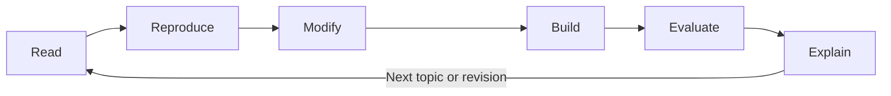

# How to Use This Course

## Objectives

By the end of this lesson, you will be able to choose a realistic study pace, produce evidence of learning, and distinguish reading about a system from being able to build and evaluate one.

## Visual map



## The learning contract

This course assumes no prior programming experience, but it does require regular practice. A useful default is **9 to 10 hours per week for 40 weeks**. Reduce the weekly load rather than skipping exercises. Technical fluency develops through repeated retrieval, implementation, failure analysis, and revision.

Every topic follows the same cycle:

1. **Read:** identify the problem, vocabulary, and constraints.
2. **Reproduce:** follow a small example without changing it.
3. **Modify:** change inputs, constraints, or tools and predict the effect.
4. **Build:** create a small artifact without copying the example.
5. **Evaluate:** test normal, edge, and failure cases.
6. **Explain:** write what happened, why it happened, and what remains uncertain.

Watching a tutorial is preparation, not completion. A lesson is complete only when its stated criteria are supported by an artifact: notes, code, workflow export, test results, diagram, decision record, or short demonstration.

## Free-first rules

- No lesson requires a paid model subscription or paid API.
- Prefer local tools, deterministic mock functions, open datasets, and free documentation.
- When a cloud model would help, the exercise must still have a model-independent path.
- Never upload employer, client, health, financial, identity, or other sensitive data to a learning service.
- Record versions and dates. AI frameworks change quickly, so a working example without version information is difficult to reproduce.

## A weekly routine

Use four sessions rather than one long session:

| Session | Suggested work |
|---|---|
| 1 | Read one lesson and make retrieval questions |
| 2 | Reproduce the smallest example |
| 3 | Complete the practice and test failures |
| 4 | Review without notes, update the journal, and commit artifacts |

At the start of each session, spend five minutes answering questions from the previous week without looking at the material. At the end, write one claim you can now demonstrate and one question you cannot yet answer.

## Practice

Create `learning-journal.md` in your own work area. Add these headings:

```markdown
# Learning Journal

## Current goal
## What I built
## Evidence and test results
## Mistakes and corrections
## Questions to revisit
## Next session
```

Choose a recurring business process you understand, such as triaging requests or preparing a weekly report. You will reuse it across modules so improvements can be compared instead of hidden by constantly changing examples.

## Completion criteria

- You selected a weekly schedule you can sustain.
- You created a learning journal.
- You selected one recurring process as a running case study.
- You can explain why an artifact and test evidence are stronger than course completion by attendance.

## References

- [The Learning Scientists: Retrieval Practice](https://www.learningscientists.org/retrieval-practice)
- [Dunlosky et al.: Improving Students' Learning With Effective Learning Techniques](https://doi.org/10.1177/1529100612453266)
- [Cornell Learning Strategies Center: Effective Study Strategies](https://lsc.cornell.edu/how-to-study/)
