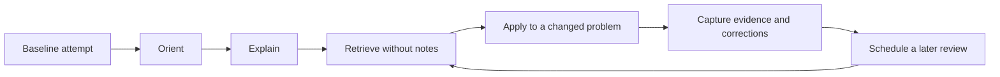

# Build an Evidence-Based Study System

## Learning objectives

By the end of this lesson, you will be able to:

- distinguish productive effort from the feeling of fluency;
- turn a broad course goal into observable learning outcomes;
- use a simple study cycle that produces evidence of learning; and
- establish a baseline without judging yourself by prior experience.

## Visual map



## Learning is a change you can retrieve and use

Reading a page, watching a video, or recognizing an explanation is exposure, not proof of learning. A useful operational definition is: **you learned something when you can retrieve it later and use it in an appropriate situation without copying the source**.

This distinction matters in technical study. A Docker command can look obvious while it is on screen and disappear when the terminal is blank. An API diagram can feel clear until you must diagnose a `401` response. Familiarity is easy to mistake for mastery because rereading makes material easier to process. That ease is real, but it is not the same as durable recall or transfer.

Use a four-part study cycle:

1. **Orient:** identify the outcome and inspect an example.
2. **Explain:** restate the mechanism in your own words.
3. **Retrieve:** close the source and reconstruct the idea or procedure.
4. **Apply:** solve a small, changed problem and inspect the result.

The cycle ends with evidence, not elapsed time. Evidence might be a working command, a diagram drawn from memory, a correct explanation, or a test that catches an intentional error.

## Write outcomes that can be tested

Avoid goals such as "understand AI" or "study APIs." They do not define a finish line. Use this form instead:

> Given **a situation**, I can **perform an observable action** under **a constraint**, and verify it with **evidence**.

Examples:

- Given an HTTP response, I can classify the status code and propose the next diagnostic step without consulting a status-code table.
- Given a small application, I can write a Dockerfile and prove that the image runs with a read-only source directory.
- Given an MCP feature request, I can decide whether it belongs as a tool, resource, or prompt and defend the choice.

An outcome should be small enough to test in 15-45 minutes. Large outcomes become a sequence of smaller ones.

## Establish a baseline

Before studying a module, spend ten minutes attempting three things:

- write what you think the major terms mean;
- solve one representative task; and
- list your uncertainties as questions.

Keep the attempt. It provides a comparison point later and prevents you from studying only what already feels comfortable. A wrong baseline is useful data: it reveals the model in your head before new material changes it.

## Free local practice

Create a plain-text file named `study-log.md` anywhere outside this course content. Add:

```markdown
# Study log

## Target outcome
Given a technical lesson, I can explain its central mechanism from memory and complete one changed example.

## Baseline
- What I can already explain:
- What I can already do:
- Questions I cannot yet answer:

## Evidence after study
- Retrieval attempt:
- Applied result:
- Error I corrected:
- Next review date:
```

Choose one concept you encountered recently. Study it for no more than 15 minutes, close every source, and fill in the evidence section. Then reopen the source and mark omissions or incorrect claims. Do not erase them; corrections are part of the record.

## Completion criteria

- [ ] You wrote one outcome containing a situation, action, constraint, and form of evidence.
- [ ] You produced a closed-source retrieval attempt.
- [ ] You compared the attempt with a reliable source and recorded at least one correction.
- [ ] You scheduled a later review rather than immediately rereading again.

## References

- [Improving Students' Learning With Effective Learning Techniques](https://www.psychologicalscience.org/publications/journals/pspi/learning-techniques.html) - Association for Psychological Science overview of a major review comparing ten common study techniques.
- [Organizing Instruction and Study to Improve Student Learning](https://ies.ed.gov/ncee/wwc/PracticeGuide/1) - free U.S. Department of Education practice guide on spacing, worked examples, and linking abstract ideas to concrete representations.
- [Metacognition](https://poorvucenter.yale.edu/teaching/teaching-resource-library/teaching-how-to/teaching-how-to-chapter-4-engaging-students-in-0) - Yale guidance on planning, monitoring, and evaluating one's own learning.

## Continue

Next: [Turn a Syllabus into a Knowledge Map](02-turn-a-syllabus-into-a-knowledge-map.md)
