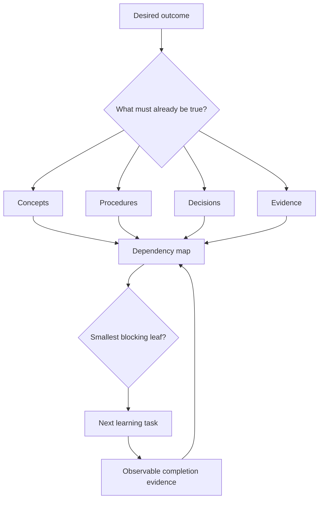

# Turn a Syllabus into a Knowledge Map

## Learning objectives

By the end of this lesson, you will be able to:

- decompose a topic into concepts, procedures, decisions, and evidence;
- identify prerequisites and dependencies instead of following links randomly;
- make uncertainty visible with a question backlog; and
- select the next smallest useful learning task.

## Applied visual



The loop turns a broad outcome into one testable task, then uses evidence to update the dependency map.

## A list is not a map

A syllabus lists destinations. A knowledge map shows how the destinations depend on one another. "Docker," "webhooks," and "MCP" are labels; they do not tell you which ideas must be available in memory when you perform a task.

For each topic, record four kinds of knowledge:

| Kind | Guiding question | Example for HTTP |
| --- | --- | --- |
| Concept | What is it and how does it relate to other things? | A request-response application protocol |
| Procedure | What steps can I perform? | Send a `GET` request with `curl` |
| Decision | When should I choose one option over another? | Use `POST` rather than `GET` when creating a subordinate resource |
| Evidence | How do I know the result is correct? | Inspect status, headers, body, and server log |

This classification prevents a common failure: memorizing definitions while never practicing decisions or verification.

## Draw dependency edges

Write each outcome on a line. Under it, ask: "What must already be true for me to do this?" For example:

```text
Verify a signed webhook
|- distinguish headers from the body
|- preserve the raw request bytes
|- compute an HMAC with a shared secret
`- compare digests without leaking timing information
```

The leaves are candidate lessons. If a leaf is still vague, decompose it again. Stop when an item can be learned and tested in one sitting.

Dependencies are not always a strict sequence. You can begin Docker concepts before mastering networking, but debugging a multi-container stack will require both. Mark edges as:

- **required:** progress is blocked without it;
- **helpful:** it reduces cognitive load; or
- **later:** it is related but not needed for the current outcome.

## Maintain a question backlog

Questions are more useful than a pile of bookmarked pages. Store them with status and evidence:

```markdown
- [open] Why does a container reach another service by name but not by localhost?
- [answered] What makes an HTTP method idempotent?
  - Evidence: repeated PUT requests target the same resource state.
  - Source: RFC 9110, section 9.2.2.
- [test] Can I demonstrate the difference locally?
```

An answer is not complete merely because text was found. Record the claim in your own words, its source, and a way to test or falsify it.

## Choose work by bottleneck

At the start of a session, select the smallest open item that blocks multiple later outcomes. This is more effective than choosing the most interesting link. End the session by updating the map:

- split items that were too large;
- add a dependency you discovered;
- attach evidence to completed items; and
- promote unresolved confusion into a specific question.

## Free local practice

On paper or in a text file, map the outcome "I can consume a JSON API safely." Include at least:

- four concepts;
- three procedures;
- three decisions;
- three forms of evidence;
- five dependency edges; and
- three open questions.

Then choose a single leaf that can be tested in 20 minutes. Write a completion test before studying it. Example: "Without notes, I can label the method, URL, headers, and body in a raw HTTP request."

## Completion criteria

- [ ] Your map contains all four kinds of knowledge.
- [ ] Every completed item has evidence, not just a check mark.
- [ ] At least one dependency is marked required and one helpful.
- [ ] Your next task has a written, observable completion test.

## References

- [Organizing Instruction and Study to Improve Student Learning: full guide](https://ies.ed.gov/ncee/WWC/Docs/PracticeGuide/20072004.pdf) - public guide explaining worked examples, problem solving, and the connection between abstract and concrete representations.
- [How Learning Works](https://firstliteracy.org/wp-content/uploads/2015/07/How-Learning-Works.pdf) - publicly accessible book from university teaching researchers; chapters cover prior knowledge, knowledge organization, practice, feedback, and self-directed learning.
- [People + AI Guidebook](https://pair.withgoogle.com/guidebook-v2/) - free, practical example of organizing complex AI product questions into actionable patterns and worksheets.

## Continue

Next: [Retrieve, Space, and Interleave](03-retrieve-space-and-interleave.md)
