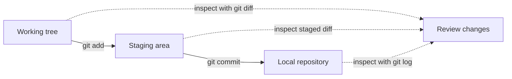

# Use the Command Line and Git

## Learning objectives

By the end of this lesson, you will be able to:

- navigate and inspect files from a shell;
- combine commands through standard input and output;
- explain Git's working tree, staging area, and repository; and
- create an inspectable local history without a hosting account.

## Applied visual



Git moves selected content through three areas, while inspection commands expose what differs at each boundary.

## Commands are programs with explicit inputs

A shell reads a command, expands syntax such as paths and variables, starts a program, and reports an exit status. A command generally has:

```text
program [options] [arguments]
```

For example, `ls -la docs` runs `ls`, enables two options, and supplies `docs` as an argument. Do not memorize every flag. Use `command --help` and manual pages, then record only the options your workflow needs.

Three standard streams make small tools composable:

- standard input (`stdin`) supplies data;
- standard output (`stdout`) carries normal results; and
- standard error (`stderr`) carries diagnostics.

The pipe in `printf 'one\ntwo\n' | wc -l` connects the first command's output to the second command's input. Redirection such as `> result.txt` writes output to a file and replaces its previous content. Treat copied shell commands as code: inspect them before execution, especially when they download content, use administrator privileges, or delete recursively.

## Git stores snapshots and relationships

Git is a distributed version-control system. A local repository is sufficient for learning; GitHub is optional.

Use this three-area model:

- **working tree:** files currently visible and editable;
- **index/staging area:** the proposed content for the next commit; and
- **repository:** committed snapshots and their history.

`git add` copies selected content into the index. `git commit` creates a commit from the index, with metadata and a link to its parent commit. A branch name points to a commit; it is not a separate folder.

Before committing, inspect:

```bash
git status
git diff
git diff --staged
```

Never commit credentials. A `.gitignore` prevents untracked matching paths from being added by ordinary workflows, but it does not remove a secret already committed.

## Free local practice

Continue in `digital-literacy-lab` from the previous lesson:

```bash
git init
git config user.name "Local Learner"
git config user.email "learner@example.invalid"
printf '.env\n*.log\n' > .gitignore
git add .gitignore docs/course.json
git diff --staged
git commit -m "Add course metadata"
```

Now change the JSON value, inspect `git diff`, stage it, inspect both diffs again, and make a second commit. Finish with:

```bash
git log --oneline --decorate --graph
git show --stat HEAD
```

Write, from memory, where each version existed after editing, staging, and committing. If a command fails, keep the error and diagnose it rather than starting over.

## Completion criteria

- [ ] You used help output to explain at least one command option.
- [ ] You can distinguish stdout from stderr and describe a pipe.
- [ ] Your local repository contains two commits with meaningful messages.
- [ ] You inspected working-tree and staged differences separately.
- [ ] Your own explanation distinguishes working tree, index, commit, and branch.

## References

- [Command line crash course](https://developer.mozilla.org/en-US/docs/Learn_web_development/Getting_started/Environment_setup/Command_line) - MDN introduction to shells, navigation, commands, flags, pipes, and tooling.
- [Pro Git](https://git-scm.com/book/en/v2) - complete, freely available official Git book.
- [Recording Changes to the Repository](https://git-scm.com/book/en/v2/Git-Basics-Recording-Changes-to-the-Repository) - official explanation of tracked states, staging, diffs, ignoring, and commits.

## Continue

Next: [Read Data Formats, Databases, and Integrations](03-read-data-formats-databases-and-integrations.md)
