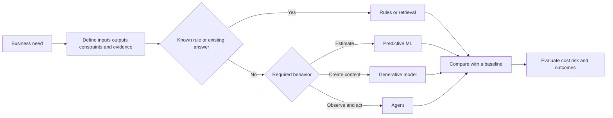

# Frame Problems for AI

## Learning objectives

By the end of this lesson, you will be able to:

- distinguish AI, machine learning, deep learning, and generative AI;
- translate a business need into inputs, outputs, constraints, and evidence;
- compare rules, search, prediction, generation, and agent approaches; and
- reject an AI proposal when a simpler system fits better.

## Visual map



## Terms describe nested and overlapping approaches

**Artificial intelligence** is a broad field concerned with systems that perform tasks associated with perception, reasoning, learning, language, planning, or action. **Machine learning** is an approach in which performance is shaped by patterns learned from data rather than only hand-written rules. **Deep learning** uses multilayer neural networks and is one family within machine learning. **Generative AI** produces new content such as text, images, audio, or code, usually from patterns represented by a trained model.

Not every useful automation is AI. A tax calculation defined by law may be more correct, transparent, and testable as deterministic code. A database query should retrieve a known record rather than ask a language model to remember it. AI becomes relevant when useful behavior depends on patterns that are difficult to specify completely, but it also introduces probabilistic error and evaluation work.

## Start with the decision, not the model

Frame a candidate problem with this contract:

```text
User and context:
Decision or task:
Available inputs at decision time:
Required output and consumer:
Cost of false positive:
Cost of false negative:
Latency and volume:
Privacy, safety, and legal constraints:
Non-AI baseline:
Evidence of success:
```

The phrase "at decision time" prevents leakage. A system cannot rely on data that becomes available only after the outcome it is supposed to predict.

## Match the approach to the work

- **Rules:** requirements are explicit, stable, and auditable.
- **Search or database retrieval:** the answer already exists and must be found accurately.
- **Optimization:** a measurable objective must be improved under constraints, such as scheduling.
- **Predictive ML:** estimate a label, number, ranking, or probability from historical examples.
- **Generative model:** produce or transform open-ended content whose acceptable forms vary.
- **Agent:** pursue a goal through multiple observations and actions using tools and state.

These can be combined. A support assistant might retrieve policy text, generate a draft, apply deterministic compliance checks, and require a human to approve the send action.

## Define success outside the model

Model accuracy is not the same as user or business success. A classifier might be statistically strong but unusable because it is slow, inequitable, expensive, or wrong on the cases that cause the most harm. Include a baseline such as current human performance, a simple rule, random choice, or "do nothing." The proposed system should earn its complexity.

## Free local practice

Choose one process you know, such as sorting email, reviewing invoices, or scheduling study sessions. Create three designs:

1. a deterministic rule-based design;
2. a predictive or generative AI-assisted design; and
3. a multi-step agent design.

For each, fill in the contract above. Write one situation in which it fails and one verification method. End with a decision: choose one design or choose no automation. Defend it using cost, risk, data availability, and evidence, not novelty.

## Completion criteria

- [ ] You distinguish the four AI terms without treating them as synonyms.
- [ ] Your problem statement names a user, decision, input, output, and constraint.
- [ ] You wrote a non-AI baseline.
- [ ] You compared false-positive and false-negative consequences.
- [ ] Your selected approach is justified by the task rather than a product name.

## References

- [Introduction to Machine Learning](https://developers.google.com/machine-learning/intro-to-ml) - free Google course defining common ML approaches and their use cases.
- [Problem Framing](https://developers.google.com/machine-learning/problem-framing) - official, free course on deciding whether ML is appropriate and defining outcomes.
- [People + AI Guidebook](https://pair.withgoogle.com/guidebook-v2/) - public human-centered patterns for user needs, success criteria, data, explanation, feedback, and graceful failure.
- [AI Risk Management Framework 1.0](https://doi.org/10.6028/NIST.AI.100-1) - NIST's voluntary framework for reasoning about AI risks across the lifecycle.

## Continue

Next: [Understand How Machines Learn from Data](02-understand-how-machines-learn-from-data.md)
