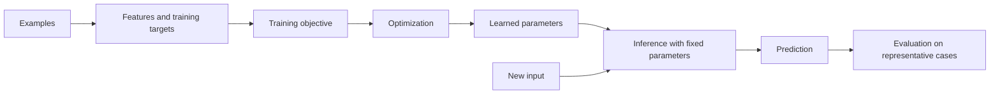

# Understand How Machines Learn from Data

## Learning objectives

By the end of this lesson, you will be able to:

- identify examples, features, labels, parameters, and objectives;
- compare supervised, unsupervised, self-supervised, and reinforcement learning;
- explain training versus inference; and
- detect common problems in a proposed dataset.

## Applied visual



Training changes parameters from examples, whereas inference applies those fixed parameters to new inputs before evaluation.

## Learning means fitting behavior to an objective

A machine-learning dataset contains **examples**. A feature is an input representation used by a model. A label is a target supplied for supervised learning. Parameters are values adjusted during training. A loss function measures how far predictions are from the training objective; an optimization procedure adjusts parameters to reduce that loss.

During **training**, the system updates parameters using data. During **inference**, it applies fixed trained parameters to new input. A production system may later retrain, but it should not silently learn from every user interaction unless that feedback path was deliberately designed and validated.

## Four learning settings

### Supervised learning

Examples include desired outputs. Classification predicts categories or probabilities; regression predicts numeric values. A spam classifier might learn from messages labeled `spam` or `not_spam`.

### Unsupervised learning

There is no supplied target label. The system seeks structure, such as clusters or lower-dimensional representations. A cluster is a pattern, not automatically a meaningful customer segment; humans must validate interpretation.

### Self-supervised learning

Targets are derived from the data itself. A language model can learn to predict hidden or next tokens from text without a human labeling every sentence. The objective produces general representations, but later behavior still depends on data, architecture, tuning, and evaluation.

### Reinforcement learning

An agent selects actions, observes consequences, and seeks to maximize cumulative reward. Reward design matters: a system can exploit a proxy in ways that satisfy the numeric objective while violating the intended outcome.

## Representation creates assumptions

Raw reality does not enter a model. Collection and representation choices determine what becomes visible. Consider:

- whether missing values mean "not present," "not measured," or "unknown";
- whether a historic label reflects a biased prior decision;
- whether duplicate people appear in both training and test data;
- whether a feature is available at inference time;
- whether categories change after deployment; and
- whether rare but costly cases are represented.

More data does not automatically repair wrong labels, sampling bias, or a mismatched objective.

## Free local practice

Create `examples.csv` with this synthetic dataset:

```csv
message_length,contains_link,known_sender,label
20,0,1,not_spam
180,1,0,spam
55,1,1,not_spam
240,0,0,spam
15,0,0,not_spam
```

Answer:

1. What is one example, each feature, and the label?
2. Which values are measurements and which are human-defined representations?
3. Could `known_sender` leak future or private information?
4. Which important cases are missing?
5. Write a simple rule baseline and test it on every row.
6. Invent one new row on which your rule should fail.

Do not train a model. The purpose is to inspect assumptions before tooling hides them.

## Completion criteria

- [ ] You correctly identify examples, features, labels, parameters, and loss.
- [ ] You explain training versus inference in your own words.
- [ ] You provide a concrete task for each learning setting.
- [ ] You identify at least three dataset risks.
- [ ] You tested a baseline and deliberately found a counterexample.

## References

- [Machine Learning Glossary: Fundamentals](https://developers.google.com/machine-learning/glossary/fundamentals) - maintained definitions with concrete examples of core ML vocabulary.
- [Machine Learning Crash Course](https://developers.google.com/machine-learning/crash-course) - free modules and browser exercises on models, data, neural networks, embeddings, LLMs, production, and fairness.
- [Datasets, Generalization, and Overfitting](https://developers.google.com/machine-learning/crash-course/overfitting) - official lesson on data quality and behavior beyond training examples.
- [Reinforcement Learning: An Introduction](http://incompleteideas.net/book/the-book-2nd.html) - free official site for the Sutton and Barto textbook.

## Continue

Next: [Evaluate Models and Generalization](03-evaluate-models-and-generalization.md)
