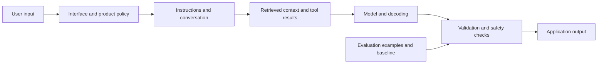

# Map the Generative AI Landscape

## Learning objectives

By the end of this lesson, you will be able to:

- distinguish discriminative, generative, and foundation-model behavior;
- classify common generative tasks and modalities;
- separate a model from the application wrapped around it; and
- choose a testable use case with a suitable baseline.

## Visual map



## Generation models a distribution

A discriminative model commonly estimates a target from an input, such as the probability that a message is spam. A generative model learns enough structure to produce samples: text continuations, images, audio, code, or other data.

A **foundation model** is trained broadly and can be adapted to many downstream tasks. A large language model is a foundation model focused on token sequences, though modern systems may accept or emit multiple modalities. "Generative AI" describes a capability category, not one architecture or vendor.

Common task patterns include:

- continuation and drafting;
- transformation, such as rewriting or translation;
- extraction into a schema;
- summarization;
- question answering over supplied context;
- classification expressed through generation;
- image, audio, or video synthesis; and
- code generation and repair.

Some tasks are better served by a smaller classifier, search engine, template, or deterministic parser. Open-ended generation is valuable when many outputs can satisfy the need; it adds risk when one exact answer is required.

## Separate the layers of an application

When a chat interface answers a question, observed behavior can come from several layers:

```text
interface and product policy
-> system instructions and conversation
-> retrieved documents and tool results
-> model and decoding settings
-> post-processing and safety checks
```

Do not attribute every feature to the model. Live web facts likely came from retrieval or a tool. Remembered preferences may come from application storage. A refusal can come from model tuning, application policy, or both.

This separation supports diagnosis. If an answer cites the wrong document, inspect retrieval. If JSON is malformed, inspect prompt, schema enforcement, decoding, and parser behavior. Replacing the model before locating the failing layer is expensive guesswork.

## Scope a generative use case

Use this decision record:

```text
Input modality and source:
Desired output and consumer:
Acceptable variation:
Facts that must be grounded:
Prohibited content or actions:
Human review point:
Non-generative baseline:
Evaluation examples and rubric:
Latency and compute constraints:
```

For high-stakes facts, require authoritative context and independent validation. Generation is not a database guarantee.

## Free local practice

Classify each task as rules, retrieval, discriminative prediction, generation, or a combination:

1. find an invoice by exact ID;
2. detect whether an invoice is probably duplicated;
3. draft an email explaining a verified invoice status;
4. extract fields from varied invoice layouts;
5. calculate tax from a published formula; and
6. answer policy questions using the latest approved manual.

For each choice, write the baseline and one failure test. Then select one generative task and fill in the decision record above. Make the facts that require grounding explicit.

## Completion criteria

- [ ] You distinguish discriminative prediction from generation with examples.
- [ ] You identify the model and at least four surrounding application layers.
- [ ] You chose a non-generative baseline for every practice task.
- [ ] Your use-case record names grounding and human-review requirements.
- [ ] Evaluation is defined with examples and a rubric, not "looks good."

## References

- [On the Opportunities and Risks of Foundation Models](https://arxiv.org/abs/2108.07258) - original Stanford report defining foundation models and analyzing capabilities, adaptation, and systemic risks.
- [Introduction to Large Language Models](https://developers.google.com/machine-learning/crash-course/llm) - free Google module covering tokens, context, Transformers, training, tuning, and limitations.
- [Hugging Face LLM Course](https://huggingface.co/learn/llm-course/en/chapter1/1) - free, ad-free course on NLP, Transformer models, inference, datasets, tokenizers, and model use.
- [NIST Generative AI Profile](https://doi.org/10.6028/NIST.AI.600-1) - public risk-management profile specific to generative systems.

## Continue

Next: [Understand Tokens, Language Models, and Embeddings](02-understand-tokens-language-models-and-embeddings.md)
