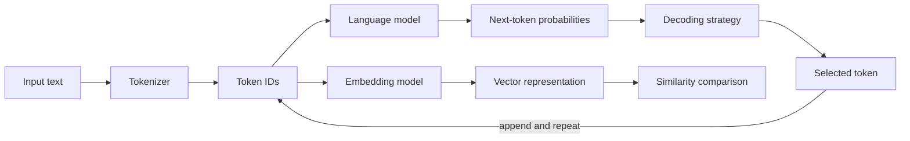

# Understand Tokens, Language Models, and Embeddings

## Learning objectives

By the end of this lesson, you will be able to:

- explain tokenization and next-token prediction;
- calculate a simple conditional language model;
- describe embeddings as learned vectors rather than a semantic database; and
- anticipate how token boundaries affect context, cost, and behavior.

## Applied visual



The same tokenized input can enter a generation loop or become a vector used for similarity-based retrieval.

## Models process tokens, not words

A tokenizer converts input into discrete token IDs and reverses generated IDs into text. Tokens may represent words, word pieces, punctuation, whitespace, bytes, or mixtures. Boundaries vary by tokenizer and language. Therefore, character count is not a reliable token count, and the same text can produce different token sequences for different models.

Tokenization matters because:

- context limits and usage are measured in tokens;
- unusual spelling and identifiers may split into many pieces;
- different languages can require different token counts for comparable meanings; and
- a model predicts token IDs, then the application decodes them into text.

## A language model predicts sequences

An autoregressive language model estimates a probability distribution for the next token given preceding tokens:

```text
P(next token | previous tokens)
```

It selects a token according to a decoding strategy, appends it, and repeats. The resulting text can express learned patterns and useful internal representations, but the objective does not guarantee factual truth, valid citations, or completion of a user's real-world intention.

An n-gram model is a small predecessor that estimates from only the last `n - 1` tokens. It illustrates prediction and sparsity even though modern LLMs use neural networks and much broader context.

## Embeddings represent items as vectors

An embedding maps a token, sentence, image, or other item to a numeric vector. Training makes geometric relationships useful for an objective: related items may have higher cosine similarity. Embeddings support search, clustering, recommendation, and model internals.

Similarity is not identity or proof. An embedding can retrieve a topically close document that contradicts the query. Quality depends on the embedding model, task, language, chunking, data, and threshold. Evaluate it on representative examples.

## Free local practice

Build a tiny bigram model with only the Python standard library:

```bash
python3 - <<'PY'
from collections import Counter, defaultdict

text = "agents observe tools act agents observe results agents stop"
tokens = ["<start>"] + text.split() + ["<end>"]
counts = defaultdict(Counter)

for left, right in zip(tokens, tokens[1:]):
    counts[left][right] += 1

for previous in ["agents", "observe", "tools"]:
    total = sum(counts[previous].values())
    probabilities = {token: count / total for token, count in counts[previous].items()}
    print(previous, probabilities)
PY
```

Predict the output before running it. Change one occurrence and observe how probabilities change. Then write two sentences explaining why longer n-grams add context but require far more data.

For embeddings, draw five points on paper representing `cat`, `dog`, `car`, `truck`, and `vehicle`. Show how two different tasks could reasonably produce different neighborhoods.

## Completion criteria

- [ ] You explain why a token is not necessarily a word.
- [ ] You calculated at least one conditional probability by hand.
- [ ] You connect iterative next-token prediction to generated sequences.
- [ ] You explain why embedding similarity is task-dependent evidence, not truth.
- [ ] You identify one fairness or cost implication of tokenization differences.

## References

- [Introduction to Large Language Models](https://developers.google.com/machine-learning/crash-course/llm) - official free lesson moving from n-grams and tokens to modern LLMs.
- [Summary of the Tokenizers Library](https://huggingface.co/docs/transformers/tokenizer_summary) - Hugging Face documentation on word, character, subword, BPE, WordPiece, and Unigram tokenization.
- [Efficient Estimation of Word Representations in Vector Space](https://arxiv.org/abs/1301.3781) - original word2vec paper demonstrating learned continuous vector representations.
- [SentencePiece](https://arxiv.org/abs/1808.06226) - original paper on language-independent subword tokenization from raw sentences.

## Continue

Next: [Understand Transformers and Attention](03-understand-transformers-and-attention.md)
