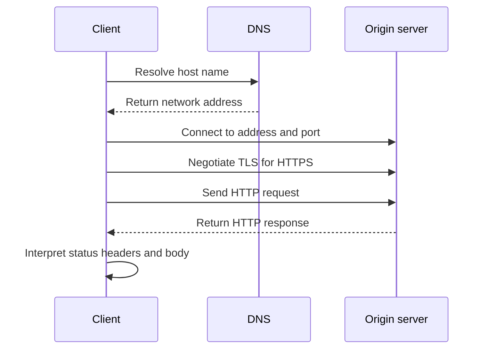

# Understand the Web Request Path

## Learning objectives

By the end of this lesson, you will be able to:

- trace a request through URL parsing, DNS, transport, TLS, and HTTP;
- distinguish a client, origin server, proxy, and browser policy;
- explain hosts, IP addresses, and ports; and
- locate a failure at the correct layer using observable evidence.

## Visual map



## The Web is a stack of contracts

When a client requests `https://example.com/items`, several things happen:

1. The client parses the URL into scheme, host, port, path, query, and fragment.
2. DNS resolves the host name to one or more network addresses.
3. A transport connection is established to an address and port.
4. For HTTPS, TLS authenticates the server certificate and establishes encryption.
5. The client sends an HTTP request.
6. The server or an intermediary returns an HTTP response.
7. The client interprets status, headers, and body.

This is a conceptual sequence; modern protocols can reuse, multiplex, cache, redirect, or proxy work. The layers still help diagnosis.

## Names and addresses are not the same

A host name is a human- and system-friendly identifier resolved through DNS. An IP address identifies a network interface for routing. A port identifies a listening service on a host. Several host names can resolve to one address, and one host can expose many services on different ports.

`localhost` normally resolves to a loopback address representing the current network namespace. Inside a container, `localhost` refers to that container, not automatically the host or another container. This becomes important in the Docker module.

## Intermediaries and browser controls

A request may cross forward proxies, reverse proxies, gateways, load balancers, and caches. Each can add headers, terminate TLS, route traffic, or return an error before the application runs.

Cross-Origin Resource Sharing (CORS) is a browser security mechanism based on HTTP headers. A command-line client can successfully call an endpoint that browser JavaScript is not permitted to read. CORS is not authentication and does not prevent non-browser clients from making requests.

## Diagnose from the bottom useful layer upward

Ask:

- Can the host name resolve?
- Can the client connect to the address and port?
- Does TLS validation succeed?
- Was an HTTP response received?
- Which component produced the status and headers?
- Did the client reject or misinterpret an otherwise valid response?

Avoid saying "the API failed" when the evidence is a DNS error.

## Free local practice

In terminal A, serve the current directory:

```bash
python3 -m http.server 8000 --bind 127.0.0.1
```

In terminal B:

```bash
curl -v http://127.0.0.1:8000/
curl -v http://localhost:8000/
curl -v http://127.0.0.1:8001/
```

For each command, record DNS behavior, destination address, port, connection result, HTTP method, status, and two response headers. Stop the server with `Ctrl+C`. Explain why the third failure is not an HTTP status response.

## Completion criteria

- [ ] You can trace all five protocol layers in order.
- [ ] You distinguish host name, address, and port.
- [ ] You captured both a successful HTTP exchange and a connection failure.
- [ ] You can explain why CORS and authentication solve different problems.
- [ ] Your diagnosis names the failing layer and supporting evidence.

## References

- [How the Web Works](https://developer.mozilla.org/en-US/docs/Learn_web_development/Getting_started/Web_standards/How_the_web_works) - MDN beginner overview of clients, servers, DNS, transport, HTTP, and site resources.
- [Overview of HTTP](https://developer.mozilla.org/en-US/docs/Web/HTTP/Guides/Overview) - detailed public guide to clients, proxies, messages, state, connections, and HTTP APIs.
- [What Is a URL?](https://developer.mozilla.org/en-US/docs/Learn_web_development/Howto/Web_mechanics/What_is_a_URL) - MDN explanation of URL components and absolute versus relative references.
- [CORS](https://developer.mozilla.org/en-US/docs/Web/HTTP/Guides/CORS) - MDN guide to browser cross-origin request policy and preflight exchanges.

## Continue

Next: [Read and Send HTTP Messages](02-read-and-send-http-messages.md)
