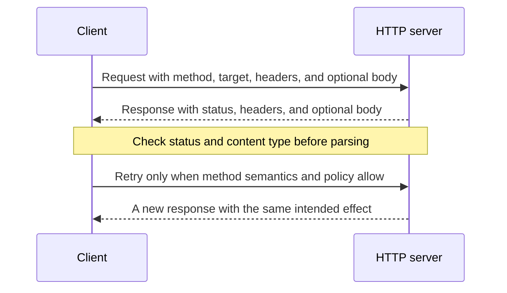

# Read and Send HTTP Messages

## Learning objectives

By the end of this lesson, you will be able to:

- identify method, target, headers, status, and body in an HTTP exchange;
- choose common methods by semantics;
- interpret status-code classes and content metadata; and
- reason about safety, idempotency, caching, and retries.

## Applied visual



An HTTP exchange is a pair of messages, and retry safety depends on method semantics plus application policy.

## Requests and responses are messages

An HTTP request contains a method, target, protocol version, headers, and sometimes a body. A response contains a status code, headers, and sometimes a body.

```http
GET /items/42 HTTP/1.1
Host: api.example.test
Accept: application/json

HTTP/1.1 200 OK
Content-Type: application/json
Content-Length: 23

{"id":42,"name":"pen"}
```

`Content-Type` describes the representation carried in the body. `Accept` expresses response media types the client can handle. Do not parse a body as JSON merely because the endpoint usually returns JSON; check the status and content type.

## Method semantics matter

- `GET` retrieves a representation and should be safe: the client is not requesting state change.
- `HEAD` is like `GET` without response content.
- `POST` submits content for resource-specific processing and often creates a subordinate resource.
- `PUT` creates or replaces state at a known target.
- `PATCH` applies a partial modification according to the chosen patch media type.
- `DELETE` requests removal of the target association.

Safe methods are intended for information retrieval. Idempotent methods have the same intended effect when the same request is repeated, though logs, timestamps, and response codes can differ. `PUT` and `DELETE` are defined as idempotent; `POST` generally is not. This distinction informs automatic retries.

## Read the status as a class and a specific contract

- `1xx`: informational;
- `2xx`: successful;
- `3xx`: redirection;
- `4xx`: the request cannot be fulfilled as sent; and
- `5xx`: the server failed to fulfill an apparently valid request.

Specific codes matter. `201 Created` can include a `Location` header. `204 No Content` has no response content. `401 Unauthorized` generally means authentication is required or failed; `403 Forbidden` means the server understood the authenticated or unauthenticated request but refuses it. `404` may also be used to avoid revealing a resource's existence.

## Free local practice

Start the local server from the prior lesson and run:

```bash
curl -i http://127.0.0.1:8000/
curl -I http://127.0.0.1:8000/
curl -i http://127.0.0.1:8000/does-not-exist
curl -i -X POST http://127.0.0.1:8000/
```

For each exchange, label the request method, response status, content type, content length if present, and body behavior. Explain why `-X HEAD` is not always equivalent to `-I`: the latter also configures curl to handle a bodyless HEAD response.

Then write which requests are safe, idempotent, and reasonable to retry automatically after a dropped connection.

## Completion criteria

- [ ] You labeled every major part of a request and response.
- [ ] You choose methods by intended semantics rather than CRUD resemblance alone.
- [ ] You distinguish safe from idempotent.
- [ ] You correctly interpret the observed `2xx`, `4xx`, and `501` or `405` behavior.
- [ ] Retry decisions account for whether the server may already have applied an effect.

## References

- [RFC 9110: HTTP Semantics](https://www.rfc-editor.org/rfc/rfc9110) - normative standard for methods, status codes, fields, representations, safety, idempotency, and caching semantics.
- [HTTP Request Methods](https://developer.mozilla.org/en-US/docs/Web/HTTP/Reference/Methods) - MDN reference for common method semantics.
- [HTTP Response Status Codes](https://developer.mozilla.org/en-US/docs/Web/HTTP/Reference/Status) - maintained reference organized by status class.
- [curl Everything](https://everything.curl.dev/) - free official curl book covering requests, responses, protocols, TLS, debugging, and scripting.

## Continue

Next: [Design and Consume REST APIs](03-design-and-consume-rest-apis.md)
