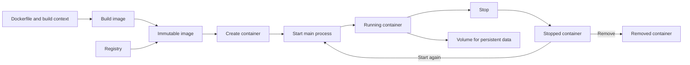

# Understand Images and Containers

## Learning objectives

By the end of this lesson, you will be able to:

- distinguish an image, container, registry, volume, and virtual machine;
- explain container creation, start, stop, and removal;
- inspect process, filesystem, and network isolation; and
- use basic Docker commands without treating containers as permanent servers.

## Visual map



## An image is a package; a container is a process

A container image is an immutable, layered package containing a filesystem and configuration needed to start a process. A container is a runtime instance created from an image. Multiple containers can start from one image and receive separate writable layers and runtime configuration.

A registry stores and distributes images. An image reference commonly contains registry, repository, and tag. A tag such as `latest` is a movable name, not a guarantee of freshness or compatibility. Production systems should identify the exact tested image, often by immutable digest.

Containers use operating-system isolation. On Linux, namespaces isolate views of resources and control groups account for and limit resource use. Containers share the host kernel; a virtual machine usually includes a guest kernel. Containers are not "lightweight VMs," though both can isolate workloads and can be combined.

## Lifecycle and state

`docker run` is convenient shorthand that can pull an image, create a container, and start its configured process. The container remains running while its main process runs. When that process exits, the container stops but can still exist until removed.

Important distinctions:

- `docker create`: define a container without starting it;
- `docker start`: start an existing stopped container;
- `docker stop`: request a graceful stop, then force if needed;
- `docker rm`: remove container metadata and writable layer; and
- `docker image rm`: remove a local image when no dependent container blocks it.

Do not store important state only in the container's writable layer. Replacing the container should be normal.

## Inspect before guessing

Use:

```bash
docker ps
docker ps -a
docker logs CONTAINER
docker inspect CONTAINER
docker stats --no-stream
docker exec CONTAINER COMMAND
```

`docker exec` starts an additional process inside a running container. It does not enter a separate machine. Minimal images may not include a shell or debugging utilities.

## Free local practice

After installing Docker Engine or Docker Desktop from the official instructions:

```bash
docker version
docker run --name course-web -d -p 127.0.0.1:8088:80 nginx:alpine
docker ps
curl -i http://127.0.0.1:8088/
docker logs course-web
docker inspect course-web
docker stop course-web
docker ps -a
docker rm course-web
```

Before removal, change a file inside the container with `docker exec` only if the image contains the needed shell. Explain what happens to that change after removal and recreation. Record the exact image ID or digest shown by inspection.

## Completion criteria

- [ ] You distinguish image, container, registry, and volume.
- [ ] You explain how a container differs from a virtual machine.
- [ ] You completed the full create/run, inspect, stop, and remove lifecycle.
- [ ] You identified the container's main process and published port.
- [ ] You can explain why container writable state is not a persistence plan.

## References

- [What Is a Container?](https://docs.docker.com/get-started/docker-concepts/the-basics/what-is-a-container/) - official conceptual introduction and hands-on container lifecycle.
- [What Is an Image?](https://docs.docker.com/get-started/docker-concepts/the-basics/what-is-an-image/) - official explanation of immutable layered image packages.
- [Docker Run Reference](https://docs.docker.com/engine/containers/run/) - detailed official reference for runtime configuration, commands, ports, and resources.
- [Open Container Initiative Specifications](https://opencontainers.org/) - open standards for container image, runtime, and distribution formats.

## Continue

Next: [Build Reproducible Images with Dockerfiles](02-build-reproducible-images-with-dockerfiles.md)
