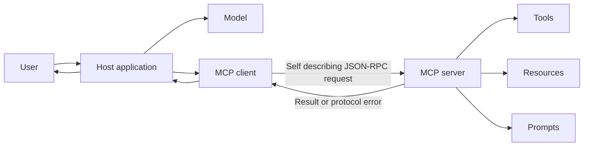

# Understand MCP Architecture and Lifecycle

## Learning objectives

By the end of this lesson, you will be able to:

- explain host, client, and server responsibilities;
- separate MCP's protocol layer from transport and model behavior;
- read a basic JSON-RPC request; and
- account for protocol-version changes, especially the 2026-07-28 stateless core.

## Visual map



## MCP standardizes a boundary

The Model Context Protocol defines how AI applications discover and use context and capabilities exposed by servers. It does not define how an LLM is trained, which model a host uses, or when the model should trust returned content.

The participants are:

- **host:** the AI application coordinating user interaction, models, permissions, and one or more connections;
- **client:** the protocol component used by the host to communicate with one server; and
- **server:** a program exposing defined capabilities such as tools, resources, and prompts.

A "server" describes a protocol role, not a deployment location. A server can be a local child process or a remote HTTP service.

## Data and transport are separate layers

The data layer uses JSON-RPC 2.0 message structures and MCP method semantics. The transport carries those messages. Common transports are:

- **stdio:** a host starts a local subprocess and exchanges protocol messages through standard input and output; and
- **Streamable HTTP:** a remote or local HTTP endpoint receives MCP requests.

The same logical tool can be exposed through either transport. Authentication, process isolation, latency, scaling, and logging differ.

## The current core is stateless

Protocol revisions matter. The 2026-07-28 release removed the earlier `initialize`/`initialized` handshake and protocol session identifier. Each request is self-describing: it carries the protocol version plus client identity and capabilities. A client may call `server/discover` to inspect capabilities, but discovery is optional.

A simplified current HTTP call looks like:

```http
POST /mcp HTTP/1.1
MCP-Protocol-Version: 2026-07-28
Mcp-Method: tools/call
Mcp-Name: search
Content-Type: application/json

{"jsonrpc":"2.0","id":1,"method":"tools/call",
 "params":{"name":"search","arguments":{"query":"MCP specification"},
 "_meta":{"io.modelcontextprotocol/clientInfo":{"name":"study-client","version":"1.0"}}}}
```

- `jsonrpc` selects JSON-RPC 2.0.
- `id` correlates request and response.
- `method` names the protocol operation.
- `params` carries the tool name, typed arguments, and request metadata.
- HTTP routing headers mirror the operation so gateways can authorize and route without parsing the body; disagreement must be rejected.

Stateless protocol does not prohibit application state. A tool can return an explicit handle that a later request supplies. This makes state visible and portable rather than hidden in a transport session.

## Free local practice

Without installing an SDK, annotate the sample request above. Then write:

1. a success response with matching JSON-RPC `id` and a result;
2. a JSON-RPC error for invalid parameters;
3. a second request that uses a returned `workspace_handle`; and
4. a list of information the server must not infer from a removed hidden session.

Compare the latest release description with an older MCP tutorial. List three assumptions that would break across the 2026-07-28 revision.

## Completion criteria

- [ ] You distinguish host, client, server, model, and transport.
- [ ] You labeled the JSON-RPC and HTTP-specific fields in the example.
- [ ] You explain why a local server is still called a server.
- [ ] You explain stateless protocol versus stateful application behavior.
- [ ] You identified and dated the specification revision your design targets.

## References

- [MCP Architecture Overview](https://modelcontextprotocol.io/docs/learn/architecture) - official conceptual guide to participants, layers, messages, and primitives; check its version notes against the current specification.
- [The 2026-07-28 MCP Specification](https://blog.modelcontextprotocol.io/posts/2026-07-28/) - official release description of the stateless core, self-describing requests, routing headers, caching, extensions, and authorization changes.
- [MCP Specification](https://modelcontextprotocol.io/specification/2026-07-28) - normative specification for the revision used in this module.
- [JSON-RPC 2.0 Specification](https://www.jsonrpc.org/specification) - base request, response, notification, ID, parameter, and error message format used by MCP.

## Continue

Next: [Design Tools, Resources, and Prompts](02-design-tools-resources-and-prompts.md)
