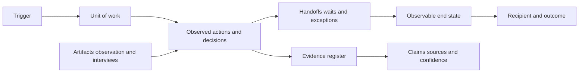

# Process Boundaries and the Current State

## Learning objectives

By the end of this lesson, you can:

- distinguish a process from a department, software screen, or job description;
- define a measurable start, end, customer, outcome, and unit of work;
- collect evidence without assuming the documented procedure matches reality;
- produce a current-state inventory that another person can verify.

## Visual map

## Why boundaries come first

A process is a repeatable transformation: an event creates a unit of work, people or systems act on it, and an outcome is delivered to someone. "Finance" is not a process. "Receive an invoice and either schedule it for payment or return it with a reason" is.

An automation project becomes unsafe when its boundary is vague. If "answer customer messages" is the scope, it is unclear whether the automation may issue refunds, expose account data, or make commitments. A useful boundary names:

| Field | Example |
| --- | --- |
| Trigger | A new invoice PDF arrives in the shared inbox |
| End state | The invoice is approved, rejected, or awaiting missing evidence |
| Unit of work | One invoice |
| Primary recipient | Accounts payable analyst |
| Desired outcome | A valid decision with an audit trail |
| Explicit exclusions | Payment execution and bank-detail changes |

Treat exclusions as a design feature. They prevent the team from quietly expanding the system into higher-risk decisions.

## Observe the real process

Use three evidence sources and compare them:

1. **Artifacts:** forms, email templates, spreadsheets, tickets, logs, policies, and example outputs.
2. **Observation:** watch at least one person complete a normal case and one exception. Record actions and waiting, not private content.
3. **Interviews:** ask what starts the work, what "done" means, where rework happens, and what cannot be decided without escalation.

For each step, capture actor, input, action, output, system, active work time, wait time, decision rule, and exception. Separate observed facts from hypotheses. "Analyst copies tax ID into ERP" is an observation; "OCR would save five minutes" is a hypothesis.

Do not collect personal or confidential records for a learning exercise. Replace them with synthetic examples that preserve the structure, such as fake order IDs and invented names.

## A compact process inventory

Create a CSV or Markdown table with one row per process:

| process_id | trigger | end_state | volume_week | work_min | wait_hours | error_rate | systems | owner |
| --- | --- | --- | ---: | ---: | ---: | ---: | --- | --- |
| P-01 | Support email | Answer or escalation | 80 | 7 | 5 | 0.08 | Mail, FAQ | Support lead |

Volume and time need not be perfect. Record the source and confidence beside every estimate: measured, sampled, reported, or unknown. An honest range such as 60-90 cases is more useful than invented precision.

## Free local practice

Choose a low-risk process you personally perform, such as organizing downloads, triaging study notes, or preparing a weekly expense summary.

1. Write a one-sentence boundary: "From ___ until ___, for each ___."
2. Perform the process twice with synthetic inputs.
3. Record each action and wait in a table. Use a phone timer or the local time command; no paid tool is required.
4. Mark every handoff, repeated copy, manual check, and return to an earlier step.
5. Create an evidence register:

| claim | evidence | confidence | how to verify |
| --- | --- | --- | --- |
| File naming takes 2 minutes | Two timed runs | Low | Measure 10 runs |

6. Ask another person to read only your boundary and say what is inside and outside it. Revise until their interpretation matches yours.

Store the result as a numbered Markdown file or spreadsheet in your own project area. Do not automate yet.

## Completion criteria

You are finished when:

- the start and end are observable events rather than broad aspirations;
- the unit of work, recipient, outcome, owner, and exclusions are explicit;
- at least one normal path and one exception are documented;
- timing or volume claims include a source and confidence level;
- no real secrets or personal data appear in the exercise;
- another reader can tell whether a proposed step is in or out of scope.

## References

- [GOV.UK Service Manual: Map and understand a user's whole problem](https://www.gov.uk/service-manual/design/map-a-users-whole-problem) - public guidance on journeys, organizational boundaries, touchpoints, and stakeholders.
- [GOV.UK Service Manual: Creating an experience map](https://www.gov.uk/service-manual/user-research/creating-an-experience-map) - a practical evidence-based mapping method.
- [GOV.UK Service Manual: Scoping your service](https://www.gov.uk/service-manual/design/scoping-your-service) - guidance for setting a useful transaction boundary around a user outcome.
- [NIST AI RMF 1.0](https://doi.org/10.6028/NIST.AI.100-1) - primary framework for documenting context, affected parties, assumptions, and risks when AI may enter a process.
