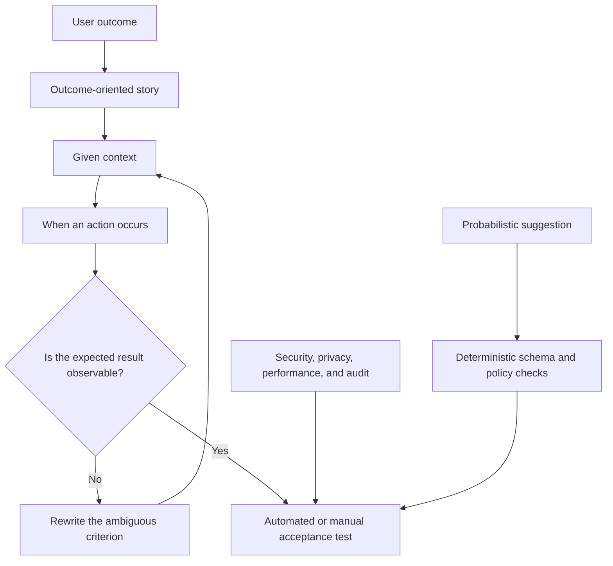

# User Stories and Acceptance Criteria

## Learning objectives

By the end of this lesson, you can:

- split an end-to-end use case into outcome-oriented stories;
- write observable acceptance criteria for normal, boundary, and failure behavior;
- define nonfunctional requirements for security, accessibility, performance, and audit;
- prevent probabilistic components from weakening deterministic business rules.

## Applied visual

Acceptance criteria connect user value to observable tests, while deterministic checks constrain any probabilistic suggestion.

## Stories are planning units, not mini-specifications

A useful story states who needs an outcome and why:

> As a reviewer, I need incomplete submissions to identify each missing field so that I can request all corrections at once.

It does not dictate "use a language model and send JSON." Implementation details belong in technical design after the behavior is agreed.

Split large stories by user-visible outcome, workflow step, business rule, data variation, or risk. Do not split into "build frontend" and "build backend," because neither is independently valuable or testable to the user.

## Acceptance criteria as examples

Use concrete Given/When/Then examples:

~~~gherkin
Scenario: required field is missing
  Given a submission has no order_id
  When it is validated
  Then no external update is attempted
  And the result status is "needs_review"
  And the audit record identifies "order_id" as missing
~~~

Cover at least:

- a valid normal case;
- each meaningful boundary;
- missing, malformed, duplicate, and unauthorized input;
- dependency timeout or unavailable service;
- retry and duplicate delivery;
- human override and cancellation;
- logging without sensitive content.

If AI supplies a classification, define the allowed labels, evidence expected, uncertainty behavior, and authority boundary. "If confidence is low" is incomplete until confidence is operationally defined and calibrated. A safer starting rule is: if the output violates the schema or the decision requires discretion, route to a person.

## Nonfunctional acceptance

Behavior includes qualities:

| quality | testable criterion |
| --- | --- |
| Security | The workflow uses a read-only credential until write approval is enabled |
| Privacy | Logs contain case IDs, not message bodies |
| Performance | 95% of synthetic cases finish within 30 seconds |
| Reliability | Replaying the same event ID creates no second external action |
| Accessibility | Human review is possible by keyboard and status is not color-only |
| Audit | Each action records rule version, timestamp, input hash, and outcome |

Avoid "fast," "secure," and "user-friendly" without a test.

## Free local practice

1. Write one epic for the complete use case.
2. Split it into 5-8 stories that each produce a meaningful outcome.
3. Choose the highest-risk story and write at least eight Given/When/Then scenarios.
4. Create a decision table before writing criteria:

| valid | duplicate | authorized | expected result |
| --- | --- | --- | --- |
| Yes | No | Yes | Process once |
| Yes | Yes | Yes | Return previous result |
| Yes | No | No | Reject and audit |
| No | Any | Any | Needs review; no write |

5. Trace every row to one acceptance scenario.
6. Add five measurable nonfunctional criteria, including privacy, idempotency, and auditability.
7. Ask someone to predict the result of three new examples using only the criteria. Rewrite ambiguous rules.

No software or subscription is required; use a local Markdown file.

## Completion criteria

You are finished when:

- each story names an actor, outcome, and reason;
- the epic is split by behavior or value rather than technical layer;
- normal, boundary, unauthorized, duplicate, malformed, and dependency-failure cases are covered;
- each decision-table row traces to an observable acceptance example;
- probabilistic output cannot directly bypass deterministic authorization or validation;
- nonfunctional criteria are measurable;
- another reader predicts expected results without oral clarification.

## References

- [GOV.UK Service Manual: Writing user stories](https://www.gov.uk/service-manual/agile-delivery/writing-user-stories) - public primary guidance on actors, goals, story splitting, and acceptance outcomes.
- [UK Government Technology Blog: Creating better acceptance criteria](https://technology.blog.gov.uk/2015/03/04/creating-better-acceptance-criteria-for-user-stories/) - public examples of consistent, non-implementation-specific criteria.
- [Cucumber: Gherkin reference](https://cucumber.io/docs/gherkin/reference/) - official language reference for Given/When/Then executable examples.
- [W3C Web Content Accessibility Guidelines 2.2](https://www.w3.org/TR/WCAG22/) - normative accessibility requirements for any web-based review interface.
