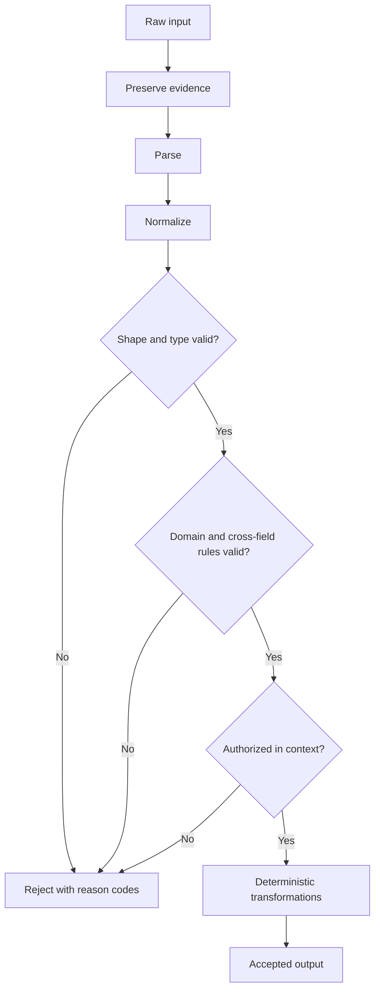

# Data Structures, Validation, and Transformation

## Learning objectives

By the end of this lesson, you can:

- choose records, lists, sets, maps, and queues for automation data;
- normalize input without destroying the original evidence;
- validate shape, type, domain rules, and cross-field consistency;
- implement filter, map, group, sort, join, and deduplicate operations locally.

## Applied visual

Preservation precedes normalization, and each validation gate can reject data before business transformations run.

## Choose structures by invariant

- A **record/map** represents named fields for one entity.
- A **list** preserves ordered items and may contain duplicates.
- A **set** answers membership and removes duplicate values when order is irrelevant.
- A **queue** processes items in arrival or priority order.
- A **map keyed by ID** supports fast lookup and explicit duplicate handling.

Do not deduplicate merely by converting records to text. Define identity, such as source plus event ID, or normalized email plus date. Two records that look similar may be legitimately distinct.

## A four-stage boundary

Handle inbound data in this order:

1. **Preserve:** retain the raw event or a lawful hash/reference for audit.
2. **Parse:** convert JSON, CSV, or form fields into a known structure.
3. **Normalize:** trim permitted whitespace, standardize dates, or map aliases.
4. **Validate:** reject or route invalid values before business actions.

Validation layers:

- shape: required keys are present;
- type: amount is numeric, items is a list;
- domain: status is one of an allowlist;
- cross-field: end date is not before start date;
- authorization/context: source and requested action are permitted.

Normalization must not hide invalid input. For example, silently turning an unparseable amount into zero could authorize a wrong outcome.

## Core transformations

Given a list of case records:

- **filter:** retain eligible open cases;
- **map:** derive a normalized record;
- **group:** collect cases by owner;
- **sort:** order by priority and arrival time;
- **join:** attach owner metadata by a stable key;
- **reduce:** calculate counts or totals;
- **deduplicate:** retain one event per identity under an explicit policy.

Sort with a deterministic tie-breaker. "Highest priority first" is insufficient if several cases have equal priority; add created time and case ID.

## Free local practice

Create a file named cases.json with 12 synthetic records containing missing fields, duplicate event IDs, mixed date formats, and unknown statuses. Then write a standard-library Python script:

~~~python
import json
from datetime import datetime

ALLOWED = {"new", "review", "closed"}

def normalize(row):
    return {
        **row,
        "case_id": str(row.get("case_id", "")).strip(),
        "status": str(row.get("status", "")).strip().lower(),
    }

def validate(row):
    errors = []
    if not row["case_id"]:
        errors.append("case_id is required")
    if row["status"] not in ALLOWED:
        errors.append("status is not allowed")
    return errors

with open("cases.json", encoding="utf-8") as source:
    raw = json.load(source)

seen = set()
accepted, rejected = [], []
for original in raw:
    row = normalize(original)
    errors = validate(row)
    if row["case_id"] in seen:
        errors.append("duplicate case_id")
    if errors:
        rejected.append({"input": original, "errors": errors})
        continue
    seen.add(row["case_id"])
    accepted.append(row)

accepted.sort(key=lambda row: (row["status"], row["case_id"]))
print(json.dumps({"accepted": accepted, "rejected": rejected}, indent=2))
~~~

Extend it to parse dates explicitly, group accepted cases by status, and output a count. Never use eval on input text.

## Completion criteria

You are finished when:

- the raw input remains available separately from normalized data;
- shape, type, domain, cross-field, and authorization checks are distinguished;
- every rejected record contains machine-readable reasons;
- identity and duplicate policy are explicit;
- transformations are deterministic, including sort tie-breakers;
- the script processes all 12 cases without crashing;
- no invalid value is silently replaced with a valid business value.

## References

- [Python Tutorial: Data structures](https://docs.python.org/3/tutorial/datastructures.html) - official semantics and examples for lists, sets, dictionaries, queues, comprehensions, and sorting.
- [Python json module](https://docs.python.org/3/library/json.html) - official safe encoding and decoding interfaces for JSON.
- [Python csv module](https://docs.python.org/3/library/csv.html) - official structured parsing and writing for tabular text.
- [JSON Schema 2020-12 specification](https://json-schema.org/specification) - public standard for machine-readable structural and conditional validation.
