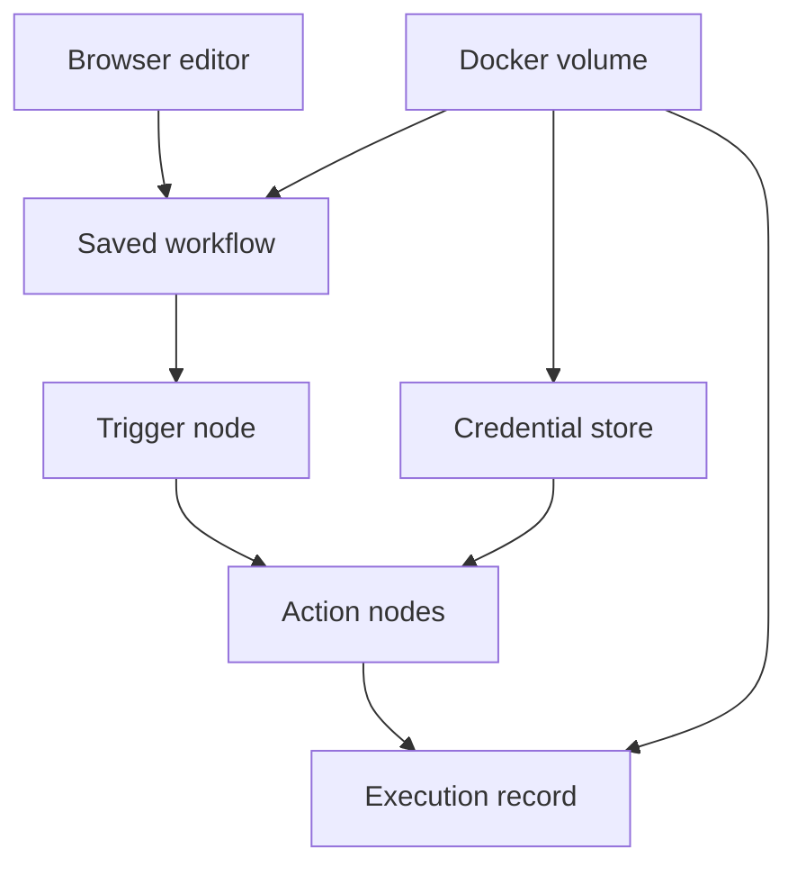

# Local Installation and the Editor

## Learning objectives

By the end of this lesson, you can:

- run n8n locally with persistent storage;
- explain the roles of the editor, workflow, node, trigger, execution, and credential;
- keep secrets and production data out of a learning instance;
- export a workflow and verify that a restart preserves it.

## Visual map

## Choose a learning setup

n8n offers cloud and self-hosted options. This course uses a local Community Edition instance so the core exercises do not require a subscription. Self-hosting also makes you responsible for updates, security, backup, and availability. A laptop instance is a lab, not production.

Docker is the clearest reproducible option. Confirm that Docker is installed, then run:

~~~bash
docker volume create n8n_data
docker run --name n8n-course --rm -it \
  -p 5678:5678 \
  -e GENERIC_TIMEZONE=America/Sao_Paulo \
  -e TZ=America/Sao_Paulo \
  -v n8n_data:/home/node/.n8n \
  docker.n8n.io/n8nio/n8n
~~~

Open http://localhost:5678 and create the local owner account. Use a unique learning password. The named volume preserves the database and encryption material between container runs.

For repeatable work, pin a tested image version rather than relying indefinitely on the floating latest tag. Check the official release notes before upgrading and back up first.

## Understand the main objects

- A **workflow** is the saved graph and its settings.
- A **trigger node** starts an execution manually, on a schedule, or from an event.
- An **action node** transforms data or calls a system.
- An **execution** is one run with input, node results, status, and timing.
- A **credential** stores authentication material separately from workflow parameters.
- An **expression** computes a parameter from execution data or context.

The canvas is not the execution itself. Editing a saved workflow does not alter a past run. Likewise, a successful manual run does not prove an active production trigger will behave correctly.

## Safe lab boundaries

Use synthetic records only. Do not connect personal email, employer systems, payment accounts, or production APIs. Do not paste keys directly into nodes or workflow names. Credentials can be encrypted at rest by n8n, but anyone who controls the instance or its encryption key may have powerful access.

Bind the editor only where intended. The command above exposes it to the local host port; do not open that port on a public server without TLS, authentication, network controls, and the hardening covered later.

## Free local practice

1. Start the container and open the editor.
2. Create a workflow named Course 12 - Installation Check.
3. Add a Manual Trigger and an Edit Fields node.
4. Add fields named lab_id, started_at, and data_classification. Use fictional values and the current-time expression available in the editor.
5. Execute the workflow and inspect INPUT, OUTPUT, JSON, schema, and table views.
6. Save it, export the workflow JSON, and inspect the file in a text editor. Verify no password or key is present.
7. Stop the container with Ctrl+C, rerun the same Docker command, and verify the saved workflow remains.
8. Record the n8n version, Docker image reference, timezone, and backup/export location in a local lab note.

## Completion criteria

You are finished when:

- the editor is reachable only at the intended local address;
- data persists after a container restart;
- a manual workflow produces inspected JSON output;
- you can distinguish workflow definition from execution history;
- exported JSON contains no literal secret;
- the exact n8n version and setup command are recorded;
- the instance contains only synthetic learning data.

## References

- [n8n documentation: Docker installation](https://docs.n8n.io/hosting/installation/docker/) - official local and server Docker setup guidance.
- [n8n documentation: Choose the right n8n](https://docs.n8n.io/choose-n8n/) - official comparison of Cloud, npm, and self-hosted options.
- [n8n documentation: Workflows](https://docs.n8n.io/workflows/) - official workflow concepts and management guidance.
- [n8n documentation: Credentials](https://docs.n8n.io/credentials/) - official credential storage and use concepts.
