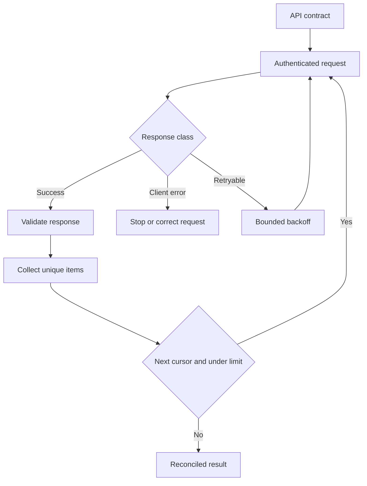

# HTTP APIs, Authentication, and Pagination

## Learning objectives

By the end of this lesson, you can:

- read an HTTP API contract and configure the n8n HTTP Request node;
- distinguish API keys, bearer tokens, basic authentication, and OAuth 2.0;
- implement pagination with explicit limits and duplicate protection;
- classify status codes before transforming a response.

## Visual map

## Begin with the contract

Before building a node, record:

| concern | evidence needed |
| --- | --- |
| Base URL and version | Official documentation or OpenAPI document |
| Method and path | Operation definition |
| Authentication | Credential type, scope, and token location |
| Request | Headers, path/query parameters, body schema |
| Response | Success schema and error schemas |
| Limits | Page size, rate limit, timeout, payload limit |
| Semantics | Idempotency, ordering, consistency, retry guidance |

HTTP Request can call services without a dedicated n8n node. A dedicated node may offer convenience, but the API contract remains authoritative.

## Method and status semantics

GET retrieves a representation and should not create business side effects. POST commonly creates or initiates work and is not inherently idempotent. PUT replaces a resource and is idempotent by HTTP semantics; PATCH partially changes one but its idempotency depends on the operation.

Do not treat every 2xx response as the same:

- 200 usually includes a completed representation;
- 201 indicates creation and may include Location;
- 202 indicates accepted, not completed;
- 204 has no response body.

Handle 4xx as a caller, authorization, conflict, or throttling issue; handle 5xx as a server/dependency issue. Parse the documented error schema before losing it in a generic transformation.

## Authentication belongs in credentials

Use the least-privilege credential supported by the provider:

- API key in a documented header or query parameter;
- bearer token in Authorization;
- basic authentication only over TLS;
- OAuth 2.0 for delegated access with appropriate scopes and refresh handling.

Store values in n8n credentials, not expressions, workflow JSON, pinned data, or notes. Never implement OAuth by copying refresh tokens through ordinary data nodes when n8n has a credential type for it.

## Pagination

APIs paginate by page number, offset, cursor, or a next link. Implement the exact advertised scheme. Stop when the next cursor/link is absent, the returned page is shorter than the documented size where valid, or a configured maximum is reached.

Guard against a server returning the same cursor forever. Deduplicate by stable resource ID and record page count, items retrieved, and termination reason.

## Free local practice

Create two local n8n workflows.

1. **Mock Catalog API:** Webhook receives page and limit query parameters plus a fictional X-Lab-Key header. It returns slices of 12 synthetic records and a next_cursor value.
2. **Catalog Client:** Manual Trigger calls the mock endpoint using HTTP Request and a generic header credential containing only the fictional lab key.
3. Configure pagination to fetch pages of five, with a maximum of five pages.
4. Validate status and response shape before collecting items.
5. Modify the mock to repeat a cursor. Verify the client stops and reports cursor_stalled.
6. Return 401, 429 with Retry-After, 500, and malformed JSON in separate tests. Record the chosen classification for each.
7. Confirm all 12 unique IDs are present exactly once in the successful run.

Keep the mock URL local and the lab credential valueless outside this exercise.

## Completion criteria

You are finished when:

- every request setting traces to a documented or mock API contract;
- authentication is stored as an n8n credential;
- success and error status families have distinct handling;
- pagination has a maximum and a stalled-cursor guard;
- returned resources are deduplicated by a stable ID;
- 202 is not represented as completed work;
- logs include counts and reason codes but no token or body;
- all 12 synthetic resources reconcile exactly once.

## References

- [n8n documentation: HTTP Request node](https://docs.n8n.io/integrations/builtin/core-nodes/n8n-nodes-base.httprequest/) - official configuration, authentication, pagination, batching, and response options.
- [n8n documentation: HTTP Request credentials](https://docs.n8n.io/integrations/builtin/credentials/httprequest/) - official generic authentication configuration.
- [IETF RFC 9110: HTTP Semantics](https://datatracker.ietf.org/doc/html/rfc9110) - primary method, status, safety, and idempotency semantics.
- [IETF RFC 6749: OAuth 2.0](https://datatracker.ietf.org/doc/html/rfc6749) - primary authorization framework specification.
- [OpenAPI Specification](https://spec.openapis.org/oas/latest.html) - public standard for machine-readable HTTP API contracts.
