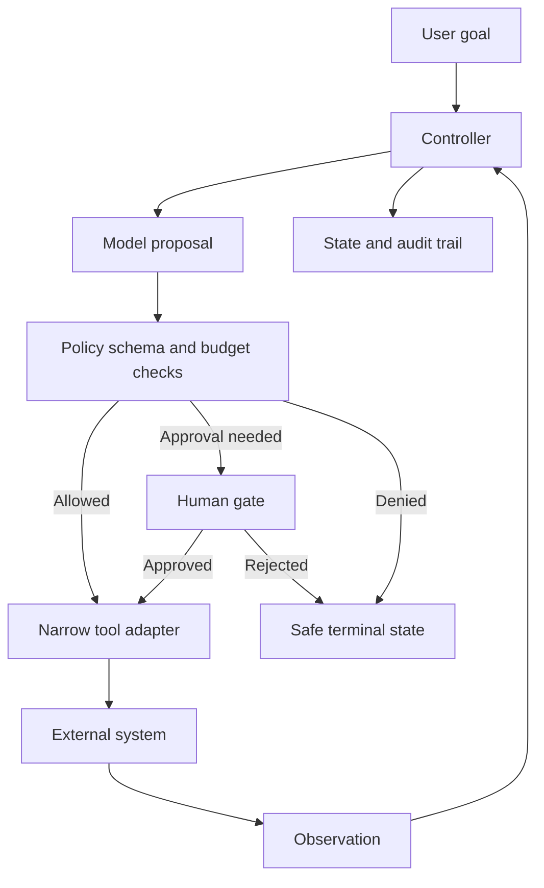

# Agent System Boundaries and Components

## Learning objectives

By the end of this lesson, you can:

- distinguish a fixed workflow, model-assisted workflow, and autonomous agent loop;
- identify the controller, model, tools, state, memory, policy, and observer boundaries;
- choose the minimum autonomy justified by task uncertainty;
- document authority, budgets, termination, and fallback before selecting a framework.

## Visual map

## Workflow or agent?

A **workflow** follows paths defined in code or configuration. A **model-assisted workflow** uses a model for a narrow transformation inside deterministic routing. An **agent** lets a model choose the next action or tool repeatedly based on observations.

Use a fixed workflow when the sequence and rules are known. Use a model-assisted step when input is unstructured but the allowed outcome is narrow. Consider an agent only when the task genuinely requires flexible multi-step choice that cannot be enumerated economically.

More autonomy adds variable paths, latency, cost, testing surface, and attack surface. "Agent" is not an upgrade tier.

## A reference boundary

An agentic system usually contains:

| component | responsibility | trusted? |
| --- | --- | --- |
| User/environment | supplies goals and observations | No |
| Controller | owns loop, limits, state transitions, and policy checks | Yes, after testing |
| Model | proposes a structured next action | No |
| Tool registry | exposes named schemas and capability metadata | Partially |
| Tool adapter | validates arguments, authorizes, executes, normalizes result | Yes, after testing |
| Short-term state | tracks task, steps, observations, and budget | Sensitive |
| Long-term memory | stores approved durable facts or artifacts | Untrusted content |
| Observer/evaluator | records outcomes, traces, cost, and safety signals | Must be independent enough |
| Human gate | authorizes consequential or ambiguous actions | Accountable role |

The model never "has permission" by itself. The controller validates the proposed tool, schema, user authority, current state, data boundary, and approval before an adapter runs.

## Bound the task

Define:

- one task objective and measurable success;
- allowed tools and resources per role;
- prohibited actions and data;
- maximum model calls, tool calls, elapsed time, tokens, and cost;
- terminal states: completed, needs_input, denied, failed_safe, budget_exhausted;
- human approval and escalation points;
- what is retained and for how long.

If the goal is open-ended, the system cannot reliably know it is done. Convert "research competitors" into an observable deliverable, scope, source policy, deadline, and evidence requirement.

## Free local practice

Use the automation use case developed earlier.

1. Design three alternatives: deterministic workflow, one model-assisted step, and bounded agent.
2. Score each for task success, auditability, latency, cost, security exposure, and operating effort.
3. Draw a component/data-flow diagram for the least autonomous option that meets the need.
4. Mark trust boundaries and every place untrusted text crosses into a model, memory, or tool argument.
5. Write an autonomy budget and terminal states.
6. Create a capability table showing read/write authority for each tool and actor.
7. Write a rejection memo if the agent adds no measured value. This is a successful architecture outcome.

## Completion criteria

You are finished when:

- workflow, model-assisted workflow, and agent alternatives are compared;
- agent autonomy is justified by task uncertainty, not fashion;
- controller, model, tools, state, memory, observer, and human roles are separate;
- model outputs are treated as untrusted proposals;
- tool and data authority is allowlisted per role;
- time, step, tool, token/cost, and retention budgets are defined;
- every execution can reach a safe terminal state;
- a simpler baseline remains available for evaluation.

## References

- [Anthropic: Building effective agents](https://www.anthropic.com/research/building-effective-agents) - primary engineering guidance distinguishing workflows from agents and presenting common orchestration patterns.
- [ReAct: Synergizing Reasoning and Acting in Language Models](https://arxiv.org/abs/2210.03629) - original paper on interleaving model reasoning and environment actions.
- [A Survey on Large Language Model based Autonomous Agents](https://arxiv.org/abs/2308.11432) - public research taxonomy covering profile, memory, planning, and action.
- [NIST AI RMF Generative AI Profile](https://doi.org/10.6028/NIST.AI.600-1) - primary cross-sector guidance for generative-AI risk across the lifecycle.
