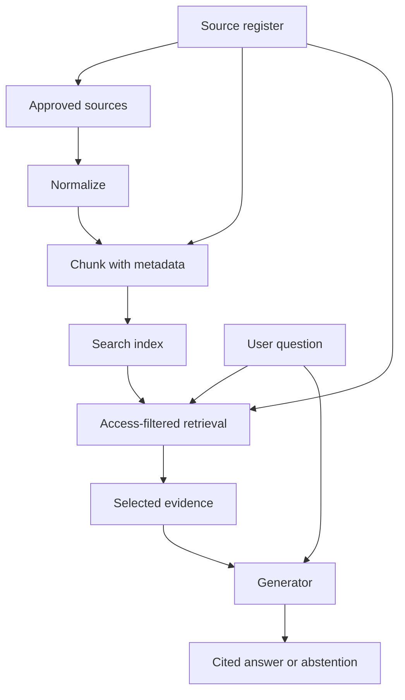
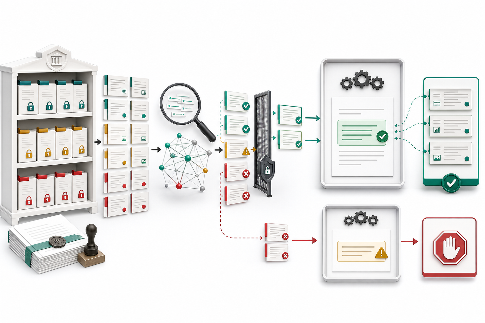

# RAG Architecture and Source Governance

## Learning objectives

- Explain what retrieval-augmented generation (RAG) changes, and what it does not.
- Turn a business question into a bounded, auditable knowledge corpus.
- Define source ownership, freshness, access, and deletion before building an index.

## Visual map

This conceptual view highlights two boundaries that are easy to miss in code: authorization filters evidence before it reaches generation, and the unsupported path ends in abstention instead of a plausible answer.

## The retrieval contract

A language model generates text from parameters learned during training. RAG adds a second, non-parametric memory: at request time, a retriever selects evidence from an external corpus and the generator receives that evidence in its context. This makes current, private, or domain-specific knowledge available without retraining. It does **not** make an answer true automatically. A bad source, missing passage, incorrect access filter, or unsupported synthesis can still produce a confident error.

Treat the pipeline as five inspectable stages:

1. **Acquire:** accept only approved documents and record their origin.
2. **Normalize:** extract useful text while preserving structure.
3. **Index:** split text, compute searchable representations, and attach metadata.
4. **Retrieve:** select evidence for a particular question and user.
5. **Generate:** answer only from the supplied evidence and expose citations.

Each stage needs an observable input and output. If an answer fails, you should be able to tell whether the source was absent, extraction lost it, chunking separated it, retrieval missed it, or generation ignored it.

## Govern sources before vectors

Create a source register. At minimum, store `source_id`, canonical URI or local path, title, owner, version, effective date, ingestion time, classification, allowed audience, retention rule, and content hash. Prefer authoritative primary sources over summaries. A document that changes should produce a new version; a removed or expired source must be removable from both the document store and vector index.

Authorization belongs in retrieval, not only in the user interface. Attach tenant and access-control metadata to every chunk, then filter before candidates reach the model. Never retrieve everything and ask the model to hide forbidden text. Embeddings can also encode sensitive material, so apply the same retention and deletion controls to vectors as to source text.

## Free local practice

Choose 8-12 public documents about one narrow topic, such as Python standard-library pages or municipal open-data documentation. Create `source-register.csv` with the fields above. For each document:

1. Assign a stable ID such as `python-pathlib`.
2. Record whether it is primary, secondary, or unverified.
3. Calculate a SHA-256 hash with `shasum -a 256 FILE` or Python's `hashlib`.
4. Define who may access it and when it should be refreshed.
5. Write three questions it should answer and one it must not answer.

Draw a failure tree for one question: source absent -> extraction failure -> chunk missing -> retrieval miss -> unsupported generation. Add one diagnostic artifact for every branch, such as an ingestion log or retrieved-chunk list.

## Completion criteria

- The register contains provenance, version, owner, access, freshness, retention, and hash for every source.
- Each test question is mapped to an expected document and passage.
- The design enforces access filters before generation.
- You can identify the pipeline stage responsible for a deliberately missing answer.

## References

- [Lewis et al., Retrieval-Augmented Generation for Knowledge-Intensive NLP Tasks](https://arxiv.org/abs/2005.11401) - original RAG paper and the distinction between parametric and non-parametric memory.
- [NIST AI RMF 1.0](https://nvlpubs.nist.gov/nistpubs/ai/NIST.AI.100-1.pdf) - lifecycle-oriented risk management and governance.
- [Qdrant multitenancy guidance](https://qdrant.tech/documentation/guides/multitenancy/) - payload-based isolation patterns for vector search.
- [SLSA provenance concepts](https://slsa.dev/spec/v1.0/provenance) - a useful model for recording where an artifact came from and how it was produced.
