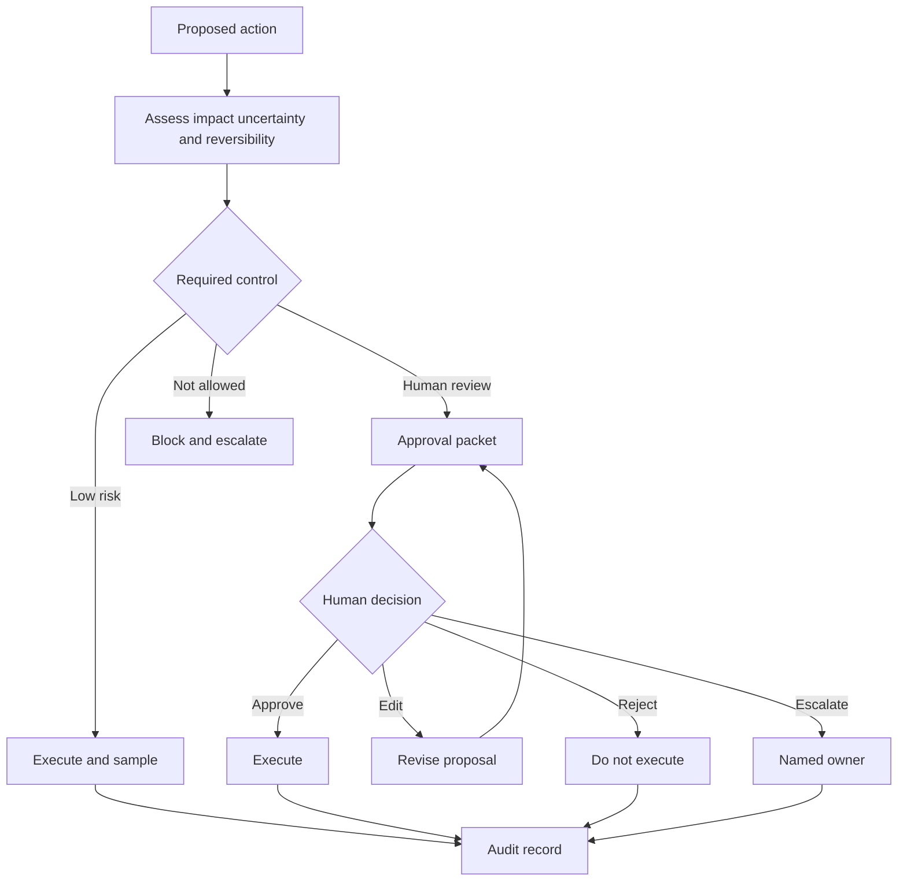

# Designing Human Oversight

## Learning objectives

- Decide where human judgment belongs in an AI workflow.
- Distinguish approval, review, correction, escalation, and appeal.
- Match the strength of a control to impact, uncertainty, and reversibility.

## Visual map




The reviewer receives evidence and meaningful choices rather than a ceremonial confirmation. Saved state and an audit trail make approval durable, reviewable, and recoverable after interruption.

## Oversight must change the outcome

Putting a person near a system is not meaningful oversight unless that person has enough information, time, authority, and a usable action. A confirmation dialog that defaults to approval after a vague summary is ceremony, not control.

Map each automated action on three dimensions:

- **Impact:** What harm could a wrong action cause?
- **Reversibility:** Can the effect be undone fully and promptly?
- **Uncertainty:** Does the system have reliable evidence and calibrated confidence?

Low-impact, reversible actions can run automatically and be sampled later. Medium-risk actions may require review when evidence is weak or rules conflict. High-impact or irreversible actions need approval before execution, independent validation, or prohibition from automation. Examples include sending money, deleting records, changing access, publishing externally, and making consequential decisions about a person.

Use distinct controls:

| Control | Timing | Appropriate use |
|---|---|---|
| Approval | before action | irreversible or high-impact tool call |
| Review | before or after | quality check with clear rubric |
| Correction | during workflow | human supplies or edits missing data |
| Escalation | on exception | policy conflict, uncertainty, or unavailable tool |
| Appeal | after outcome | affected person challenges a decision |

Do not ask reviewers to reconstruct context. An approval packet should show the proposed action, destination, material inputs, source evidence, expected effect, uncertainty, alternatives, and an immutable request ID. Hide secrets and unrelated personal data.

## Free local practice

Choose a workflow such as drafting and sending a customer email. Draw every step and classify it by impact, reversibility, and uncertainty from 1 to 3. Define a gate rule, for example:

```text
require approval when impact >= 3
or reversible == false
or evidence_conflict == true
or destination is external
```

Create five scenarios: routine reply, wrong recipient, sensitive attachment, conflicting policy sources, and reviewer unavailable. For each, specify what the system does, what the reviewer sees, allowed decisions (`approve`, `edit`, `reject`, `escalate`), timeout behavior, and audit record.

Run a tabletop exercise with one person acting as system and another as reviewer. Time each decision and note what evidence was missing. Revise the packet until a reviewer can make a defensible decision without seeing hidden chain-of-thought. Use concise rationales, cited inputs, and tool parameters instead.

## Completion criteria

- Every consequential action has an explicit automation or oversight rule.
- Reviewers can reject and escalate; approval is not the only path.
- Timeout and reviewer-unavailable behavior fails safely.
- The audit record explains what was proposed, who decided, when, and what executed.

## References

- [NIST AI RMF 1.0](https://doi.org/10.6028/NIST.AI.100-1) - roles, accountability, risk measurement, and human-AI configurations.
- [NIST GenAI Profile](https://doi.org/10.6028/NIST.AI.600-1) - recommended controls for generative-AI risks and oversight.
- [Amershi et al., Guidelines for Human-AI Interaction](https://doi.org/10.1145/3290605.3300233) - empirically validated interaction guidelines.
- [NIST AI RMF Appendix C: Human-AI Interaction](https://airc.nist.gov/airmf-resources/airmf/appendices/app-c-ai-risk-management-and-human-ai-interaction/) - operational concerns for human oversight.
