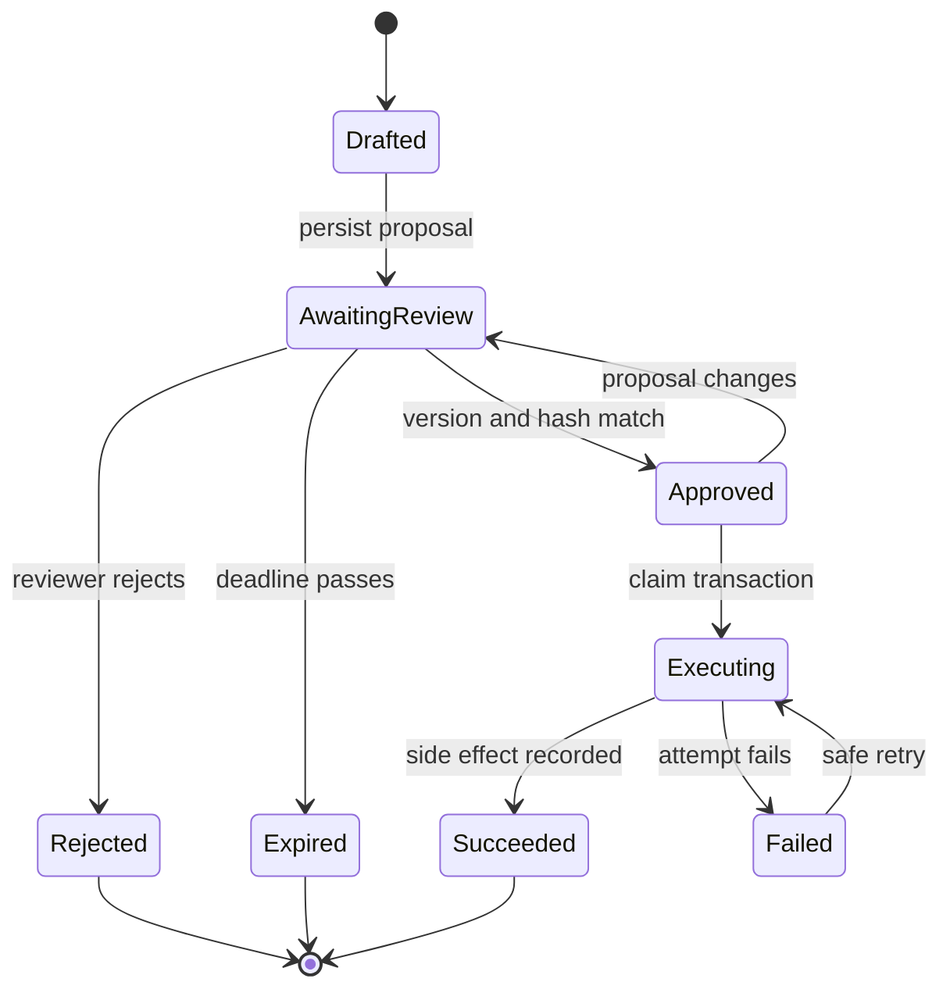

# Durable Approval Workflows

## Learning objectives

- Pause and resume a workflow without losing state.
- Prevent duplicate side effects after retries or restarts.
- Validate an approval against the exact action that eventually executes.

## Applied visual



Only a persisted, matching approval can reach execution, while retries remain explicit and recoverable.

## A pause is a state transition

An approval workflow is a state machine, not a blocking `input()` call. Persist the proposed action before notifying a reviewer. A minimal lifecycle is:

```text
drafted -> awaiting_review -> approved -> executing -> succeeded
                              |          |-> failed
                              |-> rejected
                              |-> expired
```

Store a request ID, version, normalized tool name and arguments, risk reason, creator, creation/expiry time, status, and content hash. The reviewer decision must bind to that version and hash. If the proposal changes, invalidate the old approval and request a new one.

Retries make side effects dangerous. A graph node may restart from its beginning after an interrupt, a worker may crash after sending an API request, or a queue may deliver twice. Use an idempotency key derived from the approval request, record execution attempts, and make the external operation idempotent when possible. Code before a pause should be free of side effects or safe to repeat.

Authorization is evaluated twice: when showing the approval and immediately before execution. A user may lose permission while a request waits. Never accept a bare Boolean from an unauthenticated client as approval.

## Free local practice

Implement a small approval queue using Python and SQLite. The proposed action writes a file into a sandbox directory; it may not access other paths. Create tables `approval_requests`, `decisions`, and `executions` with foreign keys and unique constraints on `(request_id, proposal_version)`.

Implement these commands:

```text
propose --path out/report.txt --content report.md
list-pending
decide REQUEST_ID --approve|--reject --reason TEXT
execute REQUEST_ID
```

The execute command must verify status, expiry, proposal hash, reviewer identity, allowed path, and absence of a successful execution. Use an atomic transaction to claim the request by moving `approved` to `executing`. Write to a temporary file and use `Path.replace()` for an atomic final move.

Test four failures: process termination after claiming, duplicate `execute`, edited proposal after approval, and expired approval. Decide how recovery moves a stuck `executing` request back to a reviewable state. Keep decision and execution logs append-only.

Optionally reimplement the same lifecycle with LangGraph interrupts and a SQLite/PostgreSQL checkpointer. Compare its replay behavior with your explicit state machine.

## Completion criteria

- Restarting the process preserves pending approvals.
- Duplicate execution attempts create at most one final side effect.
- Editing the proposal invalidates its approval.
- Expired, unauthorized, or out-of-sandbox actions fail closed and leave an audit event.

## References

- [LangGraph interrupts](https://docs.langchain.com/oss/python/langgraph/interrupts) - pause/resume behavior and idempotency rules.
- [LangGraph persistence](https://docs.langchain.com/oss/python/langgraph/persistence) - checkpoints, threads, replay, and fault tolerance.
- [Python sqlite3 transactions](https://docs.python.org/3/library/sqlite3.html#transaction-control) - local transactional state storage.
- [Stripe idempotent requests](https://docs.stripe.com/api/idempotent_requests) - a concrete public design for deduplicating side effects.
