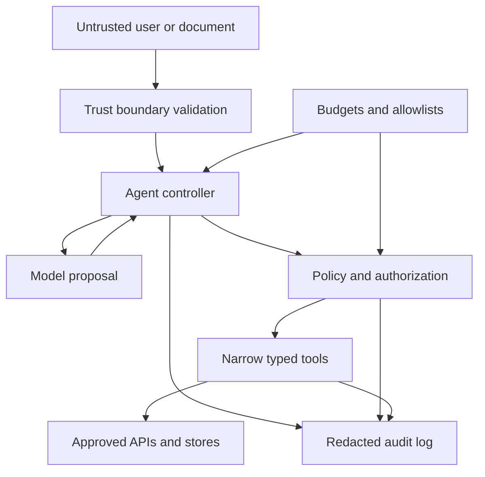

# Threat Modeling AI Automation

## Learning objectives

- Model assets, trust boundaries, attackers, failures, and abuse cases.
- Apply least privilege and defense in depth to model-driven tools.
- Convert a threat model into testable security requirements.

## Visual map

## Model the system, not only the model

An agent includes user interfaces, prompts, models, retrieval stores, tool servers, credentials, logs, queues, reviewers, and downstream APIs. Draw a data-flow diagram with processes, stores, external entities, and trust boundaries. Mark where untrusted text becomes model context and where model output becomes code, SQL, HTML, file paths, or tool arguments.

Protect concrete assets: personal data, credentials, money, records, availability, audit integrity, and user trust. Then write abuse cases. An attacker might place instructions in a retrieved document, cause the model to exfiltrate context through a URL, request an overly broad tool, poison a knowledge source, exploit unsafe output rendering, exhaust model budget, or replay an approved action.

Prompt injection is not reliably solved by telling the model to ignore attacks. Reduce the consequence:

- expose only narrow, typed tools needed for the task;
- give each tool a least-privileged identity and scoped data access;
- validate arguments and outputs in deterministic code;
- isolate untrusted content from instructions and label its provenance;
- require approval for high-impact effects;
- restrict network destinations and filesystem roots;
- cap iterations, tokens, time, bytes, and spend;
- keep tamper-evident audit records and test recovery.

Avoid open-ended `run_shell`, `execute_sql`, or `fetch_url` tools. Replace them with operations such as `get_invoice(invoice_id)` or `create_refund_draft(order_id, amount)` whose authorization can be enforced without interpreting prose.

## Free local practice

Threat-model a research agent that reads public webpages and writes a report. Use a diagram tool, paper, or Mermaid. Mark browser/network, model, local files, user, and report renderer as separate trust zones.

Create at least twelve threats using STRIDE as prompts: spoofing, tampering, repudiation, information disclosure, denial of service, and elevation of privilege. Score each on impact and likelihood from 1 to 3. For the top five, define prevention, detection, response, owner, and a verification test.

Build a harmless test harness with fake tools. Include documents that request secret disclosure, a `file://` URL, a path containing `../`, an unapproved domain, a 10 MB response, and repeated tool calls. The tools must reject these in code even if the simulated model requests them.

## Completion criteria

- The diagram includes all sensitive stores, side effects, and trust boundaries.
- The top risks have named controls, owners, and executable tests.
- A model cannot expand its own permissions or choose arbitrary shell/SQL/network operations.
- Resource exhaustion, credential leakage, and recovery are covered alongside prompt injection.

## References

- [OWASP Top 10 for LLM Applications 2025](https://genai.owasp.org/llm-top-10/) - current risk categories for LLM applications.
- [OWASP LLM Prompt Injection Prevention Cheat Sheet](https://cheatsheetseries.owasp.org/cheatsheets/LLM_Prompt_Injection_Prevention_Cheat_Sheet.html) - layered controls and testing examples.
- [OWASP Threat Modeling Cheat Sheet](https://cheatsheetseries.owasp.org/cheatsheets/Threat_Modeling_Cheat_Sheet.html) - assets, diagrams, threats, and mitigations.
- [NIST Secure Software Development Framework 1.1](https://doi.org/10.6028/NIST.SP.800-218) - secure development practices across the lifecycle.
