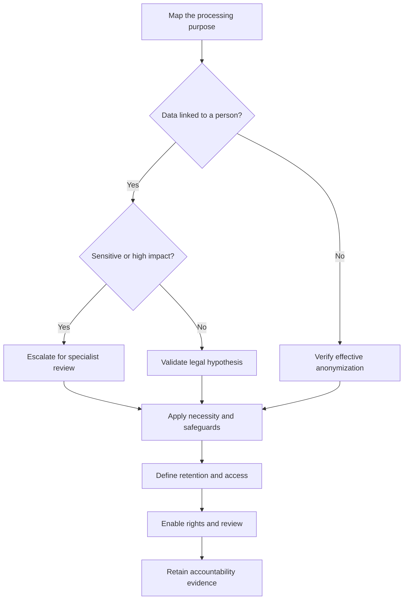

# LGPD Foundations for AI Systems

## Learning objectives

- Apply LGPD principles, roles, legal hypotheses, and data-subject rights to an AI workflow.
- Distinguish personal, sensitive, anonymized, and derived data.
- Recognize when specialist legal review is necessary.

## Applied visual

The classification is only the start: every path still requires purpose limitation, safeguards, rights handling, and evidence.

## Read the law from the processing activity outward

Brazil's Lei Geral de Protecao de Dados Pessoais (LGPD), Law No. 13,709/2018, regulates processing of personal data, including digital processing. This lesson is engineering education, not legal advice. Identify the applicable jurisdiction and obtain qualified advice for a real deployment.

Personal data relates to an identified or identifiable natural person. Sensitive personal data includes categories listed in Article 5, such as racial or ethnic origin, religious belief, health, genetic or biometric data linked to a person. Model inferences and embeddings can be personal data when linkable to someone; calling a field a "score" does not remove it from the law. Anonymization must be effective in context, considering reasonable means of reversal. Pseudonymization reduces exposure but normally remains within scope.

For each purpose, document an appropriate legal hypothesis. Ordinary personal data hypotheses are in Articles 7 and 10; sensitive-data processing has the distinct Article 11 regime. Consent is only one possibility and should not be selected by habit. It must be free, informed, and unambiguous for specified purposes and can be revoked. Do not combine incompatible purposes under a vague "improve AI" statement.

Apply Article 6 principles as design tests: purpose, adequacy, necessity, free access, data quality, transparency, security, prevention, non-discrimination, and accountability. Record the controller (`controlador`), which determines processing decisions, the operator (`operador`), which processes on instructions, and the data protection officer/contact (`encarregado`) as applicable. Contract labels do not override actual conduct.

Data subjects have rights including confirmation, access, correction, portability subject to regulation, information, and deletion in applicable cases. Article 20 addresses review of decisions made solely through automated processing that affect interests and information about criteria and procedures, subject to protected secrets. Do not promise that a model can explain itself; maintain understandable decision records and a functioning review channel.

## Free local practice

Map a fictional job-screening assistant. For every input, derived field, output, log, and recipient, record purpose, category, source, legal hypothesis to be validated, retention, access, and deletion route. Include resume text, disability information, inferred seniority, ranking, reviewer notes, and telemetry.

Test each field against necessity: what breaks if it is removed, coarsened, processed locally, or deleted sooner? Draft a plain-language notice and procedures for access, correction, deletion where applicable, and Article 20 review. Flag sensitive data, children/adolescents, biometric data, high-impact scoring, and incompatible secondary use for legal and ethics review.

## Completion criteria

- Each processing purpose is specific and separately mapped to data and a legal hypothesis for validation.
- Sensitive and derived data are identified; pseudonymized data is not mislabeled anonymous.
- Controller/operator responsibilities and a data-subject channel are documented.
- Automated-decision review and meaningful information can be supported from retained records.

## References

- [Official consolidated text of Law No. 13,709/2018](https://www.planalto.gov.br/ccivil_03/_ato2015-2018/2018/lei/l13709compilado.htm) - authoritative LGPD text.
- [ANPD guide to processing agents and the encarregado](https://www.gov.br/anpd/pt-br/centrais-de-conteudo/materiais-educativos-e-publicacoes/guia_agentes_de_tratamento_e_encarregado___defeso_eleitoral.pdf) - official guidance on roles and responsibilities.
- [ANPD data-subject rights](https://www.gov.br/anpd/pt-br/assuntos/titular-de-dados-1/direito-dos-titulares) - official public explanation of rights and request channels.
- [ANPD regulations](https://www.gov.br/anpd/pt-br/acesso-a-informacao/institucional/atos-normativos/regulamentacoes_anpd) - current authoritative regulatory index; check it before production decisions.
