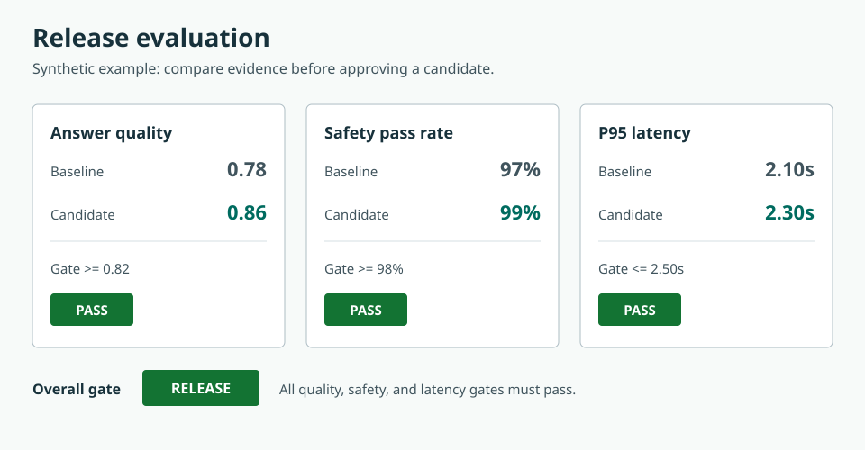

# Production Monitoring and Release Gates

## Learning objectives

- Detect distribution, quality, safety, and operational changes after release.
- Design alerts and rollback criteria tied to user impact.
- Turn production failures into reviewed regression cases.

## Monitoring closes the evaluation loop

Offline evaluation cannot represent every input, outage, policy update, or attacker. Production monitoring combines immediate deterministic signals with delayed sampled quality review. Monitor input size/language/type distributions, refusal and escalation rates, retrieval scores, source age, tool errors, approval overrides, latency, cost, and confirmed outcome quality. A shift is a prompt to investigate, not automatic proof of harm.

Set release gates at three levels:

- **Build:** unit, schema, security, privacy-redaction, and deterministic eval tests.
- **Pre-release:** held-out quality, critical-slice safety, load, recovery, and human review.
- **Progressive delivery:** small traffic percentage with rollback thresholds before expansion.

The chart is generated from [`evaluation-release-results.csv`](../assets/data/evaluation-release-results.csv), not drawn by hand. Change one candidate value, run `python scripts/generate_evaluation_chart.py` from the repository root, and observe how an individual failure changes the overall gate. In a real project, the release decision must also block on critical slice failures that no aggregate score can average away.

Alert on actionable symptoms. "Average score changed" is vague. "Payment workflow safe-completion rate below 99.5% for 15 minutes with at least 100 requests" has an owner and response. Use burn-rate alerts for service objectives and absolute alarms for severe events such as cross-tenant access or unauthorized side effects.

Feedback needs triage. Link a report to trace/configuration IDs, redact it, classify severity and failure layer, reproduce it in a sandbox, fix it, and add a minimal case to the regression suite. Do not train directly on unreviewed thumbs-down data or private content.

## Free local practice

Use the 200 simulated traces from the observability lesson. Split them into baseline and "new release," then inject higher tool latency, a retrieval-score shift, and one unauthorized fake tool attempt. Write monitoring code that:

1. computes rolling success, p95 latency, cost, and policy-block counts;
2. compares input/retrieval distributions with simple quantiles;
3. fires alerts containing window, threshold, observed value, version, and runbook link;
4. recommends rollback for the unauthorized attempt regardless of average quality.

Create a release checklist with hard gates and named approvers. Practice rollback by switching a configuration pointer from `candidate` to `stable`; verify in new traces that the stable version is active. Convert the injected failures into versioned evaluation cases.

## Completion criteria

- Each alert maps to a user impact, owner, and tested runbook.
- A release cannot pass by averaging away a critical safety failure.
- Rollback changes the active version and is verified from telemetry.
- Production reports become reviewed, redacted, reproducible regression cases.

## References

- [MLflow production trace evaluation](https://mlflow.org/docs/latest/genai/eval-monitor/running-evaluation/traces/) - scoring stored traces and attaching ground truth.
- [OpenTelemetry logs data model](https://opentelemetry.io/docs/specs/otel/logs/data-model/) - correlation fields and structured event representation.
- [Google SRE Workbook: alerting on SLOs](https://sre.google/workbook/alerting-on-slos/) - multi-window burn-rate alert design.
- [NIST AI RMF Playbook](https://airc.nist.gov/airmf-resources/playbook/) - lifecycle monitoring, incident response, and continuous improvement actions.
