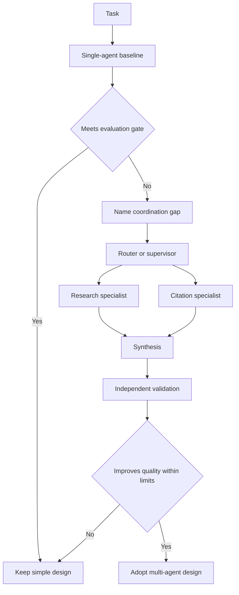

# When and How to Use Multiple Agents

## Learning objectives

- Decide whether a problem needs multiple agents at all.
- Compare router, supervisor, handoff, pipeline, debate, and parallel-worker patterns.
- Define a baseline that can disprove the need for added orchestration.

## Visual map

## Architecture follows coordination needs

An "agent" is a component that uses a model to choose actions or tools within a bounded role. Splitting one prompt into several personas does not automatically add capability. It adds model calls, state transitions, context boundaries, security identities, latency, cost, and new failure modes. Start with a single agent plus clear tools. Adopt multiple agents only when evaluation shows a specific coordination benefit.

Common patterns have different semantics:

- **Router:** classifies a request and dispatches zero or more specialists, often in parallel.
- **Supervisor/subagents:** a central agent dynamically delegates tasks and synthesizes results while workers have isolated context.
- **Handoff:** the active role changes and the new role interacts directly with the user; state records ownership.
- **Deterministic pipeline:** fixed stages such as extract -> validate -> review -> publish; use ordinary code where choices are known.
- **Parallel workers:** independent analyses fan out and a deterministic or model-based reducer combines them.
- **Critic/debate:** candidates challenge or review each other; useful only if independent evidence and a stopping rule improve measured outcomes.

Do not use multi-agent architecture to simulate an org chart. Good boundaries follow different permissions, data domains, tools, latency profiles, ownership, or evaluation criteria. A specialist that shares the same prompt, context, tools, and model may add only cost.

## Free local practice

Select one task, such as researching a public policy and producing a cited summary. Implement a paper design for:

1. one agent with search and writing tools;
2. a router with research and citation-check specialists;
3. a fixed retrieve -> draft -> citation-validate pipeline.

For each, list model calls, context passed, permissions, state owner, possible parallelism, termination condition, and failure recovery. Estimate worst-case calls and tokens. Create 15 evaluation cases and identify which architecture should help each case.

Choose the simplest design that meets the requirements. Write an adoption gate: multi-agent must improve a named held-out metric by a minimum amount while remaining inside latency, cost, and safety limits. Without that evidence, keep the baseline.

## Completion criteria

- The proposal states the coordination problem that each extra agent solves.
- A single-agent or deterministic baseline is specified for comparison.
- Every architecture has explicit state ownership, permissions, and termination.
- Adoption depends on paired evaluation rather than a more elaborate demo.

## References

- [LangChain multi-agent overview](https://docs.langchain.com/oss/python/langchain/multi-agent) - pattern selection and context engineering concepts.
- [LangChain router pattern](https://docs.langchain.com/oss/python/langchain/multi-agent/router) - classification, parallel fan-out, and synthesis.
- [LangChain subagents pattern](https://docs.langchain.com/oss/python/langchain/multi-agent/subagents) - centralized supervision and context isolation.
- [AutoGen teams guide](https://microsoft.github.io/autogen/stable/user-guide/agentchat-user-guide/tutorial/teams.html) - explicit advice to optimize a single agent before using teams.
