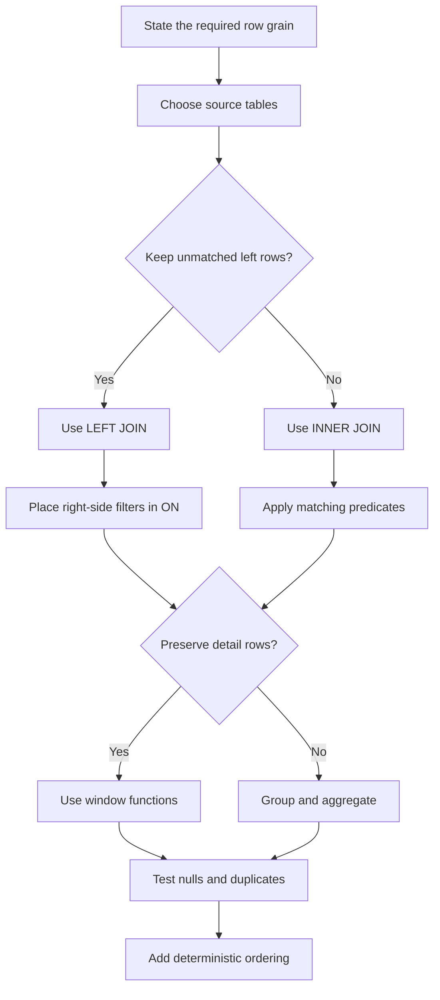

# SQL Queries, Joins, Aggregates, and Windows

## Learning objectives

- Write explicit, testable queries using filters, joins, grouping, and subqueries.
- Use window functions without collapsing detail rows.
- Recognize null, duplicate, and outer-join traps.

## Applied visual



Choosing the result grain first makes join, filter, aggregate, and window decisions testable instead of accidental.

## Think in result sets

State the desired result grain first: one row per student, enrollment, course, or day. Most SQL mistakes are grain mistakes. Select named columns rather than `*` in durable code. Qualify ambiguous columns and use deterministic `ORDER BY` when order matters.

An inner join keeps matching pairs; a left join preserves every left row and fills missing right values with `NULL`. A filter on the right table in `WHERE` can accidentally turn a left join into an inner join; put the condition in `ON` when unmatched left rows must remain. A one-to-many join multiplies rows, so do not repair an incorrect join with unexplained `DISTINCT`.

`NULL` means unknown or absent, not zero or empty. Compare with `IS NULL`, understand three-valued logic, and use `COALESCE` only when substituting a value is semantically correct. Aggregates collapse groups. Window functions calculate across a partition while preserving detail rows:

```sql
SELECT student_id, offering_id, submitted_at, score,
       ROW_NUMBER() OVER (
         PARTITION BY student_id, offering_id
         ORDER BY submitted_at DESC, id DESC
       ) AS attempt_rank,
       AVG(score) OVER (PARTITION BY offering_id) AS offering_average
FROM submissions;
```

Common table expressions can name stages for clarity, but they do not excuse unclear grain or unnecessary work.

## Free local practice

Populate the course schema with at least 5 courses, 3 offerings, 20 students, incomplete enrollments, students with no submissions, and repeated attempts. Write and verify ten queries:

1. offerings with enrollment counts, including zero;
2. students with no submission;
3. latest attempt per student/offering;
4. completion percentage per offering;
5. score rank within offering;
6. running submission count by date;
7. courses above the global average completion;
8. duplicate natural identifiers;
9. students enrolled in every active offering;
10. a recursive prerequisite chain if supported.

For each query, state result grain and create a tiny counterexample that would expose a wrong join or null assumption. Compare `NOT EXISTS` with `NOT IN` when the subquery contains `NULL`.

## Completion criteria

- Each query declares and preserves its result grain.
- Zero-related rows and null values are tested explicitly.
- Latest/ranking/running calculations use deterministic window ordering.
- No `DISTINCT` is used merely to hide an unexplained row multiplication.

## References

- [PostgreSQL query tutorial](https://www.postgresql.org/docs/current/tutorial-select.html) - selection, expressions, qualification, and ordering.
- [PostgreSQL joins tutorial](https://www.postgresql.org/docs/current/tutorial-join.html) - inner and outer join behavior.
- [PostgreSQL aggregate functions](https://www.postgresql.org/docs/current/functions-aggregate.html) - aggregate semantics and ordering.
- [PostgreSQL window functions](https://www.postgresql.org/docs/current/tutorial-window.html) - partitions, frames, rankings, and running calculations.
- [SQLite query language](https://www.sqlite.org/lang.html) - supported SQL grammar for the local practice option.
