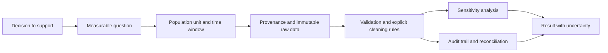

# Questions, Data Provenance, and Cleaning

## Learning objectives

- Turn a vague request into a measurable analytical question and decision.
- Document population, unit of analysis, collection process, and provenance.
- Clean data with explicit rules, tests, and an audit trail.

## Visual map

## Analysis begins before the dataframe

Write the decision, estimand or metric, population, unit of analysis, time window, comparison, and acceptable uncertainty. "Analyze engagement" is not testable. "Estimate the difference in 28-day lesson-completion rate between first-time mobile and desktop students who enrolled in July" identifies rows, groups, outcome, and window.

Understand how observations entered the dataset. A convenience sample, survivorship filter, tracking outage, duplicate event, or changed definition can dominate any later statistic. Create a data dictionary with field meaning, type, allowed values, units, source, owner, refresh cadence, and known limitations. Hash immutable raw files and never edit them in place.

Cleaning is a series of claims. Parsing a date, converting currency, deduplicating, or imputing missing values changes meaning. Preserve raw columns when feasible and produce a validation report: row counts before/after, parse failures, duplicates, missingness, range violations, and reconciliation totals. Distinguish structural absence ("not applicable") from unknown and from zero.

Missing data mechanisms matter. Missing completely at random, conditional on observed variables, or related to the missing value itself imply different risks. Do not fill every numeric null with the mean; it distorts distributions and uncertainty. Start with missingness patterns and sensitivity analysis.

## Free local practice

Use a synthetic course dataset you generate yourself with `student_id`, platform, enrollment date, lesson events, and completion date. Inject duplicate events, impossible dates, mixed platform labels, missing IDs, and a tracking outage.

Create `data-dictionary.md`, `validation.py`, and a cleaned Parquet or CSV output. Use pandas with explicit dtypes and date formats. Normalize platform values through a reviewed mapping, reject impossible sequences, and deduplicate only with a stated business key. Produce `validation.json` containing row reconciliation and every rule count.

Compute the target completion rate twice: excluding and including the outage period with an explicit assumption. Explain how the difference changes the decision. Hash raw data, cleaning code, and output in a manifest.

## Completion criteria

- The question specifies decision, population, unit, outcome, comparison, and time window.
- Raw data is immutable and has provenance, dictionary, and hash.
- Every cleaning rule has a count and justification; rows reconcile.
- Missingness and the tracking outage receive sensitivity analysis rather than silent imputation.

## References

- [pandas user guide](https://pandas.pydata.org/docs/user_guide/) - data types, missing data, joins, grouping, and I/O.
- [pandas missing-data guide](https://pandas.pydata.org/docs/user_guide/missing_data.html) - nullable values and operations.
- [Tidy Data by Hadley Wickham](https://vita.had.co.nz/papers/tidy-data.pdf) - original paper on structuring datasets around variables and observations.
- [NIST Engineering Statistics Handbook: measurement process](https://www.itl.nist.gov/div898/handbook/mpc/mpc.htm) - measurement characterization and process control foundations.
