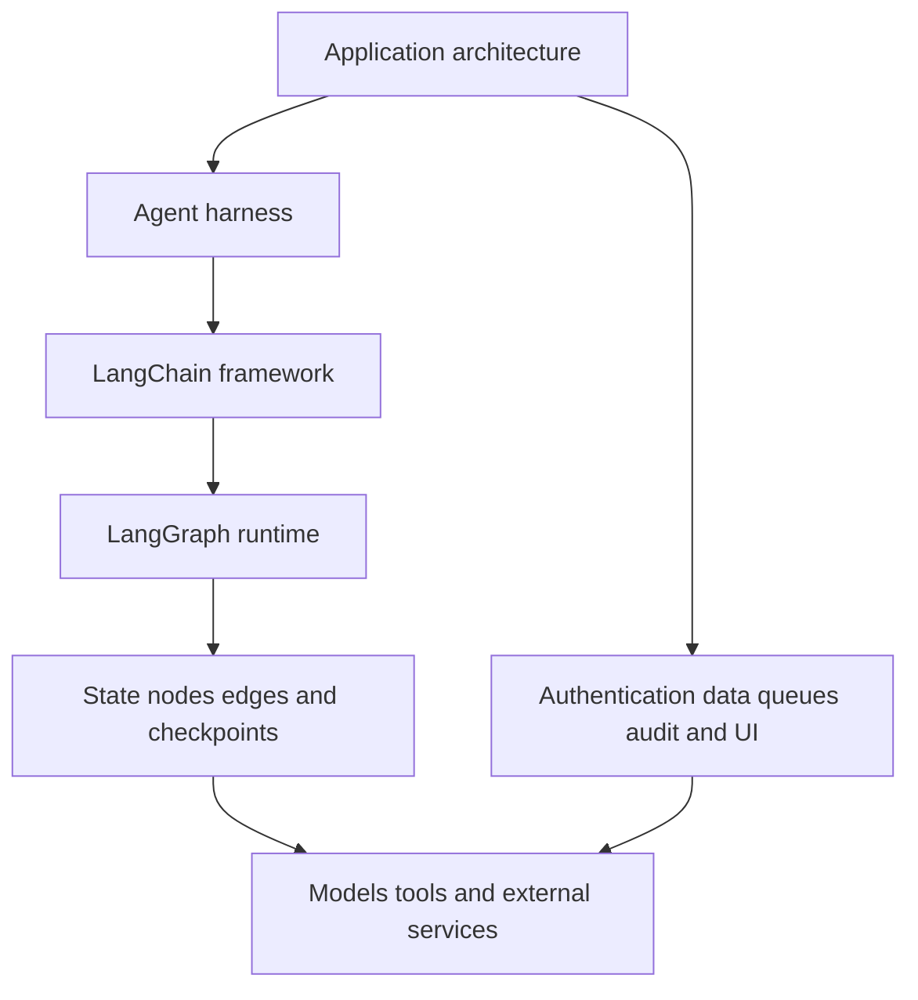

# Framework, Runtime, and Harness

## Learning objectives

Distinguish LangChain from LangGraph, decide when either is justified, and avoid treating a framework as the architecture itself.

## Visual map

## The three layers

An **agent framework** supplies reusable interfaces for models, messages, tools, structured outputs, and common agent loops. LangChain occupies this layer. It helps swap integrations and assemble a standard tool-calling agent quickly.

An **agent runtime** executes a workflow over time. LangGraph models that workflow as state, nodes, and edges. Its concerns include branching, loops, persistence, resumability, streaming, and human intervention. LangChain agents use LangGraph underneath, but LangGraph can also run ordinary Python functions without LangChain or an LLM.

An **agent harness** is a more opinionated package of prompts, tools, context management, planning, and subagent behavior. A harness is productive when its assumptions match the task and constraining when they do not.

These layers do not replace application architecture. Authentication, authorization, data ownership, queues, transactions, audit logs, user interfaces, and incident response still belong to the surrounding system.

## When a framework helps

Use LangChain when standard model and tool abstractions reduce integration work. Use LangGraph when the workflow needs explicit state transitions, pause/resume behavior, long-running execution, or nontrivial human approval. Use plain Python when the work is a short deterministic sequence. Every added abstraction should pay for itself through reduced complexity, not through novelty.

Create a decision table before adopting either tool:

| Question | Plain Python | LangChain | LangGraph |
|---|---|---|---|
| Fixed sequence? | Strong fit | Possible | Usually unnecessary |
| Standard tool-calling loop? | More plumbing | Strong fit | Possible |
| Branches, cycles, or resume? | Manual control | Limited control | Strong fit |
| Need to inspect every state transition? | Manual logging | Middleware/tracing | Explicit graph state |

Framework code changes faster than architectural principles. Keep domain rules in ordinary functions and place framework adapters at the boundary. This makes tests cheaper and migration possible.

## Free local practice

Take the running business process from your learning journal. Draw its states and transitions. Mark deterministic steps, model decisions, external side effects, and approval points. Write a one-page decision choosing plain Python, LangChain, LangGraph, or a combination. Include the smallest feature that would cause you to reconsider.

## Completion criteria

- You can explain framework, runtime, and harness without using product names.
- Your decision is based on workflow requirements rather than popularity.
- Domain rules can be tested without loading a model integration.
- Human approval and side effects are visible in the architecture.

## References

- [LangChain: Frameworks, runtimes, and harnesses](https://docs.langchain.com/oss/python/concepts/products)
- [LangChain overview](https://docs.langchain.com/oss/python/langchain/overview)
- [LangGraph overview](https://docs.langchain.com/oss/python/langgraph/overview)
