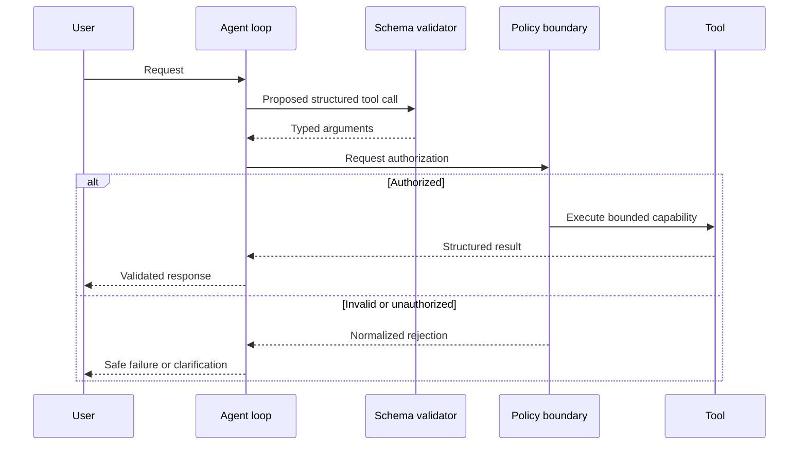

# Models, Tools, and Structured Output

## Learning objectives

Define narrow tools, validate agent outputs, and keep model-generated arguments inside an authorization boundary.

## Applied visual



Schema validation establishes shape, but a separate policy boundary decides whether the requested capability may execute.

## Components of a LangChain agent

A basic agent repeatedly gives a model the current messages and available tool schemas. The model either returns a final response or requests tool calls. Tool results enter the state and the loop continues. The framework manages the loop; you remain responsible for what each tool is allowed to do.

A tool should represent one clear capability. Give it a precise name, typed arguments, a description of when it is appropriate, and structured results. Validate arguments again inside the tool. A model-produced tool call is untrusted input, not authorization.

```python
from langchain.tools import tool
from pydantic import BaseModel, Field

class TicketLookup(BaseModel):
    ticket_id: str = Field(pattern=r"^T-[0-9]{4}$")

@tool(args_schema=TicketLookup)
def get_ticket(ticket_id: str) -> dict:
    """Return the public status fields for one support ticket."""
    # A real implementation must also check the caller's permission.
    return {"ticket_id": ticket_id, "status": "open"}
```

Separate read and write tools. A read tool can retrieve a draft; a write tool should require an authenticated identity, a narrow resource scope, idempotency protection, and often explicit human approval.

## Structured output

Natural-language answers are a poor interface between software components. Define a schema for fields such as classification, confidence, evidence identifiers, and requested action. Validate the result and handle validation failure explicitly. Structured output improves parsing; it does not guarantee factual accuracy or safe intent.

Never place secrets in tool descriptions or prompt context. Return only fields required for the next decision. Limit output size and normalize errors so a model cannot learn sensitive infrastructure details from stack traces.

## Free local practice

Design three tools for your case study: two read-only tools and one proposed write tool. Implement deterministic stand-ins. Define input and output schemas, permission checks, timeouts, error types, and an audit event for each. Then create ten malformed or unauthorized calls and verify that the tool rejects them before performing work.

## Completion criteria

- Tool arguments and structured agent output have explicit schemas.
- Authorization is enforced by code outside the model.
- Read and write capabilities are separated.
- Error, timeout, and duplicate-call behavior is tested.

## References

- [LangChain agents](https://docs.langchain.com/oss/python/langchain/agents)
- [LangChain tools](https://docs.langchain.com/oss/python/langchain/tools)
- [LangChain structured output](https://docs.langchain.com/oss/python/langchain/structured-output)
- [Pydantic models](https://docs.pydantic.dev/latest/concepts/models/)
