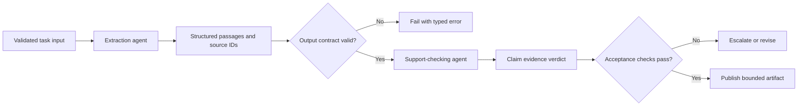

# Agents, Tasks, and Processes

## Learning objectives

Configure focused agents and testable tasks, connect tasks through explicit processes, and prevent vague role descriptions from hiding missing requirements.

## Applied visual

Explicit contracts turn a sequential Crew into inspectable stages with validation before every handoff.

## Agent configuration

An agent needs a specific goal and bounded capabilities. A useful configuration answers:

- What artifact must this agent produce?
- Which tools and data may it access?
- What must it never do?
- When should it stop, fail, or request help?
- Which schema and evidence must accompany its output?

Role and background text can guide behavior, but they are not controls. Enforce tool access in code. Give an agent the minimum tools required for its current task and avoid delegation unless delegation is explicitly tested.

## Task contracts

A task description should define input, output, constraints, acceptance checks, and examples of failure. Prefer structured output using a Pydantic model when the next task consumes the result. If the task produces a report, require source identifiers and separate observations from conclusions.

Sequential processes are easiest to inspect: one task's validated output becomes the next task's input. Hierarchical or delegated processes add routing decisions and should be evaluated against a sequential baseline. Parallel work is appropriate only when branches are independent or conflicts are intentionally reconciled.

## Configuration is code

CrewAI projects may separate agents and tasks into YAML files. Review configuration changes like source code. Pin expected keys with tests, validate configuration at startup, and never place secrets in YAML. A typo in a goal or tool name can change runtime behavior without a Python diff.

## Free local practice

Define a two-task Crew for synthetic policy research: one agent extracts relevant passages from a supplied local document, and another checks whether a proposed answer is supported. Give both structured outputs. Add cases for missing evidence, conflicting passages, an unsupported conclusion, and a malicious instruction inside the document.

Run a baseline where ordinary Python passes preselected passages to the checker. Compare task success, unsupported claims, latency, and model calls.

## Completion criteria

- Each task has explicit acceptance and failure conditions.
- Tools are allowlisted per agent.
- Handoffs use validated structures rather than prose alone.
- Configuration contains no credentials and has startup validation.

## References

- [CrewAI documentation: Agents](https://docs.crewai.com/en/concepts/agents)
- [CrewAI documentation: Tasks](https://docs.crewai.com/en/concepts/tasks)
- [CrewAI documentation: Processes](https://docs.crewai.com/en/concepts/processes)
- [Pydantic models](https://docs.pydantic.dev/latest/concepts/models/)
