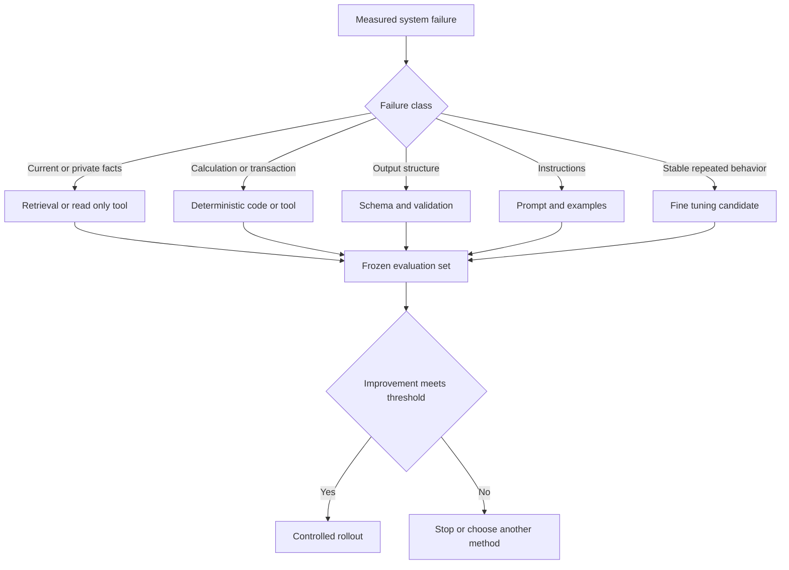

# Choose the Right Adaptation

## Learning objectives

Diagnose a model-system failure, distinguish behavioral adaptation from knowledge access, and decide whether fine-tuning is warranted.

## Visual map

## Start with the failure

Fine-tuning changes model behavior by training on examples. It is not the universal next step after a disappointing prompt. First classify the failure:

| Failure | First intervention to test |
|---|---|
| Missing current or private facts | Retrieval or a read-only tool |
| Wrong calculation or transaction | Deterministic code or a tool |
| Inconsistent output structure | Schema-constrained output and validation |
| Poor instructions or missing examples | Prompt and context revision |
| Repeated domain style or task behavior | Fine-tuning candidate |
| Unsafe permission or side effect | Authorization and workflow control |

Knowledge baked into model weights can become stale and is difficult to cite or delete. Retrieval is usually a better fit for changing documents. Fine-tuning can help with stable behavior such as classification conventions, response style, or mapping inputs to a specialized output pattern, provided representative examples and evaluation data exist.

## Decision experiment

Create a frozen evaluation set before adaptation. Establish four baselines:

1. current prompt;
2. improved prompt with a few examples;
3. retrieval or tool augmentation where relevant;
4. a smaller or different existing model.

Define the minimum improvement that would justify dataset creation, training, deployment, and maintenance. Include safety regressions, latency, memory, and operational complexity, not only task accuracy.

Do not fine-tune to compensate for unclear requirements. Training examples encode decisions. If reviewers cannot agree on the correct output, the model will learn inconsistency.

## Free local practice

Collect 30 failures from a synthetic or public task. Label each as knowledge, reasoning, format, instruction, tool, permission, or evaluation failure. Propose the cheapest intervention and identify which failures are plausible fine-tuning candidates. Write a stop condition that would end the fine-tuning experiment.

## Completion criteria

- The proposed adaptation targets a measured failure.
- A non-training baseline exists.
- The task has stable labels or target behavior.
- Costs and regression risks are part of the decision.

## References

- [Hugging Face PEFT method overview](https://huggingface.co/docs/peft/main/methods/overview)
- [Retrieval-Augmented Generation paper](https://arxiv.org/abs/2005.11401)
- [Google Rules of Machine Learning](https://developers.google.com/machine-learning/guides/rules-of-ml)
