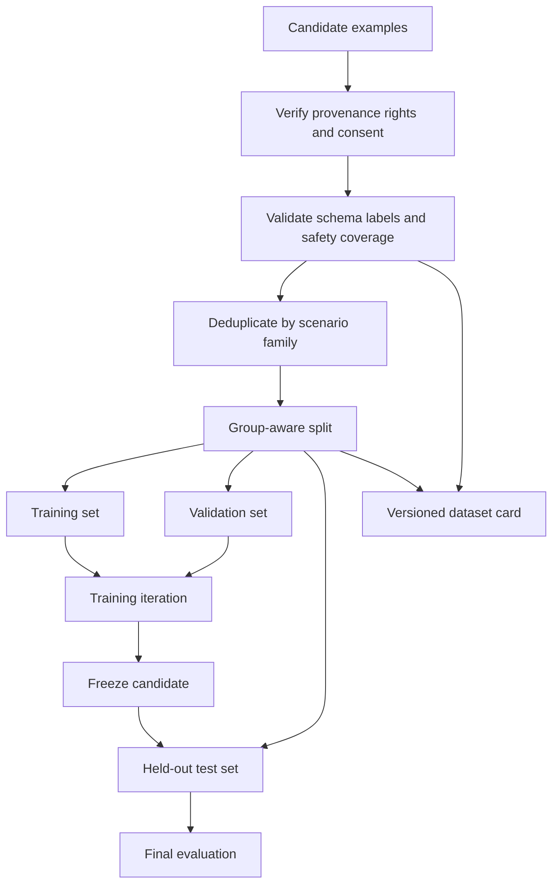

# Dataset Design and Quality

## Learning objectives

Build a documented training dataset, prevent evaluation leakage, and identify consent, privacy, ownership, and representation risks.

## Applied visual

Rights and quality checks precede a group-aware split, keeping the held-out test set outside training iteration.

## Define the data contract

Specify the unit of one example, required fields, allowed sources, label instructions, exclusions, and quality checks. For instruction tuning, an example may contain system constraints, user input, optional context, and an expected response. Keep metadata such as source, creation method, reviewer, language, domain, and rights separate from the training text when possible.

Split data by the entity or process that could leak across examples, not merely by random row. Messages from the same conversation, variants of one document, or records from one customer should not appear across train and final test sets. Deduplicate before splitting and keep the final evaluation set inaccessible to prompt and training iteration.

## Quality before volume

Review examples for correctness, consistency, coverage, and harmful shortcuts. A model can learn formatting artifacts or annotator habits rather than the intended task. Measure reviewer agreement and adjudicate ambiguous cases. Preserve hard negative examples and safe abstentions; a dataset containing only ideal requests teaches no failure behavior.

Do not use private conversations, copyrighted collections, or scraped personal data merely because they are technically obtainable. Record provenance and applicable licenses. Apply data minimization, remove identifiers, and define deletion propagation to derived datasets and adapters.

## Dataset card

Document purpose, composition, collection process, preprocessing, sensitive attributes, recommended uses, prohibited uses, known gaps, maintenance, and licensing. Version the dataset and transformations together. A checksum and reproducible build script are stronger than an unexplained uploaded file.

## Free local practice

Create a 100-example synthetic JSONL dataset for a bounded classification or transformation task. Write label instructions, generate cases independently from the final test set, review every example, deduplicate, and split by scenario family. Add a dataset card and a script that validates required fields and rejects secrets or direct identifiers.

## Completion criteria

- Train, validation, and test splits cannot leak scenario families.
- Every example has provenance and a rights basis.
- Ambiguous and unsafe cases are represented.
- The dataset card states limitations and prohibited uses.

## References

- [Hugging Face Datasets documentation](https://huggingface.co/docs/datasets/)
- [Hugging Face dataset cards](https://huggingface.co/docs/hub/datasets-cards)
- [Hugging Face file names and splits](https://huggingface.co/docs/hub/datasets-file-names-and-splits)
- [Datasheets for Datasets](https://arxiv.org/abs/1803.09010)
