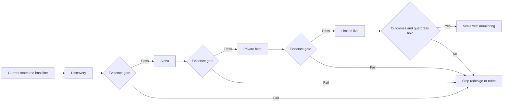

# Discovery, Outcomes, and Roadmap

## Learning objectives

Run a problem-focused discovery, define measurable outcomes, and build a roadmap that tests risk before scaling investment.

## Visual map

## Discovery before delivery

Discovery asks whether a worthwhile, feasible, and responsible service can be built. Learn how work happens now, who participates, what users need, which constraints are legal or technical, what data exists, and how failures are handled. Observe real work where possible; process documentation often omits exceptions and informal coordination.

Write a problem statement without prescribing AI:

> For [affected people], [current situation] causes [measurable impact] because [evidence-backed causes]. We will know the situation improved when [outcome changes] without worsening [guardrail measures].

Do not use "deploy an agent" as an outcome. Outcomes describe changed performance or experience: shorter wait with stable quality, fewer duplicate entries, faster access to cited policy, or reduced rework.

## Assumptions and experiments

List assumptions about desirability, usability, technical feasibility, data, security, legal basis, economics, and operations. Rank them by uncertainty and impact. Test the riskiest assumption with the smallest credible experiment. A manual prototype or deterministic workflow may answer the question more cheaply than a production model integration.

## Outcome roadmap

Organize the roadmap by decisions and evidence rather than feature dates:

1. **Discovery:** verify need, baseline, constraints, and alternatives.
2. **Alpha:** prototype risky interactions and control boundaries.
3. **Private beta:** test end-to-end with synthetic or low-risk data and trained users.
4. **Limited live:** constrained scope, close monitoring, rollback, and support.
5. **Scale or stop:** expand only when thresholds and adoption evidence hold.

Include stop criteria and retirement work. Ending an unviable project is a valid discovery outcome.

## Free local practice

Interview or simulate three stakeholders in your running case study. Create a current-state map, baseline measures, problem statement, ten assumptions, and three small experiments. Produce a roadmap with evidence gates and a stop condition at every phase.

## Completion criteria

- The problem statement does not assume AI is the solution.
- Outcomes have a baseline and guardrail measures.
- The riskiest assumptions are tested first.
- The roadmap includes stop and retirement decisions.

## References

- [GOV.UK: How the discovery phase works](https://www.gov.uk/service-manual/agile-delivery/how-the-discovery-phase-works)
- [GOV.UK: How the alpha phase works](https://www.gov.uk/service-manual/agile-delivery/how-the-alpha-phase-works)
- [Google People + AI Guidebook](https://pair.withgoogle.com/guidebook-v2/)
