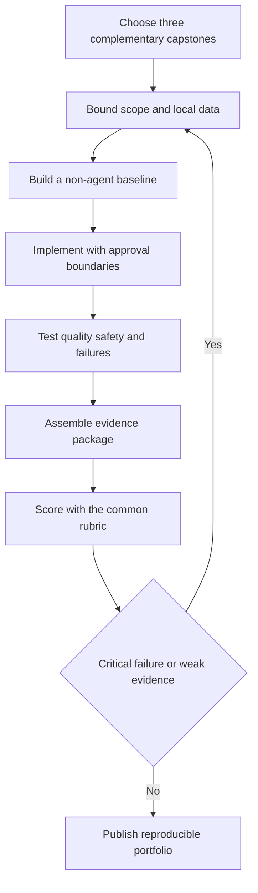

# Capstone Rules and Rubric

## Objectives

Select an appropriately bounded project, produce auditable evidence, and assess work consistently across no-code and code implementations.

## Visual map

## Common rules

Every capstone must:

- use synthetic, public, or explicitly authorized data;
- run in a documented free/local mode;
- include a deterministic or non-agent baseline;
- separate read capabilities from write capabilities;
- require human approval before consequential simulated actions;
- version prompts, workflows, code, data, and evaluation cases;
- test normal, edge, misuse, and infrastructure-failure cases;
- document limitations, prohibited uses, data retention, and cleanup;
- provide a kill switch and rollback or reset procedure.

Do not connect a learning project to real email, payment, HR, health, production, or customer systems. Use local fakes or dedicated sandboxes. Redact screenshots and logs before publishing.

## Rubric

Score each category from 0 to 4, then multiply by its weight:

| Category | Weight | A score of 4 means |
|---|---:|---|
| Problem and user evidence | 15% | Need, baseline, affected people, and non-AI alternative are clear |
| Architecture and implementation | 20% | Boundaries are coherent, reproducible, and appropriately simple |
| Evaluation | 20% | Versioned representative cases, thresholds, slices, and error analysis |
| Safety, security, and privacy | 20% | Threats, permissions, approval, data controls, and failure recovery are tested |
| Operations and governance | 15% | Owners, monitoring, incident, change, rollback, and retirement are usable |
| Communication and reflection | 10% | Demo is honest, sources are traceable, and limitations are specific |

Critical failure caps the project below 70%, regardless of average. Critical failures include exposed secrets, unauthorized data, unbounded consequential tools, missing approval where required, fabricated evaluation evidence, or a project that cannot be reproduced.

## Evidence package

Include `architecture.md`, `setup.md`, `threat-model.md`, `evaluation.md`, `system-card.md`, `runbook.md`, `decision-log.md`, and a machine-readable evaluation set. A short demonstration should show one success, one safe refusal or review, and one recovered failure.

## Practice

Select three capstones below: one automation, one knowledge or data project, and one agent project. Score the proposed scope before building. Remove features until a complete evidence package fits the available time.

## Completion criteria

- Three projects cover different competency areas.
- Each has a local/synthetic execution path and baseline.
- Critical-failure conditions are understood.
- Scope includes documentation, tests, and operations, not just features.

## References

- [NIST AI Risk Management Framework](https://www.nist.gov/itl/ai-risk-management-framework)
- [OWASP Top 10 for LLM Applications](https://genai.owasp.org/llm-top-10/)
- [Model Cards for Model Reporting](https://research.google/pubs/model-cards-for-model-reporting/)
