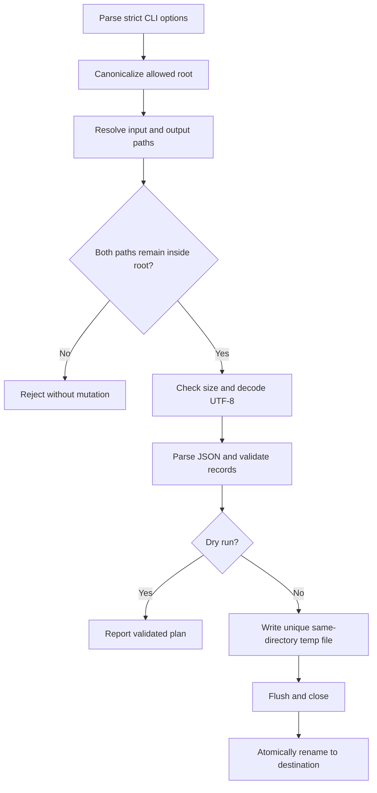

# Files, CLI, and Data Validation

File automation crosses a trust boundary. A filename can escape an intended directory, an input can be much larger than expected, JSON can be syntactically valid but structurally wrong, and a process can stop halfway through a write. Correct automation constrains paths, bounds resources, validates data, and publishes results atomically.

Prefer promise-based filesystem calls in automation that performs concurrent I/O. Use streams for inputs that may not fit comfortably in memory, such as large JSON Lines exports. A whole-file JSON parser is acceptable only after enforcing a documented size limit.

## Learning objectives

- Build a strict CLI with the built-in `parseArgs` function.
- Resolve and constrain input and output paths to an allowed root.
- Distinguish JSON syntax validation from application schema validation.
- Enforce a file-size bound and use explicit UTF-8 decoding.
- Publish a file with a same-directory temporary file and atomic rename.
- Provide a dry-run mode that performs validation without mutation.

## Applied visual



Path, resource, and schema checks finish before either the dry-run report or the atomic publication path begins.

## Reliable file boundaries

Never concatenate an untrusted filename onto a directory string. Resolve it, compare it to a canonical allowed root, and reject traversal. Canonicalizing the existing input and output parent with `realpath` also exposes many symbolic-link escapes. This is still not a complete defense against a hostile user changing links between checks and use; high-risk multi-user systems should isolate the process and use platform-specific secure file-opening controls.

Validation should produce a small internal representation. Reject extra ambiguity at the boundary: arrays versus objects, missing properties, empty strings, unexpected numeric ranges, and unsupported encodings. Avoid silently converting arbitrary values unless that conversion is part of the contract.

For output, write a unique temporary file in the destination directory, flush it if durability requirements demand it, then rename it to the final name. A same-filesystem rename prevents readers from seeing a partially written document. Atomic visibility does not by itself guarantee disk durability after power loss; that stricter guarantee also involves syncing the file and directory.

The exercise requires the output parent to exist so it can canonicalize that directory before writing. Creating an untrusted nested path and checking it afterward is too late: a symbolic link could already have redirected the directory creation outside the root.

## Free local practice

Inside `node-automation-lab`, create `src/normalize-file.js`:

```javascript
import { randomUUID } from "node:crypto";
import {
  mkdir,
  readFile,
  realpath,
  rename,
  rm,
  stat,
  writeFile
} from "node:fs/promises";
import { basename, dirname, isAbsolute, relative, resolve, sep } from "node:path";
import { parseArgs } from "node:util";

const { values } = parseArgs({
  options: {
    root: { type: "string", default: "var/files" },
    input: { type: "string", short: "i" },
    output: { type: "string", short: "o", default: "normalized.json" },
    "dry-run": { type: "boolean", default: false }
  },
  strict: true
});

if (!values.input) throw new Error("--input is required");

function isInside(root, candidate) {
  const pathFromRoot = relative(root, candidate);
  return pathFromRoot === "" || (
    pathFromRoot !== ".." &&
    !pathFromRoot.startsWith(`..${sep}`) &&
    !isAbsolute(pathFromRoot)
  );
}

function validateRecords(value) {
  if (!Array.isArray(value)) throw new TypeError("input must be an array");
  if (value.length > 10_000) throw new RangeError("at most 10000 records are allowed");

  return value.map((item, index) => {
    if (item === null || typeof item !== "object" || Array.isArray(item)) {
      throw new TypeError(`record ${index} must be an object`);
    }
    if (typeof item.id !== "string" || typeof item.email !== "string") {
      throw new TypeError(`record ${index} id and email must be strings`);
    }
    const id = item.id.trim();
    const email = item.email.trim();
    if (!id || !/^[^@\s]+@[^@\s]+\.[^@\s]+$/.test(email)) {
      throw new TypeError(`record ${index} has an invalid id or email`);
    }
    const at = email.lastIndexOf("@");
    return { id, email: `${email.slice(0, at)}@${email.slice(at + 1).toLowerCase()}` };
  });
}

const requestedRoot = resolve(values.root);
await mkdir(requestedRoot, { recursive: true });
const root = await realpath(requestedRoot);

const input = await realpath(resolve(root, values.input));
if (!isInside(root, input)) throw new Error("input escapes the allowed root");
const metadata = await stat(input);
if (!metadata.isFile()) throw new Error("input must be a regular file");
if (metadata.size > 1_048_576) throw new Error("input exceeds the 1 MiB limit");

const requestedOutput = resolve(root, values.output);
if (!isInside(root, requestedOutput)) throw new Error("output escapes the allowed root");
const outputParent = await realpath(dirname(requestedOutput));
if (!isInside(root, outputParent)) throw new Error("output escapes the allowed root");
const output = resolve(outputParent, basename(requestedOutput));

const parsed = JSON.parse(await readFile(input, "utf8"));
const normalized = `${JSON.stringify(validateRecords(parsed), null, 2)}\n`;

if (values["dry-run"]) {
  console.log(normalized);
} else {
  const temporary = `${output}.${process.pid}.${randomUUID()}.tmp`;
  try {
    await writeFile(temporary, normalized, { encoding: "utf8", flag: "wx", mode: 0o600 });
    await rename(temporary, output);
  } finally {
    await rm(temporary, { force: true });
  }
  console.log(JSON.stringify({ event: "file_written", output }));
}
```

Prepare data and exercise both modes:

```sh
mkdir -p var/files/results
printf '%s\n' '[{"id":"u-1","email":"ADA@EXAMPLE.ORG"}]' > var/files/records.json
node src/normalize-file.js --input records.json --output results/clean.json --dry-run
node src/normalize-file.js --input records.json --output results/clean.json
node src/normalize-file.js --input ../../package.json --dry-run
```

Inspect `var/files/results/clean.json`. Then try an invalid email, a top-level object instead of an array, and a file larger than the limit. For line-oriented data at larger scale, redesign the contract as JSON Lines and process it with `createReadStream` plus `readline`; do not merely raise the memory limit indefinitely.

## Completion criteria

- Unknown CLI flags and a missing `--input` fail instead of being ignored.
- The dry run validates and prints data without creating the output file.
- Traversal outside the allowed root, non-files, oversized input, malformed JSON, and invalid records are rejected.
- A successful run writes formatted normalized data via a unique temporary file and rename, and a missing output parent is not created from an unchecked path.
- You can explain why lexical path checks alone do not fully address symbolic links and time-of-check/time-of-use races.
- You can state when to replace whole-file parsing with streaming JSON Lines.

## References

- [Node.js: File system promises API](https://nodejs.org/api/fs.html#promises-api)
- [Node.js: Path API](https://nodejs.org/api/path.html)
- [Node.js: `util.parseArgs`](https://nodejs.org/api/util.html#utilparseargsconfig)
- [Node.js: Streams](https://nodejs.org/api/stream.html)
- [Node.js: Readline](https://nodejs.org/api/readline.html)
- [OWASP: Path Traversal](https://owasp.org/www-community/attacks/Path_Traversal)
- [JSON specification, RFC 8259](https://www.rfc-editor.org/rfc/rfc8259.html)

[Next lesson: HTTP APIs, Webhooks, and Retries](./03-http-apis-webhooks-and-retries.md)
