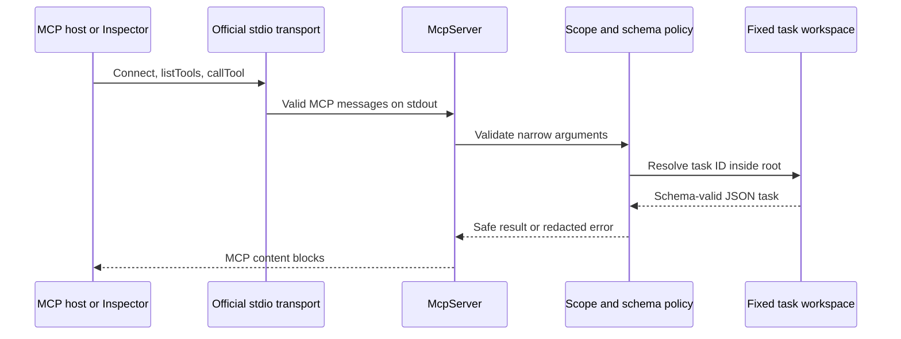

# MCP Task Server Lab

Build a local Model Context Protocol server with narrow tools, launch-time least privilege, a fixed filesystem boundary, and end-to-end tests through the official MCP client SDK.

This lab follows the current v2 TypeScript packages: `@modelcontextprotocol/server` and `@modelcontextprotocol/client`. It does not use the older monolithic `@modelcontextprotocol/sdk` package.

## Prerequisites

- Node.js 20 or later
- npm
- Basic TypeScript and filesystem knowledge

## Goals

- Register typed tools with Zod schemas.
- Serve a local integration over stdio without corrupting the protocol channel.
- Test list and call behavior through the official SDK client and `StdioClientTransport`.
- Constrain file access to one configured root and narrow task IDs.
- Refuse symbolic-link task files and redact internal paths from expected errors.
- Enforce least privilege by omitting mutation tools from read-only processes.

## Architecture



## Security model

`TASK_SCOPE=read` registers only `list-tasks` and `get-task`. `TASK_SCOPE=read-write` additionally registers `create-task` and `complete-task`. An unavailable tool cannot be persuaded into mutating data through its arguments.

The stdio process treats its inherited environment as trusted launch configuration. Tool arguments never accept a root path or authorization token. A remotely hosted HTTP server needs transport-level OAuth authorization; the environment scope in this local lab is not a substitute for that protocol.

## Install and verify

```bash
cd labs/mcp-task-server
npm install
npm run typecheck
npm test
```

The committed lockfile pins the dependency graph. The test suite creates temporary workspaces and launches the server through `StdioClientTransport`; it does not send hand-written JSON-RPC messages.

`npm run test:starter` is expected to fail before the starter TODOs are complete.

## Run the server

An stdio server waits silently for a host. Diagnostics belong on stderr because stdout is the MCP protocol channel.

```bash
TASKS_ROOT="$(pwd)/fixtures/workspace" TASK_SCOPE=read npm start
```

Stop it with `Ctrl+C`.

## Inspect it interactively

The official MCP Inspector launches the server and connects over stdio:

```bash
TASKS_ROOT="$(pwd)/fixtures/workspace" TASK_SCOPE=read-write \
  npx @modelcontextprotocol/inspector npx tsx solution/src/index.ts
```

In the browser, select **Tools**, list the available tools, call `list-tasks`, then create and complete a synthetic task. Use a copy of `fixtures/workspace` when you do not want to modify the fixtures.

## Tool contract

| Tool | Read scope | Read-write scope | Purpose |
| --- | ---: | ---: | --- |
| `list-tasks` | yes | yes | List all tasks or filter by `open`/`completed` |
| `get-task` | yes | yes | Read one strict task ID |
| `create-task` | no | yes | Create a new file atomically with `O_EXCL` |
| `complete-task` | no | yes | Complete a task; repeated calls are idempotent |

## Learner tasks

1. Implement a `TaskStore` for the starter with a fixed, resolved workspace root.
2. Accept only lowercase task IDs of at most 64 characters; never accept paths.
3. Open existing task files with `O_NOFOLLOW` and validate their full JSON shape.
4. Register read tools for both scopes and mutation tools only for `read-write`.
5. Return `isError: true` for expected missing, duplicate, unsafe, and invalid-store cases.
6. Keep all diagnostic output on stderr.
7. Pass the unchanged official-client contract suite.

## Hints

- A schema check prevents `../`, while a root containment check documents the invariant in depth.
- `Dirent.isFile()` excludes symlinks during listing, but direct reads need `O_NOFOLLOW` too.
- `O_EXCL` makes two simultaneous creates for the same ID resolve to one winner.
- Returning an idempotent result from `complete-task` is easier for agents to recover from than treating repetition as an error.
- Do not log full tool arguments when they might later contain sensitive task details.

## Expected behavior

| Case | Expected result |
| --- | --- |
| Read-only tool discovery | Exactly `list-tasks` and `get-task` |
| Read-write discovery | Four documented tools |
| `taskId: "../secret"` | SDK schema error with `isError: true` |
| Extra `path` argument | Strict-schema error |
| Missing task | Redacted `task_not_found` tool error |
| Symlink named as a task | `unsafe_task_file` tool error |
| Duplicate create | `task_exists` tool error |
| Repeated completion | Same completed timestamp, no second mutation |

## Completion criteria

- `npm run typecheck` passes under strict TypeScript settings.
- `npm run test:starter` passes without modifying the tests.
- A read-only client cannot discover a mutation tool.
- Traversal-shaped IDs, extra arguments, missing files, and symlinks fail safely.
- All tests communicate through the official MCP client and stdio transport.
- The server never writes diagnostics to stdout.
- The learner can explain why a remote Streamable HTTP deployment needs OAuth rather than `TASK_SCOPE` alone.

## References

- [Official TypeScript SDK: build the first server](https://github.com/modelcontextprotocol/typescript-sdk/blob/main/docs/get-started/first-server.md)
- [Official TypeScript SDK: connect a client](https://github.com/modelcontextprotocol/typescript-sdk/blob/main/docs/clients/connect.md)
- [Official TypeScript SDK: serve over stdio](https://github.com/modelcontextprotocol/typescript-sdk/blob/main/docs/serving/stdio.md)
- [Official MCP Inspector](https://github.com/modelcontextprotocol/inspector)
- [MCP authorization guidance](https://modelcontextprotocol.io/docs/tutorials/security/authorization)
- [Node.js file open constants](https://nodejs.org/api/fs.html#file-access-constants)
