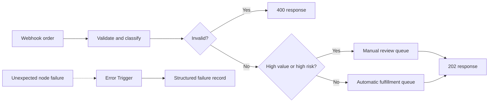

# n8n Order Triage Lab

Import, inspect, and complete a webhook workflow that validates orders before routing them to automatic fulfillment or manual review. No credentials or paid service are required.

## Prerequisites

- n8n 1.x, either [self-hosted](https://docs.n8n.io/hosting/) or a hosted workspace
- Node.js 20 or later for the local verifier
- `curl` for webhook calls

## Goals

- Turn a business policy into explicit workflow branches.
- Validate untrusted webhook data before using it in downstream nodes.
- Test threshold boundaries rather than only representative values.
- Return intentional 400 and 202 responses.
- Capture unexpected execution failures in a separate error workflow.
- Export a portable workflow without credentials or production data.

## Workflow map



## Policy

- `orderId` and `customerId` must be non-empty strings.
- `currency` must be a three-letter uppercase code.
- `totalCents` must be a non-negative safe integer.
- `riskScore` is optional; when absent it becomes `0`, otherwise it must be an integer from 0 through 100.
- A valid order enters manual review when `totalCents >= 100000` or `riskScore >= 70`.

## Local verification

```bash
cd labs/n8n-order-triage
npm test
npm run verify
npm run demo
```

`npm run verify:starter` is expected to fail until the starter workflow has been completed and exported.

## Import the workflows

1. In n8n, open **Workflows**, select the menu, and choose **Import from File**.
2. Import `solution/error-handler.workflow.json`, give it a stable name, save it, and activate it.
3. Import `starter/order-triage.workflow.json` for the exercise, or `solution/order-triage.workflow.json` for the reference.
4. Open the order workflow settings and select the imported error handler in **Error Workflow**.
5. Save the workflow. Use the Webhook node's test URL while editing; activate the workflow before using its production URL.

## Exercise the webhook

Select **Listen for test event** in the Webhook node, copy its test URL, and run:

```bash
curl -i -X POST 'PASTE_TEST_WEBHOOK_URL' \
  -H 'content-type: application/json' \
  --data-binary @fixtures/standard-order.json
```

Repeat with all four order fixtures. Expected routes are recorded in `fixtures/expected-routes.json`.

## Learner tasks

1. Import the starter and read the policy sticky note.
2. Implement validation and normalization in the Code node.
3. Add explicit invalid and manual-review decisions.
4. Build a JSON 400 response that includes all validation errors.
5. Build JSON 202 responses for automatic and manual-review routes.
6. Import and attach the error workflow; use `fixtures/runtime-error.json` as representative trigger data when inspecting its Code node.
7. Export your completed workflow over the starter file and run the verifier.

## Export instructions

Open the workflow menu, select **Download**, and replace `starter/order-triage.workflow.json` with the downloaded JSON. Remove credential references and pinned customer data before committing. Then run:

```bash
npm run verify:starter
```

The verifier checks node types, reachable response paths, policy tokens, the error workflow in the solution, JSON validity, and fixture route expectations. It does not execute n8n nodes.

## Hints

- Normalize numbers once in the validation node, then make later nodes consume normalized fields.
- Route invalid data before evaluating business thresholds.
- Test exactly `100000` and exactly `70`; comparison bugs usually live at boundaries.
- Business validation failures belong in the main workflow. Infrastructure and unexpected node failures belong in the Error Trigger workflow.

## Expected behavior

| Fixture | HTTP status | Route |
| --- | ---: | --- |
| `standard-order.json` | 202 | `automatic` |
| `manual-review-order.json` | 202 | `manual_review` by risk |
| `boundary-order.json` | 202 | `manual_review` by exact value boundary |
| `invalid-order.json` | 400 | `invalid` with multiple errors |
| Unexpected execution failure | n/a | Error workflow creates a structured failure record |

## Completion criteria

- `npm test` and `npm run verify:starter` pass.
- All fixture payloads follow their expected branch in n8n.
- Invalid input cannot reach either accepted queue.
- Both accepted branches terminate in a Respond to Webhook node.
- The error workflow is active and selected in the main workflow settings.
- The exported JSON contains no credentials, secrets, or real customer data.

## References

- [n8n workflow import and export](https://docs.n8n.io/workflows/export-import/)
- [n8n Webhook node](https://docs.n8n.io/integrations/builtin/core-nodes/n8n-nodes-base.webhook/)
- [n8n Respond to Webhook node](https://docs.n8n.io/integrations/builtin/core-nodes/n8n-nodes-base.respondtowebhook/)
- [n8n error handling](https://docs.n8n.io/flow-logic/error-handling/)
- [n8n Code node](https://docs.n8n.io/integrations/builtin/core-nodes/n8n-nodes-base.code/)
