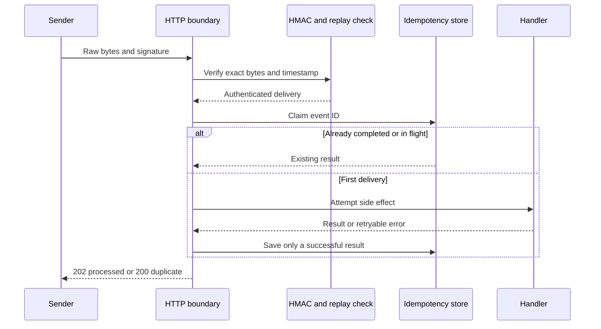

# Node.js Webhook Processor Lab

Build a webhook boundary that assumes deliveries can be forged, delayed, repeated, and interrupted. The implementation uses only Node.js built-ins.

## Prerequisites

- Node.js 20 or later
- Basic JavaScript promises and HTTP knowledge
- A terminal that can set environment variables

## Goals

- Verify an HMAC over the untouched request bytes.
- Reject stale signed requests before they become replays.
- Make a repeated delivery ID idempotent, including concurrent duplicates.
- Retry only explicitly transient failures with exponential backoff.
- Produce structured logs that an observability system can query.
- Keep authentication, validation, orchestration, and HTTP concerns separate.

## Delivery flow



## Layout

- `starter/` contains purposeful TODOs and an incomplete HTTP boundary.
- `solution/` is a complete reference implementation.
- `fixtures/` contains a realistic synthetic order event and expected log shapes.
- `test/contract.test.js` runs the same behavioral contract against either target.

## Run the reference implementation

```bash
cd labs/node-webhook-processor
npm test
npm run demo
WEBHOOK_SECRET=development-secret npm start
```

The demo processes the fixture twice. The first result has `"status":"processed"`; the second has `"status":"duplicate"`, and the structured log stream includes `delivery_attempt`, `delivery_processed`, and `duplicate_delivery`.

## Learner tasks

1. Implement every numbered TODO in `starter/src/webhook-processor.js`.
2. Compare HMAC digests with `timingSafeEqual`, after checking equal byte lengths.
3. Parse JSON only after authentication succeeds.
4. Store an event ID only after the handler succeeds; a failed attempt must remain replayable.
5. Coalesce two simultaneous calls for the same event ID into one side effect.
6. Complete the raw-body size limit and error mapping in `starter/src/server.js`.
7. Run the contract suite against the starter until it passes.

```bash
npm run test:starter
```

The starter test command is expected to fail before the TODOs are complete.

## Manual HTTP exercise

Start the server in one terminal:

```bash
WEBHOOK_SECRET=development-secret npm start
```

In another terminal, generate a current signature and send the exact fixture bytes:

```bash
node -e 'const fs=require("node:fs");const c=require("node:crypto");const b=fs.readFileSync("fixtures/order.created.json");const t=Math.floor(Date.now()/1000);const v=c.createHmac("sha256","development-secret").update(String(t)).update(".").update(b).digest("hex");console.log(`t=${t},v1=${v}`)'
curl -i -X POST http://127.0.0.1:3000/webhooks/orders \
  -H 'content-type: application/json' \
  -H 'x-webhook-signature: PASTE_THE_VALUE_HERE' \
  --data-binary @fixtures/order.created.json
```

Do not use `curl -d` for this exercise: changing whitespace changes the authenticated bytes.

## Hints

- Treat timestamp freshness and event-ID idempotency as different controls. A current duplicate can still be legitimate delivery behavior.
- Keep in-flight promises separately from completed results.
- A handler error is transient only when it carries `retryable: true`.
- Never log the shared secret or the signature header.

## Expected behavior

| Case | Expected result |
| --- | --- |
| Valid first delivery | Handler runs once; HTTP 202 |
| Same event ID again | Stored result returned; HTTP 200 |
| Same event ID concurrently | One handler call; second request is duplicate |
| Tampered body | HTTP 401 before parsing or handler execution |
| Signature older than five minutes | HTTP 401 `stale_signature` |
| Retryable handler failure | Delays of 50 ms, then 100 ms by default |
| Permanent handler failure | One attempt; HTTP 502 |

## Completion criteria

- `npm run test:starter` passes without changing the tests.
- The replay and concurrent-duplicate tests produce exactly one side effect.
- A tampered raw body and a stale timestamp are both rejected.
- Normal, edge, retry, and permanent-failure cases emit structured log objects.
- The learner can explain why a database uniqueness constraint would replace the in-memory map in a multi-process deployment.

## References

- [Node.js crypto HMAC API](https://nodejs.org/api/crypto.html#class-hmac)
- [Node.js timingSafeEqual API](https://nodejs.org/api/crypto.html#cryptotimingsafeequala-b)
- [Node.js test runner](https://nodejs.org/api/test.html)
- [OWASP Webhook Security Guidelines](https://cheatsheetseries.owasp.org/cheatsheets/Webhook_Security_Guidelines.html)
