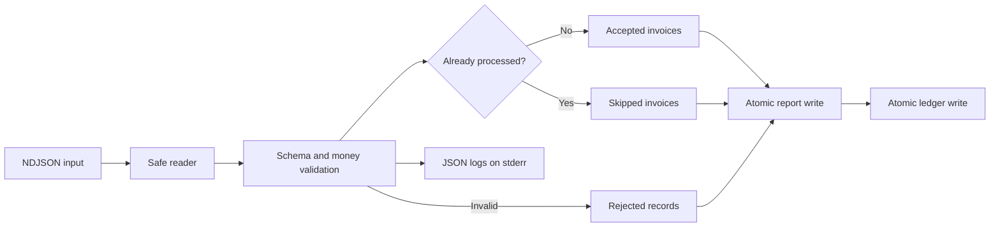

# Python Invoice Audit Lab

Build a safe, repeatable command-line pipeline that audits newline-delimited JSON
(NDJSON) invoices. The lab uses only the Python standard library and synthetic
data.

## Prerequisites

- Python 3.10 or newer
- A shell that can set environment variables
- Familiarity with functions, exceptions, JSON, and files

## Learning goals

- Validate untrusted records without using binary floating-point for money.
- Keep repeated runs idempotent with a durable ledger.
- Protect input and output paths and write JSON files atomically.
- Emit machine-readable logs without mixing logs with program output.
- Test normal records, malformed input, repeated input, and unsafe paths.

## Pipeline



## Run the reference solution

From this directory:

```bash
mkdir -p .work
python3 solution/audit.py fixtures/invoices.ndjson \
  --report .work/report.json \
  --ledger .work/ledger.json
cat .work/report.json
```

Run the same command again. The first run accepts two invoices, rejects two
records, and skips one duplicate. The second run accepts none and skips the
three valid occurrences because their IDs are already in the ledger.

## Run the tests

The test suite targets the complete solution by default:

```bash
python3 -m unittest discover -s tests -v
```

Point it at the starter to see the intended red tests:

```bash
INVOICE_AUDIT_IMPL=starter python3 -m unittest discover -s tests -v
```

No test writes outside a temporary directory.

## Tasks

Open `starter/audit.py` and complete the TODOs in this order:

1. Validate identifiers, dates, currencies, line items, and exact totals.
2. Reject symlink inputs and destinations and use an atomic JSON writer.
3. Load and validate the processed-invoice ledger.
4. Skip invoice IDs already seen either earlier or in the current run.
5. Write the report and ledger and emit one structured log per decision.

## Expected behavior

- Valid money is represented as a normalized string such as `"125.50"`.
- Invalid JSON is rejected without stopping later records from being audited.
- A duplicate ID is never accepted twice.
- A destination that is a symbolic link is rejected before it is written.
- Logs are JSON objects on stderr; the report remains valid JSON on disk.
- The first fixture run matches `fixtures/expected-first-report.json` and
  `fixtures/expected-first-ledger.json`.

## Hints

- Use `decimal.Decimal`, not `float`, and reject more than two decimal places.
- `tempfile.NamedTemporaryFile` plus `os.replace` supports an atomic same-volume
  write.
- A set is useful for ledger membership, but sort IDs before serialization.
- Keep a line number with each rejected or skipped decision.

## Completion criteria

- The solution-targeted test command passes with no skipped tests.
- Repeating a run does not create another accepted invoice.
- Every rejected record has a stable reason and line number.
- No partial report remains after a validation or path-safety exception.
- Your implementation contains no network calls or third-party dependencies.
