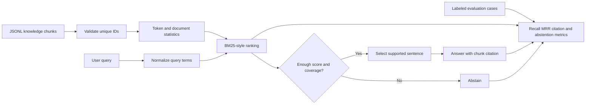

# Deterministic Grounded Search Lab

Build the retrieval and grounding core of a retrieval-augmented generation (RAG)
system without an API key, model download, or third-party dependency. This lab
does **not** pretend that an extractive function is an LLM. It isolates the parts
that should be deterministic and testable before a generator is introduced.

## Prerequisites

- Python 3.10 or newer
- Familiarity with JSON, tokenization, and basic information retrieval

## Learning goals

- Build a deterministic BM25-style lexical index.
- Rank evidence with stable tie-breaking.
- Extract a supported sentence and attach a verifiable source citation.
- Abstain when query coverage or retrieval score is insufficient.
- Measure Recall@k, mean reciprocal rank, citation validity, and abstention
  accuracy on labeled queries.

## Retrieval and answer flow



## Run the reference solution

From this directory:

```bash
python3 solution/rag.py search --corpus fixtures/corpus.jsonl \
  --query "How many minutes before a password reset link expires?"
python3 solution/rag.py search --corpus fixtures/corpus.jsonl \
  --query "Where can employees park?"
python3 solution/rag.py evaluate --corpus fixtures/corpus.jsonl \
  --cases fixtures/evaluation.jsonl --k 3
```

The first command returns a sentence cited as `[security-passwords]`. The second
abstains. Evaluation output matches `fixtures/expected-evaluation.json`.

## Run the tests

```bash
python3 -m unittest discover -s tests -v
```

Run the same contract against the incomplete starter:

```bash
RAG_SEARCH_IMPL=starter python3 -m unittest discover -s tests -v
```

## Tasks

1. Validate the corpus and reject missing or duplicate chunk IDs.
2. Compute document frequency, average document length, and BM25-style scores.
3. Sort equal scores by chunk ID to make output deterministic.
4. Require both a minimum retrieval score and query-term coverage.
5. Select an evidence sentence and return matching inline and structured
   citations.
6. Evaluate answerable and unanswerable queries separately.

## Expected behavior

- A known policy query ranks its labeled chunk first.
- An empty, unrelated, or weakly supported query returns `status: abstained`.
- An answered response contains `[chunk-id]` and the same ID in `citations`.
- Running the same query repeatedly produces byte-equivalent JSON output.
- Evaluation reports retrieval metrics only over answerable cases and abstention
  accuracy over all cases.

## Hints

- Ignore common stop words before scoring and coverage checks.
- `log(1 + (N - df + 0.5) / (df + 0.5))` is a useful positive IDF variant.
- Retrieval score and query coverage protect against different failure modes.
- An unanswerable example has no relevant chunk; do not count it in Recall@k.
- Citation validation should compare both the answer marker and structured ID
  against the loaded corpus.

## Completion criteria

- All solution-targeted tests pass, including malformed-corpus failure cases.
- The golden evaluation achieves perfect fixture Recall@3 and abstention accuracy.
- An unrelated query never produces a confident answer.
- Every answered fixture response passes citation validation.
- The implementation remains deterministic and makes no network calls.
