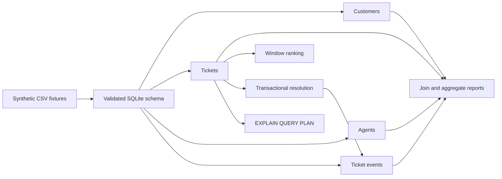

# SQL Support Analytics Lab

Build and query a small support-operations database with SQLite. Everything is
synthetic, local, and implemented with Python's standard `sqlite3` module.

## Prerequisites

- Python 3.10 or newer with SQLite 3.25 or newer
- Basic SQL knowledge: `SELECT`, `JOIN`, `GROUP BY`, and transactions

Check the bundled SQLite version:

```bash
python3 -c "import sqlite3; print(sqlite3.sqlite_version)"
```

## Learning goals

- Encode domain rules with primary keys, foreign keys, checks, and indexes.
- Use joins and pre-aggregation without accidentally multiplying rows.
- Rank resolution times with a SQL window function.
- Make a ticket update and its audit event one atomic transaction.
- Read a query plan and verify that an index is actually selected.

## Data flow



## Run the reference solution

From this directory:

```bash
mkdir -p .work
python3 solution/support_analytics.py setup \
  --db .work/support.db --fixtures fixtures
python3 solution/support_analytics.py report --db .work/support.db
python3 solution/support_analytics.py plan --db .work/support.db
```

To resolve an open ticket and create its event in the same transaction:

```bash
python3 solution/support_analytics.py resolve --db .work/support.db \
  --ticket T002 --agent A003 --resolved-at 2026-01-05T16:00:00 \
  --minutes 35
```

The initial report matches `fixtures/expected-report.json`.

## Run the tests

```bash
python3 -m unittest discover -s tests -v
```

The incomplete starter is selected with:

```bash
SQL_ANALYTICS_IMPL=starter python3 -m unittest discover -s tests -v
```

## Tasks

1. Add keys, foreign keys, `CHECK` constraints, and useful indexes to the starter
   schema.
2. Load all four fixture files inside one transaction.
3. Implement the agent workload and customer summary joins.
4. Use `ROW_NUMBER()` to rank slow resolutions within each priority.
5. Resolve a ticket and append its event atomically; prove rollback on failure.
6. Inspect a selective lookup with `EXPLAIN QUERY PLAN`.

## Expected behavior

- Invalid statuses, priorities, agent IDs, and negative work minutes are rejected.
- All customers appear in the summary, including customers with zero work minutes.
- The open workload includes an explicit `Unassigned` group.
- A failed event insert rolls back the preceding ticket update.
- The selective lookup uses `idx_tickets_status_priority` rather than a table scan.

## Hints

- Execute `PRAGMA foreign_keys = ON` for every connection.
- Pre-aggregate event minutes before joining them to customer ticket counts.
- ISO timestamps sort correctly when every fixture uses the same format.
- A connection context manager commits on success and rolls back on exceptions.
- Query-plan descriptions are returned by the fourth column of
  `EXPLAIN QUERY PLAN`.

## Completion criteria

- The solution-targeted tests pass with normal, boundary, and rollback cases.
- `fixtures/expected-report.json` matches a freshly initialized database.
- At least one analytical query contains a join, one contains aggregation, and
  one contains a window function.
- The transaction test proves that partial state cannot survive a failed write.
- No package installation, remote database, or paid service is required.
